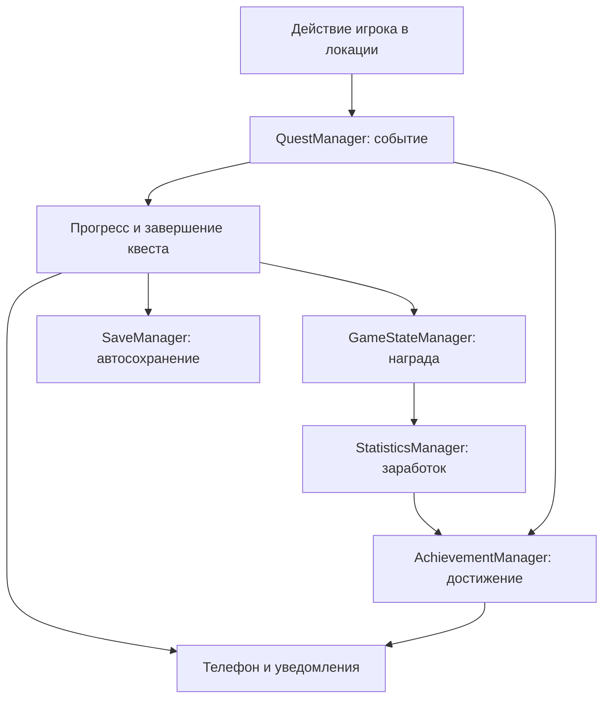

# StudentDay — инструкция по архитектуре и подключению модулей

Эта инструкция предназначена для участников проекта «Один день из жизни студента», в том числе для тех, кто недавно начал работать с Godot. Здесь объясняется, как открыть проект, проверить управление, создать свою локацию и подключить её к общим системам.

**Материалы комнаты.** В локальных сценах холодильника, микроволновки, будильника, стола и пиццы настроены обычные StandardMaterial3D. Исходные GLB, геометрия, текстуры, размеры, коллизии и игровые скрипты этим оформлением не изменяются. В Inspector раздел **Roughness** задаёт шероховатость: у эмали холодильника 0.38, светлого корпуса микроволновки 0.4, её металла 0.36–0.38 и тёмного стекла 0.22, корпуса будильника 0.42, стола 0.65, тарелки 0.28; корочка пиццы остаётся матовой (0.95). **Metallic** у эмали холодильника 0.15, металла микроволновки 0.35–0.5; стекло и тарелка не металлические. Стекло микроволновки тёмное, непрозрачное, без преломления и дополнительного прохода прозрачности. У корпуса и исходной дверцы холодильника один сохранённый surface material override с прежним Sushi_Atlas; исходный материал внутри GLB не редактируется. Ткань, постель, кожа рук, общий UI и материалы остальных модулей не затронуты.

В `RoomDorm.tscn` у WorldEnvironment: **Ambient Light → Source = Color**, **Energy = 0.4**; **Reflected Light → Source = Sky**, небольшая карта отражений **Radiance Size = 128** с нейтральным ProceduralSkyMaterial. Это общее освещение поверхностей, без отражения самой комнаты в реальном времени. Единственный RoomLight — OmniLight3D в позиции **(0, 2.35, -0.3)**, **Energy = 0.38**, **Range = 6**, **Shadow → Enabled = Off**. Геометрия источника света не добавляется. SSR, SSAO, Glow, объёмный туман, дополнительные ReflectionProbe и новые текстуры не включены. Общий рендерер и XR-настройки в project.godot не изменяются. Настройки соответствуют [StandardMaterial3D](https://docs.godotengine.org/en/stable/tutorials/3d/standard_material_3d.html) и [Environment](https://docs.godotengine.org/en/stable/classes/class_environment.html).

Проверка оформления: F5, встать и осмотреть предметы при перемещении и повороте головы; у холодильника, микроволновки и тарелки должен быть умеренный блеск, у стола — слабый, у ткани — матовая поверхность. Проверить читаемость часов будильника, кнопки подъёма и телефона. При сравнении одинаковых четырёх ракурсов до и после оформления (до подключения механики микроволновки) на ПК (Godot 4.7.2, Compatibility, RTX 4050, 1280×720) сохранились 121 MeshInstance3D, число вызовов отрисовки 64 / 48 / 64 / 25 и число примитивов 6630 / 10758 / 12410 / 2962. Это ограниченная проверка сцены на ПК, а не подтверждение частоты кадров на PICO: в шлеме проверить плавность обоих глаз при движении, открытии холодильника и переносе пиццы.

Общая сборка объединяет архитектуру модуля 7, комнату модуля 1 и транспорт модуля 2. Используются один постоянный игрок и один набор общих менеджеров. Примеры с библиотекой показывают порядок подключения будущей локации; остальные модули не реализованы этой интеграцией.

F5 запускает общую `scenes/main.tscn` сразу с комнатой `scenes/locations/RoomDorm/RoomDorm.tscn` (ID `dorm_room`). Комната использует постоянного игрока Main и точку `Spawn_Default` на уровне пола. «Новая игра» также начинает день в комнате. Игровой маршрут: `dorm_room` → `transport` → `test_room`. TestRoom с тестовым кубом сохранена как явно обозначенная временная заглушка кампуса; самостоятельная сцена кампуса ещё не подключена.

В начале нового дня тот же игрок видит комнату с подушки кровати; перед ним появляется кнопка «Встать». После нажатия он поднимается в свободный проход рядом с кроватью и самостоятельно идёт к будильнику. На компьютере подъём занимает 0,85 секунды; в настоящем XR принудительного наклона или анимации камеры нет. Будильник продолжает звонить до близкого взаимодействия рукой. Завершённый подъём сохраняется и не повторяется при возвращении в комнату.

Используемые модели, материалы и узлы предметов сохранены. Будильник подключён к общим часам, взаимодействию, достижению и сохранению; его корпус, экран, кнопка и звук обновлены в сохранённой сцене. Дверца холодильника открывается и закрывается общей рукой, её состояние сохраняется через общий SaveManager. Пицца на тарелке берётся общим физическим захватом, первое взятие выдаёт существующий квест завтрака; её положение сохраняется. Разогрев и завершение завтрака подключены к общим часам, квесту и сохранению. Выбор футболки с вешалки подключён к общему взаимодействию и сохранению без изменения статов. Сон на кровати игрока подключён через подтверждение, общий TimeManager, Энергию и сохранение. Окно подключено к общему времени через подтверждённое ожидание; свет комнаты и декоративная улица меняются по общим часам. При приближении к выходной двери существующая зона DoorInteract вызывает общий SceneManager: цель `transport`, точка `Spawn_FromDorm`. Это переход локации без добавления анимации открытия двери. При этом часы на руке, телефон и меню относятся к общему игроку и продолжают работать. Отключённые прежние менеджеры из `scripts/core/`, старый игрок из `player/`, прежний симулятор `addons/xr-simulator/` и неподключённые старые скрипты предметов удалены. Единственный игрок находится в `scenes/player/player.tscn`; компьютерное управление обеспечивает `scripts/debug/desktop_simulator.gd`. Также удалены неиспользуемые тостер, прежняя модель микроволновки, корневая стандартная иконка и пустой файл проверки физики. Восемь отдельных текстур стула удалены как дубликаты: действующий `computer_chair_grey.glb` содержит все эти изображения внутри себя. Общие системы, используемые плагины, карта действий OpenXR и шаблон Android-сборки сохранены. Сцену комнаты проверяйте через F5: при отдельном F6 в ней намеренно нет собственного игрока и камеры.

Сохранения из `dorm_room`, `transport` и `test_room` загружаются через общий SaveManager при корректных данных. Локальное расширение меню `scripts/RoomDorm/dorm_main_menu_panel.gd` сохранено: оно отклоняет TestRoom только в сборках, где эта локация не зарегистрирована. В общей сборке TestRoom зарегистрирована, поэтому этот запрет не срабатывает. Код общего SaveManager и формат сохранения не изменены.

Габариты мебели согласованы с общим игроком: глаза на высоте 1,7 м, радиус капсулы 0,3 м. Комната расширена по полу с 5,5 × 5,5 до 6 × 6 м для более свободной ходьбы и выбора одежды; потолок сохранил высоту около 2,70 м; корни RoomDorm и Room имеют масштаб (1, 1, 1). Холодильник высотой 1,955 м стоит в левом дальнем углу. Корпус микроволновки — около 56 × 35 × 42 см; полка под ней находится на высоте 1,035 м и имеет собственную коллизию. Стол — 1,725 × 0,8625 м, столешница на высоте 0,8625 м; стул высотой 1,2075 м расположен перед ним. Длина каждой кровати — 2,3575 м, ширина — около 1,20 м. Кровати расположены углом у правой и дальней стен; свободное расстояние между их торцами по направлению прохода — около 2,35 м. Вешалка имеет высоту 1,955 м. Мебель у стен смещена наружу на 25 см без изменения её размеров. Размеры окна, двери и их проёмов сохранены; расширены внешние края стен и соответствующие коллизии. Положение будильника, одежды и неактивных зон взаимодействия соответствует новой расстановке; Spawn_Default остаётся в центре комнаты.

У холодильника сохранена исходная GLB-модель с материалами и собственной дверцей, размещённая внутри Fridge/Model. Корень сцены fridge.tscn — StaticBody3D с коллизией геометрии корпуса и внутренних полок; отдельный DoorPivot — AnimatableBody3D с коллизией дверцы. Корпус внутри полый, прежняя сплошная блокирующая форма заменена. Внутри добавлены три светлые полки с передней окантовкой и совпадающими по размеру коллизиями; пицца размещена на верхней. Старая заготовка RoomDorm/FridgeDoor сохранена скрытой; она не участвует в работающей механике. Блокирующая коллизия двери комнаты соответствует толщине видимой двери — 20 см. Изменения габаритов сохранены в сценах, без генерации мебели при запуске; параметры общего игрока не менялись.

Расстановка комнаты 6 × 6 м хранит локальный **layout_version = 2** в данных RoomDorm; версия общего файла SaveManager не меняется. Для сохранений прежней комнаты 5,5 × 5,5 м без этого ключа `dorm_room.gd._migrate_food_layout()` однократно переносит позицию пиццы/тарелки вместе с мебелью по сохранённым областям её прежнего размещения. У холодильника, микроволновки и полки смещение **(-0.25, 0, -0.25)**; у стола и стула **(-0.25, 0, 0.25)**; у кроватей — соответствующие смещения к новым стенам, у вешалки **(-0.25, 0, 0)**. Состояния еды, Сытость, квест, выбранная футболка и остаток разогрева при этом сохраняются. Предмет в центральном проходе остаётся на прежнем месте. После записи новой версии повторного переноса нет. Начальная пицца, точка глаз на подушке и точка подъёма также смещены вместе с предметами; Spawn_Default остаётся в центре. Общий Player, Input Map и настройки движения не менялись.

Наручные часы используют сцену `scenes/ui/wrist_watch.tscn` из коммита модуля 7 `3c3300b`: у `TimeLabel` и `Caption` поворот Z равен 180°, а позиции по Y — -0.001 и 0.013 соответственно. Скрипт `scripts/ui/wrist_watch.gd` по-прежнему получает текст через `TimeManager.get_time_text()` и обновляет его по `time_changed(total_minutes)`; правила времени и сохранения не менялись. Проверка: F5, посмотреть на циферблат с руки игрока, проверить направление надписей и обновление минут.

## Содержание

1. [Что уже готово и какую версию открыть](#status)
2. [Первый запуск: пошагово](#start)
3. [Управление на компьютере и в VR](#controls)
4. [Небольшой словарь Godot](#words)
5. [Как устроен проект](#structure)
6. [Менеджеры и порядок их работы](#managers)
7. [Создание и регистрация своей локации](#location)
8. [Настройка переходов](#transitions)
9. [Показатели студента и деньги](#stats)
10. [Кнопки, предметы и взаимодействие руками](#interaction)
11. [Квесты: выдача, события, награды](#quests)
12. [Достижения](#achievements)
13. [События дня](#events)
14. [Игровое время](#time)
15. [Общий игрок](#player)
16. [Часы, телефон, меню и уведомления](#ui)
17. [Сохранение и загрузка](#save)
18. [Справочник сигналов](#signals)
19. [Проверка своей локации](#check)
20. [Разбор частых проблем](#problems)
21. [Передача работы через Git](#git)
22. [Что нужно согласовать при объединении модулей](#integration)
23. [Официальная документация](#sources)

<a id="status"></a>
## 1. Что уже готово и какую версию открыть

Проект проверялся в **Godot 4.7.2 stable Steam**, сборка `ed1daf0bf`. Используется GDScript, рендерер **GL Compatibility**, физика **Jolt Physics**, частота физики 90 Гц.

В проект включены:

- **Godot XR Tools**: версия `4.5.1` указана в `addons/godot-xr-tools/plugin.cfg`;
- **Godot OpenXR Vendors**: в истории установленной зависимости указана версия `5.1.0`, минимальная версия Godot в её GDExtension — `4.6`;
- собственный домашний симулятор рук и головы на клавиатуре и мыши.

OpenXR Vendors загружается как GDExtension. Отсутствие его названия в списке обычных Editor Plugins само по себе не означает, что зависимости нет. Основные файлы находятся в `addons/godotopenxrvendors/`.

Работа над интеграцией модуля 1 ведётся в ветке:

```text
Modul_1(DimaKorniloov)
```

Исходная архитектура сохранена в ветке `Modul_7(DimaKorniloov+AlisaMeshkova)`. В `main` и `dev` могут находиться более ранние версии. Коммиты интеграции относятся к ветке модуля 1; исходная ветка архитектуры напрямую не изменяется.

**Уже работает:** общий игрок, перемещение и взаимодействие, домашнее управление, показатели, часы, загрузка локаций с затемнением, квесты и награды, достижения, статистика, состояние событий дня, телефон, меню паузы, уведомления со звуком, сохранение и загрузка.

**Сейчас в Main начальной локацией является RoomDorm.** В реестре подключены `dorm_room` (комната), `transport` (двор, автобус и прибытие к университету) и `test_room` (временная заглушка кампуса).

TestRoom и тестовый куб сохранены из архитектуры и транспорта. Доступ в эту заглушку открывается в воротах университета после поездки и высадки. В TestRoom остаются технический переход к второй точке и выход обратно во двор общежития.

Общая цепочка проверена на компьютере. Для Android подготовлен профиль **PICO 4** в `export_presets.cfg`; тестовый APK ранее собирался для исходной архитектуры. Текущая версия с комнатой ещё не экспортировалась и не проверялась на настоящем PICO 4. Порядок сборки и установки описан в разделе 22.3.

<a id="start"></a>
## 2. Первый запуск: пошагово

### 2.1. Открыть проект

1. Получите папку проекта целиком из нужной ветки репозитория.
2. Найдите в ней `project.godot`. Это файл проекта, его не нужно прикреплять как скрипт.
3. В **Godot Project Manager** выберите **Import**, укажите `project.godot` и откройте проект.
4. Дождитесь импорта моделей, звука и регистрации классов. При первом открытии это занимает больше времени.
5. В левом нижнем углу находится **FileSystem** — список файлов проекта. Откройте `scenes/main.tscn` двойным щелчком.
6. Нажмите **F5 — Run Project**.

**F5 запускает общий Main. F6 запускает только открытую сцену.** Отдельная локация без Main не получает игрока и полный контекст переходов. Для проверки архитектуры используйте F5.

Если Godot предлагает выбрать главную сцену, выберите `res://scenes/main.tscn`.

### 2.2. Что должно появиться

Вы появитесь в комнате общежития: видны существующие мебель, окно, холодильник, руки общего игрока и часы слева. Телефон изначально спрятан. Меню при запуске не открывается. Сверху на четыре секунды появляется уведомление о главном квесте. Из комнаты выходят во двор к остановке через дверь. Механики пробуждения, будильника, завтрака, одежды, отдыха и ожидания у окна подключены к общему API.

Игра начинается в **08:00**. При обычном F5 запускается новое состояние текущего процесса. Сохранение с диска автоматически не подгружается: откройте меню клавишей **M** и выберите **«Загрузить сохранение»**.

### 2.3. Если дома нет шлема

Может появиться сообщение:

```text
OpenXR was requested but failed to start.
HMD was not detected...
Godot will start in normal mode.
```

Без подключённого шлема можно нажать **OK** и продолжить домашнюю проверку. Симулятор включится автоматически. Это сообщение не подтверждает работоспособность VR на устройстве; на самом PICO запуск OpenXR должен быть успешным.

### 2.4. Проверить настройки один раз

В **Project → Project Settings → Globals → Autoload** должны присутствовать менеджеры из раздела 6. Повторно добавлять их не нужно. Порядок важен: Godot создаёт Autoload сверху вниз. [Объяснение Autoload в Godot](https://docs.godotengine.org/en/4.7/tutorials/scripting/singletons_autoload.html)

В **Project → Project Settings → Plugins** проверьте, что Godot XR Tools включён. Строка Autoload `XrSimulator` также уже настроена.

<a id="controls"></a>
## 3. Управление на компьютере и в VR

### 3.1. Клавиатура и мышь

| Действие | Управление |
|---|---|
| Ходьба | W, A, S, D |
| Поворот головы | Движение мыши, когда Q и E отпущены |
| Поворот тела шагом | Стрелки влево/вправо |
| Перемещение левой руки | Удерживать Q и двигать мышь |
| Перемещение правой руки | Удерживать E и двигать мышь |
| Поворот выбранной руки | Удерживать Q или E, добавить Shift и двигать мышь |
| Приблизить выбранную руку | Удерживать Q или E, крутить колесо вниз |
| Отдалить выбранную руку | Удерживать Q или E, крутить колесо вверх |
| Нажать курок выбранной руки | Удерживать Q или E и нажать ЛКМ |
| Взять/отпустить предмет выбранной рукой | Удерживать Q или E и нажать ПКМ |
| Достать/спрятать телефон | Tab |
| Открыть/закрыть меню | M |
| Освободить курсор | Esc |
| Вернуть захват мыши игрой | Щёлкнуть в окне игры; затем повторить нужное действие |
| Сбросить домашнее направление взгляда | R |
| Остановить запуск из редактора | F8 |

Q/E нужно **удерживать**, это выбор руки на время нажатия. При ПКМ захват предмета фиксируется и остаётся после отпускания Q/E. Следующее нажатие ПКМ той же выбранной рукой отпускает предмет.

Если перейти в другое окно, симулятор сбрасывает нажатия и освобождает курсор. После возвращения сначала щёлкните по игре, затем заново удерживайте Q/E.

### 3.2. Как нажать кнопку телефона

1. Нажмите Tab. Телефон находится в правой руке.
2. Удерживая E, расположите телефон удобно для чтения. Колесо вниз подносит руку ближе.
3. Отпустите E. Удерживайте Q и направьте луч левой руки на кнопку.
4. При необходимости приблизьте левую руку колесом вниз: начало луча должно находиться перед экраном телефона.
5. Продолжая удерживать Q, нажмите и отпустите ЛКМ.

Кнопки 3D-интерфейса выбираются лучом руки. Обычный курсор компьютера не является указателем VR-контроллера.

### 3.3. Управление контроллерами VR

| Действие | Настройка текущего игрока |
|---|---|
| Ходьба | Левый стик, действие `primary` |
| Поворот тела | Правый стик, шаг 30° |
| Близкое взаимодействие / выбор UI | Курок, `trigger` / `trigger_click` |
| Захват предмета | Боковой захват, `grip` |
| Телефон | Правая A, `ax_button` |
| Меню | Левый `menu_button` |
| Повторная калибровка | Правая B, `by_button` |

Профиль `/interaction_profiles/bytedance/pico4_controller` настроен в `openxr_action_map.tres`. Доступность кнопок и удобство положения интерфейсов нужно подтвердить на PICO 4.

<a id="words"></a>
## 4. Небольшой словарь Godot

| Термин | Что это значит в нашем проекте |
|---|---|
| Node — узел | Один объект дерева: свет, модель, игрок, точка появления |
| Scene — сцена | Сохранённое дерево узлов, файл `.tscn` |
| Instance — экземпляр | Копия готовой сцены внутри другой; оригинал остаётся отдельным файлом |
| Prefab — префаб | В этой инструкции так называем готовую сцену для повторного использования |
| Script | Файл `.gd` с поведением узла |
| Resource — ресурс | Данные/настройки: материал, форма коллизии, описание квеста; часто `.tres` |
| Inspector | Правая панель настроек выбранного узла или ресурса |
| Signal — сигнал | Сообщение о событии: например, «квест выполнен» |
| Method — метод | Действие, которое можно вызвать из кода, например `change_stat()` |
| API | Согласованные методы и сигналы для связи модулей |
| Autoload | Постоянный узел, который Godot создаёт до Main |
| ID — идентификатор | Короткий постоянный ключ: `library`, `breakfast`, `energy` |
| Marker3D | Точка с положением и направлением, используемая для появления игрока |
| Collision | Физическая форма: не даёт пройти через пол или обнаруживает руку |
| Group — группа | Метка узла; нужный скрипт может искать объекты по этой метке |
| Local / Remote | Local — сохранённая сцена; Remote — экземпляры работающей игры |
| `res://` | Корневая папка проекта, где лежит `project.godot` |
| `user://` | Отдельная папка данных пользователя, где хранится сохранение |

**Название для игрока и ID — разные вещи.** Игрок читает «Библиотека», а менеджеры используют `library`. Пробелы, регистр и написание ID важны. Имена существующих квестов и событий после выпуска сохранений меняют только согласованно.

В Inspector поля обычно показываются по-английски: например, переменная `target_location` отображается как **Target Location**.

<a id="structure"></a>
## 5. Как устроен проект

```text
student-day/
├── project.godot                 Настройки, главная сцена, Autoload
├── openxr_action_map.tres        Действия XR-контроллеров
├── addons/                      XR Tools и OpenXR Vendors
├── assets/                      Модели, текстуры, материалы и звук
├── resources/
│   ├── quests/                  Описания квестов
│   ├── achievements/            Описания достижений
│   └── events/                  Описания событий дня
├── scenes/
│   ├── main.tscn                Постоянная общая сцена
│   ├── locations/               Локации участников
│   ├── player/                  Игрок и модели рук
│   ├── objects/                 Готовые предметы и выход
│   ├── systems/                 Сцены менеджеров
│   ├── ui/                      Часы, телефон, меню, уведомления
│   └── debug/                   Домашний симулятор
└── scripts/                     Поведение сцен и описания ресурсов
```

Дерево [Main](scenes/main.tscn):

```text
Main
├── Locations
│   └── RoomDorm                 Начальная игровая локация
├── VRPlayer                     Остаётся тем же объектом
│   ├── CollisionShape3D
│   └── XROrigin3D
│       ├── XRCamera3D
│       ├── RightHand
│       │   ├── HandVisual
│       │   ├── Phone
│       │   ├── VRGrab
│       │   └── FunctionPointer
│       └── LeftHand
│           ├── HandVisual
│           ├── WristWatch
│           ├── VRGrab
│           └── FunctionPointer
├── MainMenuPanel
└── Notifications
```

При переходе SceneManager заменяет дочернюю сцену внутри `Locations`. Сам Main, игрок, часы, телефон и общие менеджеры продолжают существовать.

### Какие файлы сохранять в Git

Сохраняйте `.tscn`, `.gd`, `.tres`, модели, текстуры, звук, файлы `.import` рядом с исходными ресурсами и `.uid` рядом со скриптами. `.import` хранит параметры импорта; `.uid` — постоянный идентификатор. Это обычные файлы Godot.

Папка `.godot/` — локальный кэш редактора, в Git она исключена. Временные копии DLL, экспортированные APK/AAB и папка `exports/` также исключены. Текущая `.gitattributes` уже задаёт окончания строк для текстовых файлов. [Правила Godot для Git](https://docs.godotengine.org/en/4.7/tutorials/best_practices/version_control_systems.html)

Зависимости внутри `addons` сохраняйте целиком вместе с их лицензиями. Скрипты глобальных классов и внутренние ресурсы плагина могут использоваться косвенно, даже если их путь не встречается в нашей сцене.

<a id="managers"></a>
## 6. Менеджеры и порядок их работы

| Менеджер | Ответственность | Что делает локация |
|---|---|---|
| GameStateManager | Шесть показателей студента | Читает или изменяет показатель через метод |
| TimeManager | Игровые часы, пауза, перемотка, события времени | Читает время, согласованно перематывает или подписывается на событие |
| QuestManager | Выданные/выполненные квесты, прогресс и награды | Сообщает, что игрок совершил действие |
| SceneManager | Реестр локаций, загрузка, затемнение и размещение игрока | Запрашивает переход или использует готовый выход |
| StatisticsManager | Заработок, посещения, игровое время в локациях | Читает результаты; обычно ничего вручную не прибавляет |
| AchievementManager | Условия и открытые достижения | Обычно отправляет событие через QuestManager |
| RandomEventManager | Начатые и завершённые события дня | Запускает/завершает подходящее событие, реализует его поведение |
| SaveManager | Файл сохранения, восстановление, новая игра | При необходимости запрашивает сохранение |

Autoload в `project.godot` расположены так:

```text
XRToolsUserSettings
XRToolsRumbleManager
GameStateManager
TimeManager
QuestManager
SceneManager
StatisticsManager
AchievementManager
RandomEventManager
SaveManager
XrSimulator
```

Сцены менеджеров уже подключены. Не создавайте их дополнительные экземпляры в локациях и не меняйте порядок при переносе проекта.

Пример общей связи:



В GDScript общий менеджер доступен по настроенному имени:

```gdscript
var energy: int = GameStateManager.get_stat("energy")
GameStateManager.change_stat("energy", -5)
```

**Как вставлять примеры.** Блок, который начинается с `extends`, показан как целый скрипт для указанного узла. Короткий блок без `extends` — фрагмент для существующего метода, например `interact()` или `_ready()`. Вставляйте его внутрь метода с таким же отступом, как у соседних строк. Не добавляйте второй `extends` в уже готовый файл. Комментарий после `#` объясняет строку и не является отдельной командой. Имена локаций из примеров заменяйте на свои только после их регистрации.

Скрипт с `_` в начале имени метода или переменной обозначает внутреннюю реализацию. Для подключения локаций используйте описанные публичные методы. `get_save_data()` и `restore_save_data()` нужны прежде всего SaveManager; восстановление одного менеджера вручную может рассогласовать остальные.

<a id="location"></a>
## 7. Создание и регистрация своей локации

### 7.1. Создать сцену с полом и точкой появления

Пример: подключаем будущую библиотеку.

1. Выберите **Scene → New Scene** и корень **3D Scene**. Тип корня — `Node3D`.
2. Назовите корень `Library` и сохраните сцену как `res://scenes/locations/library.tscn`.
3. Добавьте к корню `StaticBody3D` с именем `Floor`.
4. Внутрь Floor добавьте `MeshInstance3D`. В Inspector у **Mesh** создайте **BoxMesh**. Размер, например, `(10, 0.2, 10)` метров.
5. Внутрь того же Floor добавьте `CollisionShape3D`. В его **Shape** создайте **BoxShape3D** с таким же размером `(10, 0.2, 10)`.
6. У Floor задайте **Transform → Position → Y = -0.1**. Верх пола окажется на Y = 0.
7. У Floor оставьте физический **Collision Layer 1**.
8. Добавьте к корню `DirectionalLight3D`, направьте его вниз. Настройки освещения можно посмотреть в `scenes/locations/RoomDorm/RoomDorm.tscn`; для своей локации подберите отдельный источник света.
9. Добавьте к корню `Marker3D`, назовите **Spawn_Default**. Для примера поставьте его в `(0, 0, 2)`.
10. Сохраните сцену через **Ctrl+S**.

```text
Library (Node3D)
├── Floor (StaticBody3D)
│   ├── MeshInstance3D
│   └── CollisionShape3D
├── DirectionalLight3D
├── Spawn_Default (Marker3D)
└── ...мебель и интерактивные объекты
```

Модель пола сама по себе не удерживает игрока: нужна коллизия. CollisionShape3D должна быть прямым ребёнком физического тела. Для двигающихся предметов используйте простые/выпуклые формы. [Коллизии в Godot](https://docs.godotengine.org/en/4.7/tutorials/physics/collision_shapes_3d.html)

### 7.2. Правила для всех локаций

- Сохраняйте сцену в `res://scenes/locations/`; подпапки допустимы.
- Масштаб мира: **1 юнит = 1 метр**.
- Корень — Node3D или его подходящий наследник, с обычным масштабом `(1, 1, 1)`.
- Player, XROrigin3D и общие менеджеры остаются в общей архитектуре. Не добавляйте их копии в локацию.
- Текущая проверка SceneManager запрещает активную Camera3D внутри локации. Камеры для специальных механик, включая отдельные SubViewport, заранее согласуйте с интегратором.
- Для обычного входа используйте Marker3D с точным именем `Spawn_Default`.
- Все точки, на которые ссылается SceneManager, должны быть **непосредственными детьми корня локации**.
- Marker3D стоит на уровне поверхности для ног. Высоту головы учитывает игрок.
- Взгляд после появления направлен по локальной оси **-Z** маркера. Поворачивайте маркер по Y, чтобы направить игрока внутрь помещения.
- Оставляйте свободное место для капсулы игрока и рук. Точка появления должна находиться за пределами зоны выхода.

### 7.3. Зарегистрировать сцену

Без регистрации SceneManager не разрешит переход по новому ID.

1. Откройте `scenes/systems/scene_manager.tscn`.
2. Выберите корень **SceneManager**.
3. В Inspector раскройте **Initial Locations**.
4. Сохраните существующие ключи `dorm_room`, `transport` и `test_room`.
5. Добавьте запись: ключ **library**, значение **res://scenes/locations/library.tscn**.
6. Сохраните сцену.

Ключ вводится без кавычек. Путь должен указывать на уже сохранённую сцену. Для другого модуля выберите свой согласованный ID и путь.

Программная регистрация также существует:

```gdscript
var registered: bool = SceneManager.register_location(
    "library", "res://scenes/locations/library.tscn"
)
```

Её выполняет общий инициализатор один раз. Повторная регистрация того же ID возвращает `false`. Для обычного подключения участнику проще редактировать Initial Locations.

**Добавьте локацию в Android-сборку.** Откройте **Project → Export… → PICO 4 → Resources**. В режиме экспорта выбранных сцен отметьте новую сцену локации вместе с уже выбранными Main, RoomDorm, Transport и TestRoom. Сохраните настройки. SceneManager хранит пути строками, поэтому экспортёр не всегда может определить такую зависимость автоматически. Без этого шага локация может работать в редакторе, но отсутствовать в APK. Модели, материалы, звуки и остальные прямые зависимости выбранных сцен экспортёр добавляет сам. Фильтр `openxr_action_map.tres` оставьте: он включает общую карту действий контроллеров.

### 7.4. Название локации в телефоне

1. Откройте `scenes/ui/phone_statistics.tscn`.
2. Выберите корень **PhoneStatistics**.
3. В Inspector раскройте **Location Names** и добавьте `library` → `Библиотека`.
4. Сохраните сцену.

В реестре используется ID, в телефоне — это понятное название. Если название не задано, интерфейс покажет «Локация 1», «Локация 2» и т. п.

### 7.5. Если локация должна стать начальной

Это изменение общей сборки, согласуйте его с интегратором. В текущем `scripts/main.gd` есть прямое обращение `$Locations/RoomDorm`. Одного изменения поля Initial Location Id недостаточно.

Нужно заменить начальный экземпляр внутри Main/Locations, обновить ссылку на его узел в `SceneManager.setup(...)` и задать соответствующий Initial Location Id. Сохраните вызовы setup меню, телефона и уведомлений. После этого и новая игра будет начинаться в этой локации.

В общей сборке начальной оставляем RoomDorm. TestRoom используется только как временная заглушка кампуса, а не как начальная локация.

<a id="transitions"></a>
## 8. Настройка переходов

### 8.1. Использовать готовый выход

Готовая сцена: [location_exit.tscn](scenes/objects/location_exit.tscn).

1. Откройте свою локацию.
2. Перетащите `scenes/objects/location_exit.tscn` из FileSystem на корень сцены.
3. Назовите экземпляр, например, **TransitionTo_DormRoom**.
4. Поставьте его на пол перед дверью. Учитывайте объём зоны, а не только видимую рамку.
5. В Inspector задайте **Target Location = dorm_room**, **Target Spawn = Spawn_Default**.
6. Сохраните локацию.

Готовый выход уже содержит Area3D, CollisionShape3D, рамку, подпись, группу `exit_point` и подключённый `body_entered`. Повторно подключать сигнал не нужно.

Переход запускается, когда тело игрока входит в зону. Нажатие рукой не требуется. Зона выхода имеет Collision Mask 1 и обнаруживает тело игрока на физическом слое 1.

Следующий технический пример **Dorm → Library → Dorm** относится к отдельной проверочной копии, где обе сцены предварительно зарегистрированы. В игровой сборке модуля 1 такого маршрута нет:

- у проверочного выхода Dorm задайте `Target Location = library`, `Target Spawn = Spawn_Default`;
- в Library добавьте выход обратно с `Target Location = dorm_room`, `Target Spawn = Spawn_Default`;
- убедитесь, что оба ID зарегистрированы, и запускайте F5.

Изменения переходов и реестра покажите в своём запросе на объединение, чтобы остальные участники понимали, какие связи добавлены.

### 8.2. Что делает SceneManager

Запрос перехода блокирует повторный запрос, временно отключает движение, затемняет изображение, загружает сцену, проверяет её корень и точку появления, отпускает удерживаемые предметы и заменяет комнату. Затем размещает прежнего игрока, убирает затемнение и восстанавливает прежний режим движения.

При регистрации ресурса есть синхронная проверка файла. Во время самого перехода используются `load_threaded_request`, `load_threaded_get_status` и `load_threaded_get` после готовности ресурса. Именно эта часть является фоновой загрузкой. [Фоновая загрузка в Godot](https://docs.godotengine.org/en/4.7/tutorials/io/background_loading.html)

### 8.3. Запрос из скрипта

```gdscript
var accepted: bool = SceneManager.change_location("library", "Spawn_Default")
```

`true` означает **«запрос принят»**, а не «игрок уже появился». Окончание приходит сигналом `location_changed(location_id, spawn_name)`. При отказе после начала перехода приходит `transition_failed(location_id, reason)`.

Обычный запрос через готовую рамку не требует собственного кода. Для дополнительных реакций используйте сигналы; не добавляйте ожидание в удаляемый узел старой комнаты в расчёте, что он обязательно продолжит работу.

| Метод | Результат |
|---|---|
| `register_location(id, scene_path)` | bool: добавлена ли запись |
| `has_location(id)` | bool: существует ли ID |
| `get_location_path(id)` | Путь зарегистрированной сцены |
| `get_current_location_id()` | ID текущей локации |
| `get_current_location()` | Корень текущей локации Node3D; до подключения Main может быть null. Используется общей системой сохранения |
| `get_initial_location_id()` | ID начальной локации текущего Main |
| `is_transitioning()` | Выполняется ли переход |
| `change_location(id, spawn_name)` | bool: принят ли запрос |
| `setup(location_root, player, current_location, id)` | Вызывается общей сценой Main один раз |

Для штатных переходов используйте SceneManager. Прямой `get_tree().change_scene_to_file()` заменяет общую сцену целиком и нарушает предусмотренный жизненный цикл игрока и контекста переходов.

Удерживаемые предметы остаются частью своей локации. При переходе они отпускаются и удаляются со старой комнатой. Переносимый между локациями инвентарь отдельно не реализован.

<a id="stats"></a>
## 9. Показатели студента и деньги

Начальные значения заданы в скрипте GameStateManager; сцена менеджера их сейчас не переопределяет.

| Ключ | Показатель | Начало | Пределы |
|---|---|---:|---|
| `energy` | Энергия | 80 | 0…100 |
| `satiety` | Сытость | 50 | 0…100 |
| `knowledge` | Знания | 0 | 0…100 |
| `money` | Деньги | 200 | Не меньше 0 |
| `mood` | Настроение | 70 | 0…100 |
| `health` | Здоровье | 100 | 0…100 |

Это текущие настройки проекта, а не всеобщая формула баланса из задания. Для изменения старта откройте `scenes/systems/game_state_manager.tscn`, выберите корень и измените поля **Initial Stats**. Общий баланс согласуется командой.

### 9.1. Прочитать, установить и изменить

```gdscript
var current_energy: int = GameStateManager.get_stat("energy")
var all_stats: Dictionary = GameStateManager.get_stats()

GameStateManager.set_stat("energy", 40)     # Сделать энергию равной 40.
GameStateManager.change_stat("energy", -5)  # Уменьшить текущее значение на 5.
```

Положительная величина прибавляет, отрицательная вычитает. Например, изменение сытости с 90 на +30 даст 100, а не 120. `get_stats()` возвращает копию: изменение полученного словаря не меняет состояние игры.

При изменении менеджер отправляет `player_stat_changed(stat_name, value)`. **value — новое итоговое значение**, не величина прибавки. Телефон подписан на этот сигнал и обновляется сам.

Показатели не убывают автоматически только от течения времени: расход и восстановление вызывают механики локаций и награды квестов.

### 9.2. Текущий баланс и заработок

```gdscript
GameStateManager.change_stat("money", 100)  # Выплата: увеличит баланс и заработок.
GameStateManager.change_stat("money", -20)  # Покупка: уменьшит баланс.
```

Положительное `change_stat("money", amount)` отправляет `money_earned(amount)`. StatisticsManager накапливает такие поступления. Покупки заработок не уменьшают. Начальные 200 и восстановление сохранения заработком не считаются.

`set_stat("money", value)` устанавливает баланс без регистрации заработка. Поэтому за обычную выполненную работу используйте `change_stat`, а не `set_stat`.

Перед оплатой проверьте достаточность денег через `get_stat`: простое уменьшение на слишком большую сумму обрежет баланс до нуля, но само по себе не отклонит покупку.

### 9.3. Статистика

| Метод StatisticsManager | Что возвращает |
|---|---|
| `get_money_earned()` | Сколько всего заработано за день |
| `get_visited_location_ids()` | Список посещённых ID |
| `get_location_visit_count(id)` | Число посещений локации |
| `get_location_time_seconds(id)` | Суммарные игровые секунды в локации, включая текущий визит |

Переход из A в B и обратно в A увеличивает счётчик A. Перезагрузка той же локации новым посещением не считается. Перемотка игрового времени прибавляется к времени в текущей локации.

<a id="interaction"></a>
## 10. Кнопки, предметы и взаимодействие руками

Есть два способа взаимодействия: близкое действие курком возле предмета и выбор 3D-интерфейса лучом. Это разные пути в текущем игроке.

### 10.1. Близкое взаимодействие: метод interact()

Пример книги, которая засчитывает библиотечный квест:

```text
InformationBook (StaticBody3D)   ← скрипт и группа interactable
├── MeshInstance3D
└── CollisionShape3D
```

1. Создайте StaticBody3D внутри своей локации.
2. Добавьте видимую модель и подходящую CollisionShape3D.
3. У тела оставьте Collision Layer 1.
4. Выберите тело и откройте **Node → Groups** в правой панели. Добавьте его в **interactable**.
5. К этому телу прикрепите скрипт, например `res://scripts/objects/information_book.gd`.
6. В скрипт вставьте целиком:

```gdscript
extends StaticBody3D

func interact() -> void:
    if QuestManager.is_quest_active("library_research"):
        QuestManager.notify_event("exam_material_found")
```

Это пример для создания участником; такого файла пока нет в базовой сборке. Сначала получите квест через телефон, затем поднесите руку к книге и нажмите курок. В домашнем режиме это Q/E + движение руки, затем ЛКМ выбранной рукой.

Скрипт захвата ищет тела `interactable` внутри GrabArea возле контроллера. Радиус области в префабе игрока — 0.16 м. Видимого пересечения пальца с картинкой недостаточно: важны физическая форма и расстояние до контроллера.

Название `interact` и отсутствие параметров важны. Если на физическом теле метода нет, поиск поднимается по его родителям. Проще начать с размещения скрипта и группы на одном StaticBody3D.

#### Дверца холодильника общежития

`scenes/locations/RoomDorm/fridge.tscn` использует исходную GLB-модель. У неё верхняя и нижняя части дверцы объединены в один меш Environment_Fridge_Door, поэтому открываются вместе. Исходный GLB не изменён; в локальной сцене на корпус и дверцу назначен общий материал эмали с прежней текстурой атласа. Корень Fridge — StaticBody3D; его CollisionShape3D содержит сохранённую ConcavePolygonShape3D по 338 треугольникам корпуса, включая реальные внутренние полки. Подвижная DoorPivot — AnimatableBody3D с группой **interactable**, физическими **Layer = 1 / Mask = 1**, единичным масштабом и отдельной BoxShape3D по габаритам дверцы. Все узлы и формы сохранены в сцене; игровая генерация геометрии отсутствует.

Узел Fridge/Shelves содержит три видимые светлые полки LowerShelf, MiddleShelf и UpperShelf с передней окантовкой. Inspector у каждой: **Mesh = BoxMesh**, **Size = (0.79, 0.024, 0.37)**; центры в локальных координатах холодильника **(0.0097216, 0.5894607, -0.0775)**, **(0.0097216, 0.8655005, -0.0775)** и **(0.0097216, 1.5439035, -0.0775)**. Соответствующие LowerShelfCollision, MiddleShelfCollision и UpperShelfCollision — непосредственные дети общего StaticBody3D Fridge; их BoxShape3D имеют те же размеры и положения. Верхние поверхности находятся на высотах 0.6014607, 0.8775005 и 1.5559035 м. Полки покрывают исходные серые поверхности, сохраняя прежние уровни с разницей 0.5 мм: начальное положение пиццы и сохранения предыдущей версии не требуют переноса. Окантовка остаётся позади закрытой дверцы. Это статические части мебели без отдельных скриптов и групп взаимодействия.

Скрипт `scripts/RoomDorm/fridge_door.gd` прикреплён к корню Fridge и наследует StaticBody3D. Общая рука находит DoorPivot по группе и поднимается к родителю с методом `interact()` без аргументов. Inspector у Fridge: **Open Angle = 90**, **Duration = 0.6**. У DoorPivot: **Position = (0.46, 0, 0.112519)**, **Sync To Physics = Off**; движение задаётся Tween в режиме **TWEEN_PROCESS_PHYSICS**. Ось находится на реальном стыке дверцы и корпуса; исходная геометрия дверцы сохранена. Для свободного открытия на 90° холодильник сдвинут вдоль стены на 30 см от стены с окном, полка и микроволновка — на 25 см в сторону вешалки; их размеры не изменены. Положение прежних неактивных областей взаимодействия обновлено вместе с предметами. Корпус и его коллизия неподвижны. `_set_angle()` одновременно задаёт позу DoorPivot и исходного меша дверцы; меш сохраняет место в импортированной модели и материалы, физическое тело не получает её неоднородный масштаб.

`interact()` переключает целевое состояние и запускает открытие/закрытие. Повторное нажатие во время движения, загрузки или перехода игнорируется. `_finish_movement()` снимает блокировку и испускает локальный `door_state_changed(opened: bool)`. В dorm_room.gd этот сигнал запрашивает обычный `SaveManager.save_game()` отложенно. Метод холодильника `get_save_data() -> Dictionary` возвращает `{"door_open": bool}`; `restore_save_data(data: Dictionary) -> void` восстанавливает готовую позу без новой анимации и игровых событий. Во время движения сохраняется целевое состояние: после загрузки дверца полностью открыта или закрыта. При временном удалении и повторном добавлении того же экземпляра комнаты анимация отменяется, после возврата восстанавливается целевая поза. Старые сохранения без ключа `fridge` продолжаются с закрытым холодильником; новая игра также закрывает его.

Проверка через F5: встать, подойти к холодильнику, приблизить выбранную Q/E руку к дверце и нажать ЛКМ (в VR — курок). Отвести руку от траектории, дождаться открытия, затем приблизить её к новому положению открытой дверцы и нажать повторно для закрытия. Дальний UI-луч не открывает холодильник. Открытая дверца имеет коллизию и занимает место в проходе; после закрытия это место освобождается. Проверить M → «Загрузить сохранение» после открытия и после закрытия. Для приёмки записать открытие, повторное нажатие во время движения, закрытие и загрузку открытого состояния. Само открытие не выдаёт продукты, не изменяет статы и не завершает квест завтрака: пиццу нужно отдельно взять рукой. Траектория проверена на компьютере; доступность рукой и физическое поведение на PICO проверяются отдельно.

### 10.2. Предмет, который можно взять

Для нового захватываемого предмета создайте сохранённую сцену с корнем `RigidBody3D`, добавьте дочерние `MeshInstance3D` и `CollisionShape3D`, прикрепите к корню [grabbable.gd](scripts/objects/grabbable.gd) и добавьте корень в группу `grabbable`. Разместите предмет на поверхности и проверьте захват. Рабочий пример комнаты — [breakfast_food.tscn](scenes/locations/RoomDorm/breakfast_food.tscn); его скрипт наследует общий захват и дополнительно реализует только поведение еды.

Требования текущего захвата:

- физическое тело — `RigidBody3D`;
- группа **grabbable**;
- доступная CollisionShape3D и физический слой 1;
- методы `begin_hold(target)` и `end_hold()`;
- базовый скрипт `scripts/objects/grabbable.gd` уже реализует физическое следование руке.

Чтобы взять предмет, приблизьте выбранную руку и нажмите ПКМ в домашнем режиме или grip в VR. Для отпускания повторите действие. Один предмет одновременно держит одна рука.

При изменении общего материала/меша помните, что ресурс может использоваться несколькими экземплярами. Для самостоятельного варианта создайте отдельный ресурс или выберите **Make Unique** у ресурса в Inspector.

Дополнительные необязательные методы предмета, которые распознаёт захват:

| Метод | Когда вызывается |
|---|---|
| `update_hold(camera, trigger_pressed, delta)` | Каждый физический кадр удержания; bool сообщает об использовании для короткой вибрации |
| `try_use(camera)` | При новом нажатии курка у удерживаемого предмета; bool сообщает об успешном использовании |

Они нужны для специальных механик; обычному кубику достаточно базового grabbable.gd.

**Пицца в комнате.** Сохранённая сцена `scenes/locations/RoomDorm/breakfast_food.tscn` размещена в RoomDorm/BreakfastPizza на верхней полке холодильника: **Position = (-2.556, 1.5575, -2.19)**. Тарелка диаметром 22 см и начинка видны в редакторе; это один физический предмет, декоративные части отдельно не взаимодействуют. Корень — RigidBody3D, единичный масштаб, **Mass = 0.3**, **Continuous CD = On**, **Freeze = On** до первого захвата, слой и маска 1. CollisionShape3D — CylinderShape3D, **Radius = 0.11**, **Height = 0.034**, смещение по Y = 0.017. Inspector скрипта: **Item Id = dorm_pizza**; стабильный идентификатор используется в сохранении.

`scripts/RoomDorm/breakfast_food.gd` прикреплён к корню BreakfastPizza и наследует общий `scripts/objects/grabbable.gd`. Его `begin_hold(target: Node3D)` и `end_hold()` вызывают родительские методы физического захвата и отправляют локальные сигналы `picked_up(first_time: bool)` и `released()`. Отдельных рук, обработки ввода и контроллера следования нет. `get_save_data()` возвращает локальный Transform3D, признаки первого взятия и замороженной физики; `restore_save_data()` проверяет данные, восстанавливает позу без скорости и игровых событий. Удержание рукой не сохраняется: после загрузки предмет находится в мире, руки свободны; предмет в воздухе падает на поверхность.

В `scripts/RoomDorm/dorm_room.gd`, прикреплённом к корню RoomDorm, `_sync_food_access()` проверяет положение пиццы относительно корпуса холодильника. Пока пицца внутри, группа **grabbable** доступна только при полностью открытой неподвижной дверце; так общая рука не берёт её сквозь закрытую дверь. Снаружи холодильника предмет доступен независимо от дверцы. `_on_pizza_picked_up()` только при первом взятии вызывает `QuestManager.give_quest(&"breakfast")`; менеджер также защищает от повторной выдачи активного или выполненного задания. Взятие и отпускание запрашивают отложенное общее сохранение, кроме периода загрузки или перехода. Ключ комнаты `foods.dorm_pizza` передаётся через существующие `get_save_data()` / `restore_save_data()` корня в SaveManager; собственного файла сохранения нет. Старое сохранение без `foods` размещает единственную пиццу на исходной полке; новая игра сбрасывает её положение и первое взятие. При выходе и возвращении предмет остаётся состоянием комнаты, переносимого между локациями инвентаря нет.

Проверка через F5: открыть холодильник, приблизить руку Q/E к тарелке, нажать **ПКМ** (grip в VR), перенести пиццу на стол и повторить ПКМ для отпускания. Вторая рука не должна одновременно забрать удерживаемый предмет. Телефон показывает квест завтрака; Сытость не меняется. Закрытие холодильника не мешает снова взять пиццу со стола. Сохранить и загрузить: пицца одна, положение восстановлено, квест не дублируется. При одном только взятии событие `breakfast_eaten` не отправляется и награда не выдаётся: разогрев и приём пищи описаны ниже. Общие часы не изменены. Автоматические проверки в Godot покрывают физический захват обеими руками, отпускание на стол, загрузку в том числе из удержания, возврат в комнату, новую игру и старый формат сохранения; ручная проверка на PICO выполняется отдельно.

### 10.2.1. Разогрев пиццы в микроволновке

`scenes/locations/RoomDorm/microwave.tscn` сохраняет исходные меши корпуса и дверцы, размеры и размещение на полке. Новые узлы видны в редакторе: DoorPivot с коллизией дверцы, неактивная область Chamber, зелёная StartButton, чёрная Display, текст Status и DoneSound. В новом дне дверца открыта влево на 90° при взгляде на микроволновку спереди. Шарнир находится на этом краю в локальной позиции **(-0.01997255, 0, 0)**; **Rotation Y = -90°** в открытом состоянии. Коллизия DoorPivot/CollisionShape3D смещена на **(-0.098145625, 0.09, 0)**. Закрытое положение исходного меша сохранено. DoorPivot — AnimatableBody3D, **Sync To Physics = Off**, группа **interactable**, слой и маска 1. Существующий меш doorMicrowave не удаляется и не переносится в другой узел; скрипт синхронизирует его с шарниром. Сохранённая ConcavePolygonShape3D корпуса по-прежнему даёт стенки и дно камеры; опора тарелки проверяется реальной физикой.

`scripts/RoomDorm/microwave.gd` прикреплён к корню Microwave (Node3D). Inspector: **Heat Minutes = 2**, **Door Duration = 0.45**. `interact()` вызывается общей рукой через DoorPivot и переключает дверцу; повторное действие во время движения игнорируется. `setup_food(food)` получает единственную BreakfastPizza от корня RoomDorm. `is_food_inside()` проверяет только центр коллизии тарелки: он должен находиться внутри Chamber. Полного вхождения всего габарита не требуется, поэтому поворот и небольшое выступание краёв не мешают размещению. Если центр остаётся снаружи или тарелка ещё удерживается рукой внутри камеры, дверца не закрывается. `can_pick_up_food()` разрешает захват находящейся внутри пиццы только при полностью открытой неподвижной дверце. В dorm_room.gd результат объединяется с проверкой доступа к холодильнику.

`scripts/RoomDorm/microwave_start_button.gd` прикреплён к StartButton (StaticBody3D, группа **interactable**, слой 1). Кнопка находится справа на передней панели при взгляде спереди; локальная **Position = (-0.263, 0.06, -0.016)**. Меш и коллизия перемещаются вместе с корнем StartButton. Более яркая кнопка использует **Albedo Color = (0.3, 0.95, 0.35, 1)**, **Emission = On**, **Emission Color = (0.08, 0.35, 0.09, 1)**, **Emission Energy Multiplier = 0.4**; дополнительных источников света и Glow нет. Единственная функция `interact()` вызывает `start_heating()` родительской микроволновки. У кнопки нет отдельного ввода и менеджеров. Для запуска: положить пиццу в камеру, отпустить, закрыть дверцу, приблизить руку к зелёной кнопке и нажать ЛКМ / курок. Дальний луч интерфейса кнопку не нажимает. Дверца и кнопка используют обычное близкое взаимодействие; захват и отпускание тарелки — ПКМ / grip.

`start_heating()` отклоняет запуск с открытой или движущейся дверцей, пустой камерой, тарелкой с центром вне камеры либо удерживаемой тарелкой и уже разогретой пиццей. Неверное действие объясняется на Status; повторный запуск работающей микроволновки не сбрасывает отсчёт. `_update_heating()` отслеживает разницу значений `TimeManager.get_total_seconds()` — отдельного игрового таймера нет. При текущей скорости общих часов 120 игровых секунд проходят примерно за 6 реальных секунд. Пауза общих часов останавливает разогрев; явная перемотка общих часов учитывается. Открытие дверцы приостанавливает цикл с сохранением остатка. Для продолжения нужно закрыть и снова нажать зелёную кнопку. Если пицца полностью вынута до готовности, частичный прогресс сбрасывается.

Status показывает оставшееся игровое время, «Пауза», «Открыто» или «Готово». По завершении `mark_heated()` устанавливает у пиццы только `is_heated`; это состояние хранится под ключом **heated** в её прежнем `get_save_data()` / `restore_save_data()`. Отдельного нагрева по независимым часам или бонуса у еды нет. DoneSound — AudioStreamPlayer3D с негромкими тремя короткими электронными сигналами `assets/audio/RoomDorm/microwave_done.wav` (собственный синтез сигнала прибора, mono 22050 Hz, 0.6 с). Inspector: **Volume dB = -14**, **Max Distance = 6**. Загрузка завершённого состояния звук повторно не запускает. Сам разогрев не меняет Сытость и не отправляет `breakfast_eaten`: квест завершается при приёме пищи, а +30 Сытости выдаёт только общий QuestManager.

Сигнал микроволновки `state_changed()` запрашивает тот же отложенный `SaveManager.save_game()` через корень RoomDorm, кроме загрузки или перехода. Локальный ключ **microwave** содержит `door_open: bool`, `heating: bool`, `remaining_seconds: float`. Перед сбором словаря комнаты синхронизируется нагрев, затем сохраняются согласованные флаг пиццы и остаток времени. В середине движения дверца сохраняет целевое открытое/закрытое положение. Загрузка активного цикла продолжает с сохранённого остатка; при паузе дверцей требуется кнопка запуска. Пока комната выгружена, цикл не симулируется: возвращение восстанавливает её сохранённый остаток. Старые сохранения без microwave получают открытую выключенную микроволновку, без heated — холодную пиццу; новая игра сбрасывает оба состояния. Общие менеджеры, Input Map и настройки XR не менялись; старый неподключённый обработчик микроволновки удалён.

Проверка на компьютере через F5: взять пиццу, положить на дно камеры, отпустить, закрыть дверцу и нажать зелёную кнопку. Убедиться, что отсчёт меняется и заканчивается статусом «Готово» со звуком; открыть и забрать ту же тарелку. Проверить пустой запуск, размещение пиццы с поворотом и небольшим выступанием краёв при центре внутри камеры, запрет запуска с центром снаружи, повторные нажатия, открытие посреди цикла, сохранение/загрузку при паузе и при активном нагреве, новую игру. Для видео показать часы/дисплей, запуск, паузу дверцей, продолжение и загрузку; Сытость не должна меняться. В автоматической проверке Godot используются общие XRControllerTracker, grab.gd, физические коллизии, реальные SaveManager и SceneManager, а не только вызовы локальных методов. Работа и удобство размещения тарелки на PICO проверяются отдельно.

### 10.2.2. Приём пищи и пустая тарелка

После разогрева откройте дверцу, возьмите пиццу обычным захватом **ПКМ / grip**, выньте её и нажмите **ЛКМ / курок**, удерживая в руке. Общий `scripts/player/grab.gd` уже вызывает `try_use(camera)` у удерживаемого предмета; Input Map и общие руки для еды не изменяются. Холодная пицца не съедается. Над тарелкой появляется короткая локальная подпись «Сначала разогрейте пиццу»; у пустой — «Тарелка пуста». Подпись UseHint — сохранённый Label3D в breakfast_food.tscn, **Billboard = Enabled**, **Position = (0, 0.12, 0)**, **Pixel Size = 0.001**, **Font Size = 22**. Она видна только после отклонённой попытки, скрывается при отпускании, загрузке либо через 2.4 секунды показа. Tween управляет только подсказкой и не заменяет игровые часы.

`scripts/RoomDorm/breakfast_food.gd` по-прежнему прикреплён к BreakfastPizza. `try_use(_camera: Camera3D) -> bool` проверяет действующее удержание, отсутствие загрузки/перехода, `is_heated` и `is_eaten`. При успешном использовании сначала устанавливает **is_eaten = true**, скрывает сохранённые меши корочки и начинки, затем испускает локальный сигнал **eaten()**. Plate остаётся видимым; экземпляр RigidBody3D и владение рукой сохраняются. `CollisionShape3D` становится тонким цилиндром **Height = 0.006**, **Position Y = 0.003**, прежний радиус 0.11; новая игра возвращает высоту 0.034 и центр Y = 0.017. Ресурс Shape_food имеет **Local To Scene = On**, поэтому смена формы одного экземпляра не влияет на другие экземпляры сцены. Узлы и ресурсы не удаляются и не создаются заново при еде.

В `scripts/RoomDorm/dorm_room.gd` сигнал `eaten()` подключён к `_on_pizza_eaten()`. Обработчик вызывает только `QuestManager.notify_event(&"breakfast_eaten")` и обычное сохранение комнаты. Существующий квест **breakfast** требует одно такое событие и сам выдаёт **+30 Сытости**, с общим ограничением показателя до 100. Предмет и комната напрямую Сытость не прибавляют; общий QuestManager защищает уже завершённый квест от повторной награды. Телефон обновляет показатель и прогресс через прежние сигналы; общий экран уведомлений сообщает о выполнении задания.

Ключ **foods.dorm_pizza.eaten** сохраняется вместе с heated, позой и физическим состоянием через тот же SaveManager. Состояние «съедено» устанавливается до сигнала квеста, чтобы награда и пустая тарелка попали в согласованное общее сохранение. `restore_save_data()` восстанавливает меши и форму без сигнала eaten и без повторных наград; отсутствие ключа eaten в старом сохранении означает целую пиццу. Загрузка съеденного состояния и возврат в комнату оставляют пустую тарелку, руки после загрузки свободны. Новая игра возвращает целую холодную пиццу и начальные данные общего квеста. Пустая тарелка остаётся доступна обычным рукам; микроволновка отказывается разогревать её и показывает «Тарелка пуста».

Приёмка: холодная пицца и повторные нажатия не меняют Сытость; горячая съедается одним нажатием, в руке остаётся тарелка, квест выполнен и Сытость выросла на 30 (или до 100). Проверить телефон, автоматическое сохранение, явную загрузку после еды и выход/возврат: повторной награды нет. Проверить отпускание и новый захват пустой тарелки, попытку её разогрева и новую игру. Для видео показать горячую пиццу в руке, нажатие, пустую тарелку и телефон с выполненным квестом; затем загрузку с тем же показателем Сытости. На PICO отдельно проверить доступность курка и читаемость подписи возле тарелки.

### 10.2.3. Выбор футболки с вешалки

RoomDorm/ClothesRack расположен в **Position = (-2.425041676, 0, 0.166023642)** после расширения комнаты; исходная модель Room/HatRack сохранена и сдвинута к новой стене вместе с одеждой. Прежние прямоугольные Shirt1, Shirt2 и Shirt3 заменены экземплярами одной сохранённой сцены `scenes/locations/RoomDorm/clothing_item.tscn` с теми же именами узлов. Красная, синяя и жёлтая футболки имеют соответственно стабильные **Item Id = shirt_red / shirt_blue / shirt_yellow** и **Display Name = Красная футболка / Синяя футболка / Жёлтая футболка**. Их локальные Position: **(-0.54, 1.35, 0.5)**, **(0, 1.35, 0.5)**, **(0.54, 1.35, 0.5)**. Одежда расположена перед выступающими частями прежних шляп, чтобы меши не пересекались; сами шляпы и исходная модель сохранены. Сохранённые Rail и RailBrace поддерживают ряд плечиков. Старый неактивный InteractArea остаётся отключённым и в выборе не участвует.

У clothing_item.tscn корень — StaticBody3D, **Collision Layer = 1 / Mask = 1**, группа **interactable**. Его CollisionShape3D — BoxShape3D **Size = (0.5, 0.485, 0.055)**, **Position Y = 0.0025**. Garment использует `resources/RoomDorm/shirt_mesh.tres` (56 треугольников), Hanger — `resources/RoomDorm/hanger_mesh.tres` (84 треугольника). Это готовые ArrayMesh, видимые до запуска; генератора геометрии в игре нет. Матовые материалы футболок имеют **Roughness = 0.95**, **Metallic Specular = 0.2**, без новых текстур, прозрачности, дополнительных источников света или симуляции ткани.

`scripts/RoomDorm/clothing_item.gd` прикреплён к корню каждого экземпляра. Общая рука вызывает `interact()` без аргументов и получает обычный локальный сигнал **chosen(item_id: StringName)**. `set_selected(selected: bool)` скрывает только Garment; плечики остаются видимыми. У выбранного предмета снимается группа interactable и отложенно выключается коллизия, поэтому невидимая футболка не блокирует игрока и не выбирается повторно. При смене выбора прежний Garment, группа и коллизия возвращаются. Общий ввод и grab.gd не изменены; предметы одежды не являются физически переносимыми grabbable.

Существующий `scripts/RoomDorm/clothes_rack.gd` адаптирован и прикреплён к Node3D ClothesRack: он больше не наследует прежний InteractableBase и не использует отсутствующие в общем API get_flag/set_flag или HintSystem. `select_outfit(item_id)` проверяет известный ID, игнорирует повторный выбор и смену во время загрузки/перехода, обновляет все три предмета и отправляет **outfit_changed(item_id: StringName)**. У SelectionLabel: **Position = (0, 1.88, 0.5)**, **Billboard = Enabled**, **Pixel Size = 0.0012**, **Font Size = 28**; он показывает «Выберите футболку» или «Выбрана: …». У общего Player по-прежнему нет добавленного торса; результат выбора подтверждают подпись и свободные плечики. Настроение, остальные статы, квесты и игровое время выбор не изменяет: прежний несогласованный бонус +5 не перенесён.

Корень RoomDorm принимает outfit_changed и запрашивает обычный отложенный `SaveManager.save_game()`. Данные передаются через существующие методы корня в **location.states.dorm_room.clothes = {"selected_outfit": String}**. `clothes_rack.gd.get_save_data()` возвращает выбранный ID, `restore_save_data()` восстанавливает меши и коллизии без сигнала выбора и без наград. Отсутствующий ключ, неизвестный ID или неверный тип дают состояние без выбора; допустимы сохранённые String и StringName. После загрузки или возвращения в комнату выбрана та же футболка, после новой игры снова доступны все три. Отдельного файла сохранения, глобального флага dressed и нового менеджера нет.

Приёмка через F5: встать, подойти к вешалке, приблизить руку Q/E к нужной футболке и нажать **ЛКМ / курок**. Выбранная ткань скрывается, плечики остаются, подпись меняется. Выбрать другую — предыдущая возвращается. Проверить все три цвета, повторное нажатие возле пустых плечиков, сохранение/загрузку, возврат в комнату и новую игру; Настроение и остальные показатели должны оставаться прежними. Для видео показать выбор красной, затем синей, подпись и загрузку с тем же выбором. На PICO отдельно проверить доступность каждой футболки рукой и читаемость подписи. Одежда считается тремя интерактивными предметами; плечики, перекладина и подпись отдельно не засчитываются.

### 10.2.4. Сон на кровати игрока

В `scenes/locations/RoomDorm/room.tscn` только к корню **Room/Bed** прикреплён адаптированный `scripts/RoomDorm/bed_rest.gd` (Node3D). Существующие четыре StaticBody3D рамы, матраса и подушки получают группу **interactable**; их формы не меняются и дополнительной блокирующей коллизии нет. Общая рука поднимается от ближайшего тела к `Bed.interact()`. Соседняя Bed2 сохраняет прежнюю сцену без нового скрипта и сна. В Inspector у Bed: **Energy Gain = 15**, **Sleep Minutes = 30**.

В RoomDorm размещён один **BedRestScreen** из сохранённой `bed_rest_screen.tscn`. Это существующий XR Tools Viewport2DIn3D со сценой содержимого `bed_rest_panel.tscn`: только кнопки **«Поспать 30 минут»** и **«Отмена»**. Inspector: **Screen Size = (0.9, 0.173076923)**, **Viewport Size = (832, 160)**, **Collision Layer = 23 — VR UI**, **Input Keyboard = Off**, **Unshaded = On**. Материал читабельно показывает кнопки поверх мебели (**No Depth Test = On**, **Render Priority = 80**). Экран изначально скрыт и отключён; новые игрок, камера и обработчик ввода не создаются.

Корень RoomDorm вызывает `Bed.setup(Wakeup, BedRestScreen)` и подключает локальный сигнал **rested()**. `interact()` доступен после первого подъёма, вне загрузки, перехода и меню. Он размещает сохранённый экран перед фактическим взглядом камеры общего Player и включает существующий FunctionPointer. Повторное взаимодействие с кроватью при открытой панели не создаёт вторую панель. Игрок сохраняет обычное управление и положение; подтверждение сна представляет собой пропуск игрового времени.

`_confirm_rest()` проверяет открытое подтверждение и возможность полного сна, затем закрывает панель до отправки сигналов. Он вызывает **GameStateManager.change_stat(&"energy", 15)** и **TimeManager.advance_minutes(30)** с текущими значениями Inspector и испускает rested(). Общий GameStateManager ограничивает Энергию максимумом 100; каждый новый подтверждённый сон снова расходует полные 30 минут, даже при полной Энергии. Само открытие и «Отмена» не прибавляют Энергию и не делают перемотку; обычное течение общих часов во время выбора сохраняется. Поскольку время меняется через TimeManager, события внутри пропущенного интервала обрабатываются общей системой. Независимого таймера сна нет.

Полный сон доступен, пока до 24:00 остаётся не меньше заданной длительности. Если времени меньше, кнопка подтверждения отключается и сообщает причину; энергия за неполный интервал не выдаётся. Последний полный сон может закончиться ровно в 24:00, после чего действуют обычные ограничения общих часов. Это не начинает новый день автоматически.

`dorm_room.gd._on_bed_rested()` запрашивает обычный отложенный **SaveManager.save_game()**. Энергия и время сохраняются в своих общих разделах; нового локального флага сна или отдельного файла нет. Меню паузы, начало перехода, загрузка и удаление комнаты закрывают временную панель. Загрузка не повторяет сон, а новая игра сбрасывает общие время и Энергию обычным способом. Выбор одежды, состояние пиццы и квеста не получают побочных наград. Старые InteractableBase, is_awake(), add_time() и HintSystem в bed_rest.gd больше не используются.

Приёмка через F5: встать, подойти к своей кровати справа, приблизить руку Q/E к матрасу/раме и нажать **ЛКМ / курок**. После появления панели навести существующий луч на нужную кнопку и нажать ЛКМ / курок. Отмена закрывает панель; подтверждение добавляет 30 игровых минут и до 15 Энергии. Телефон и часы обновляются через прежние общие сигналы. Проверить 80 → 95 → 100, стоимость повторного сна, повторное нажатие после закрытия, меню, сохранение/загрузку и новую игру. Для видео показать время и Энергию до сна, обе кнопки, подтверждение и обновлённый телефон; затем загрузку с тем же результатом. На PICO отдельно проверить доступность кровати рукой и читаемость двух кнопок. Четыре коллизии кровати считаются одной интерактивной кроватью.

### 10.2.5. Окно, общее время и вид улицы

Сохранённая сцена `scenes/locations/RoomDorm/window_time.tscn` стоит в RoomDorm как **WindowTime**. Адаптированный `scripts/RoomDorm/window_time.gd` прикреплён к её корню Node3D; старые InteractableBase и HintSystem больше не используются. **InteractionBody** — StaticBody3D в общей группе interactable, с BoxShape3D размером (2.1, 1.5, 0.06) в позиции (0.05, 1.45, -2.99). Он позволяет общей руке вызвать родительский `interact()` и закрывает физический проём стекла. **Collision Layer = 1 + 23**. На теле установлен существующий XRToolsInteractableBody; его **pointer_event** передаётся адаптеру окна. Прежняя неактивная WindowInteract сохранена без обработчика. Рама и геометрия стекла остались исходными. В `window.tscn` 43 исходных MeshInstance3D сохранены, но скрыты; видимый **OptimizedVisual** использует сохранённый `resources/RoomDorm/window_visual_mesh.tres` с пятью поверхностями по материалам. Границы и 1780 треугольников исходного окна сохранены; прозрачное стекло имеет Alpha = 0.09 и Roughness = 0.18. Исходная GLB-модель не изменяется.

`dorm_room.gd` вызывает `WindowTime.setup(WorldEnvironment.environment, WindowStreet, Wakeup)` и подключает локальный сигнал **waited()** к обычному отложенному **SaveManager.save_game()**. Взаимодействие доступно после подъёма, вне загрузки и перехода. Сохранённые `window_wait_screen.tscn` и `window_wait_panel.tscn` содержат две кнопки — подтверждение ближайшего периода и «Отмена». Screen: **Screen Size = (1.1, 0.171428571)**, **Viewport Size = (1024, 160)**, **Collision Layer = 23 — VR UI**, **Input Keyboard = Off**, **Unshaded = On**. Панель закреплена у нижней части окна: **Position = (0.05, 1.1, -2.78)**, Rotation = (0, 0, 0), не следует за камерой; у её материала **No Depth Test = Off**. Кнопки использует прежний FunctionPointer игрока; панель не останавливает общие часы и ходьбу. **Update Mode = Throttled**, **Throttle FPS = 30** ограничивают перерисовку содержимого панели, а её положение в мире продолжает отображаться с частотой всего кадра. Меню, загрузка и переход закрывают её. С открытой панелью сна окно не открывается; открытие сна закрывает ожидание.

Целевые периоды согласованы: **день 12:00 → вечер 18:00 → ночь 22:00**; выбирается ближайшая будущая цель. После 22:00 подтверждение отключено, перехода на утро нет. Цель фиксируется при открытии: если она наступит сама, кнопка отключится с текстом «Это время уже наступило», без подмены на следующий период. Открытие и отмена не делают перемотку; подтверждение закрывает панель до событий и вызывает **TimeManager.advance_minutes(target - TimeManager.get_total_minutes())** ровно один раз. API принимает целые минуты и сохраняет текущие дробные секунды: например, 08:00:12 → 12:00:12. Общие часы на руке, события и разогрев продолжают использовать тот же TimeManager. Ожидание до вечера действительно расходует время до экзамена. Наград и изменения статов у окна нет.

`_sync_lighting()` читает **TimeManager.get_total_seconds()**, плавно интерполирует палитру между ключами 00:00, 05:00, 08:00, 12:00, 18:00, 22:00, 24:00. Обновление идёт по **time_changed**, после **game_loaded/new_game_started** и при setup. Утро заметно тёплое, день нейтральный и более яркий, вечер оранжевый, ночь синяя и слабая; часть окон соседних домов светится ночью. Матовый материал стен Wallmaterial.tres имеет Albedo = (0.76, 0.78, 0.73), Roughness = 1, Metallic Specular = 0.15; прежний яркий бирюзовый оттенок больше не подавляет палитру света. Общие часы также меняют длину пятна на полу (Scale Z: утро 1.1, день 0.7, вечер 1.2) и яркость существующего RoomLight (08:00 — 0.38, 12:00 — 0.22). Эти начальные утренние настройки сохранены и в сценах для предпросмотра редактора. После сна и загрузки палитра выводится из общих часов заново. WorldEnvironment имеет **Local To Scene = On**; ресурс света на полу и материал светящихся окон также локальны экземпляру. Отдельных часов, нового менеджера, флага времени суток или поля room.window в сохранении нет.

В `window_time.tscn`: **Sunlight** — SpotLight3D, **Range = 8**, **Angle = 53**, **Shadow = Off**, **Cull Mask = Layer 1**; FloorLight — плоский меш над полом (Y = 0.002) с `resources/RoomDorm/window_light.gdshader`. Шейдер рисует мягкое пятно от двух створок, меняет цвет и силу по часам; обычная проверка глубины скрывает его под мебелью. Это декоративное пятно, не физическая симуляция теней оконной рамы. Существующий RoomLight сохраняется; его яркость меняется по тем же общим часам. Потолку назначен двусторонний матовый материал: прежняя плоскость была видна только сверху и показывала небо из комнаты; размеры и коллизия не менялись.

`window_street.tscn` размещена как **WindowStreet**, Position = (0, 1.8, 0). Это только вид за окном: дома, дорога, разметка, тротуар, деревья и припаркованная машина. В сцене восемь сохранённых объединённых мешей (4464 треугольника), без скрипта, коллизий, NPC и логики транспорта. Меши находятся на визуальном **Layer 2**, не отбрасывают тени; единственный **Daylight** освещает только Layer 2, без теней. Новых растровых текстур, динамических отражений, Glow/SSAO и генерации домов при запуске нет. Материалы улицы находятся внутри сохранённой сцены. Общий реестр локаций и модуль «Транспорт» не менялись.

Приёмка F5: встать, подойти в пределах 4 м от окна, выбрать руку Q/E и **навести её существующий луч на любую часть области окна**. Панель появляется без нажатия; затем лучом выбрать кнопку через ЛКМ / курок. Ближнее взаимодействие прежней рукой также сохраняется. Сначала проверить «Отмена», затем последовательно 12:00, 18:00 и 22:00: часы, свет комнаты, пятно на полу и свет окон снаружи должны соответствовать времени. Проверить сон перед сменой периода, активный разогрев во время ожидания, меню, сохранение/загрузку и новую игру. Для видео показать окно и часы до ожидания, подтверждение, дневной/вечерний/ночной вид, затем загрузку с тем же временем и светом. На PICO отдельно проверить доступность стекла рукой, читаемость кнопок, стереовид улицы и фактическую частоту кадров; настольные проверки не подтверждают производительность шлема.

Наведение обрабатывают `_on_window_pointer_seen()`, `_on_pointer_event()` и `_rearm_after_exit()` в window_time.gd. Адаптер подписывается на **pointing_event** существующих FunctionPointer, учитывает стекло и экран кнопок как одну область и различает две руки. После отмены или подтверждения луч, остающийся в этой области, не открывает панель повторно; нужно отвести и навести его заново. Переход со стекла на кнопки не считается уходом от окна. После возвращения в комнату новое наведение на окно может снова показать панель, но время без подтверждения не меняется. Собственного RayCast3D, второго игрока или нового обработчика нажатий нет; общие скрипты игрока не менялись.

Оптимизация сцены: у улицы восемь объединённых мешей, у окна пять поверхностей, новые текстуры не добавлялись. Всего в комнате остаются три источника света без динамических теней; скрытые 3D-экраны не перерисовываются постоянно, открытая панель окна обновляет 2D-содержимое до 30 раз/с. В одинаковом настольном ракурсе на Compatibility/RTX 4050 число вызовов отрисовки уменьшилось **148 → 106**, вблизи окна **65 → 23**; отображаемая геометрия комнаты — около **23.4 тыс. треугольников**, улица входит в это число. Это оценка стоимости сцены на ПК, а не измерение FPS или времени GPU на PICO. Принципы ограничения прозрачности, света и числа объектов описаны в [официальной документации Godot](https://docs.godotengine.org/en/stable/tutorials/performance/optimizing_3d_performance.html).

Проверка производительности PICO 4 остаётся аппаратной: запуск Android-сборки на очках, выбранная частота экрана, контроль FPS и времени кадра после прогрева 5–10 минут; пройти комнату, открыть телефон/панель окна, холодильник и запустить разогрев. Зафиксировать провалы при поворотах и в наиболее тяжёлом ракурсе. Настольный FPS, проверка синтаксиса и отсутствие тяжёлых эффектов не подтверждают результат на шлеме.
### 10.2.6. Звуки комнаты

В RoomDorm размещена сохранённая сцена **Audio** (`scenes/locations/RoomDorm/dorm_audio.tscn`), к корню Node3D прикреплён `scripts/RoomDorm/dorm_audio.gd`. Она содержит 15 AudioStreamPlayer3D; проигрыватели не создаются при запуске. Скрипт подписывается на локальные сигналы предметов, наблюдает перемещение общего Player и читает TimeManager. Общие менеджеры, сцена Player, карта ввода и общие звуки уведомлений не менялись. Аудио не добавляет статов, квестовых событий или полей сохранения.

| Узел Audio | Действие и настройки Inspector |
|---|---|
| City / Birds | Тихая улица и птицы у окна; Unit Size = 3, Max Distance = 10, Panning Strength = 0.4. По общим часам City плавно меняется от −28 dB днём до −34 dB ночью; Birds утром −34 dB, к вечеру затихает и останавливается. |
| BedRustle | Шелест при успешном начале подъёма; −19 dB, Max Distance = 5. |
| Footsteps | Три чередующихся коротких записи; −20 dB, Max Distance = 5. У корня Audio: Step Distance = 0.85 м; Pitch Scale меняется 0.97 / 1.00 / 1.03. |
| FridgeOpen / FridgeClose | Уплотнитель при начале открытия и стук в конце закрытия; −15 / −16 dB, Max Distance = 6. |
| PlatePickup / PlatePlace / Bite | Взятие, контакт отпущенной тарелки с поверхностью, успешный приём пищи; −21 / −19 / −24 dB, Max Distance = 4 / 4 / 3. |
| MicrowaveOpen / MicrowaveClose | Открытие и защёлкивание дверцы; −17 dB, Max Distance = 5. |
| MicrowaveButton / MicrowaveHum | Щелчок кнопки −19 dB и петля работы −23 dB; Max Distance = 4 / 5. Гудение слышно только при is_heating и прекращается при открытии или готовности. |
| Fabric | Выбор другой футболки; −18 dB, Max Distance = 5. Повторный выбор той же вещи звука не даёт. |
| UiTap | Подтверждение/отмена сна и ожидания у окна; −23 dB, Unit Size = 1.5, Max Distance = 5. Источник размещается у соответствующей панели. |

`_ready()` связывает сигналы; `_play_at()` размещает существующий проигрыватель у предмета. `_update_footsteps()` отсчитывает пройденное телом общего Player расстояние по полу: стояние, повороты, лежание, подъём, выключенное перемещение и телепортация шагов не создают. Скрипт игрока остаётся прежним. `_sync_ambience()` плавно меняет громкость за 0.45 реальной секунды; это только огибающая звука, не новый игровой таймер. `_sync_hum()` выводит звук из текущего состояния микроволновки.

Минимальные изменения локальных скриптов: `fridge_door.gd` на Room/Fridge испускает **door_motion_started(opened: bool)** в начале движения, существующий door_state_changed остаётся сигналом завершения. `microwave_start_button.gd` на StartButton испускает **pressed()** при допустимом взаимодействии, затем вызывает прежний start_heating(); щелчок возможен и при пустой камере. В `bed_rest.gd` (Room/Bed) и `window_time.gd` (WindowTime) добавлен **cancelled()**, только для реально открытой панели; автоматическое закрытие при меню/переходе не считается нажатием «Отмена». Настроек Inspector у этих новых сигналов нет. Прежние rested()/waited() озвучивают успешное подтверждение. У BreakfastPizza в breakfast_food.tscn включены **Contact Monitor = On**, **Max Contacts Reported = 4**: звук постановки срабатывает один раз после отпускания и контакта, без звона при каждом отскоке. Скрипт физики и форма тарелки не менялись.

`_is_blocked()` проверяет текущую комнату через SceneManager, загрузку через SaveManager и видимость общего меню. Меню приостанавливает местные фоновые проигрыватели, выход останавливает их вместе с комнатой. Загрузка и возвращение восстанавливают только подходящий фон и гудение активного разогрева; звуки дверец, выбора, еды и нажатий повторно не проигрываются. Остановленные короткие эффекты после меню не догоняют игрока. Никакого отдельного звукового сохранения нет. Будильник alarm_ring.wav и прежний сигнал готовности microwave_done.wav сохранены.

Добавлено 16 WAV-файлов, вместе **2 383 640 байт (около 2.3 МиБ)**: mono, PCM 16 bit, 22050 Hz. Петли City/Birds/Hum имеют сглаженный стык и WAV smpl; Import **Loop Mode = Detect From WAV**, **Normalize = Off**. У каждого проигрывателя **Max Polyphony = 1**. Птицы ночью выключаются; одновременно постоянно звучат только нужные фоновые дорожки и работающий прибор. Новых визуальных эффектов и обработки аудиошины нет. Отдельной анимации и звука выходной двери нет: существующая зона запускает переход в транспорт.

Записи под [CC0 1.0](https://creativecommons.org/publicdomain/zero/1.0/), использованы публичные MP3-превью с обрезкой, переводом в моно, выравниванием уровня и короткими огибающими; в проект включены только подготовленные фрагменты:

- Улица: [City ambience — DCphotofilm](https://freesound.org/people/DCphotofilm/sounds/411604/); птицы: [Morning Birds in a Quiet Urban Garden — WhisperingEarth](https://freesound.org/people/WhisperingEarth/sounds/798842/).
- Холодильник: [Fridge refrigerator door, open and close — SpliceSound](https://freesound.org/people/SpliceSound/sounds/218334/); дверца микроволновки: [Opening and Closing a Microwave Door — Colonnades](https://freesound.org/people/Colonnades/sounds/804991/); гудение: [Microwave running stopping — supersnd](https://freesound.org/people/supersnd/sounds/400682/).
- Шаги: [Footsteps indoor on floor — Hoertalker](https://freesound.org/people/Hoertalker/sounds/440486/); одежда и постель: [Clothes Rustling Movement 13_22 — Joao_Janz](https://freesound.org/people/Joao_Janz/sounds/493505/).
- Тарелка: [Plate Put Down — CapsLok](https://freesound.org/people/CapsLok/sounds/181260/); еда: [Bite Apple — 190129_Tristan_Woolmington](https://freesound.org/people/190129_Tristan_Woolmington/sounds/492453/). UiTap — собственный короткий синтезированный щелчок; MicrowaveButton использует тот же файл.

Приёмка F5: послушать фон у окна и вдали от него, встать, пройти и остановиться, открыть/закрыть холодильник, взять и поставить тарелку, выбрать одежду, запустить разогрев, открыть дверцу и продолжить цикл. Проверить сон/ожидание и отмену, вечер/ночь, паузу меню и загрузку работающей микроволновки. Для видео показать одно действие каждого типа с включённым звуком; отдельной записью — загрузку без хлопков и повторных щелчков. Громкость относительно будильника, качество и комфорт нужно оценить на слух на ПК и отдельно на PICO; автоматические проверки запуска/остановки не заменяют прослушивание.

### 10.3. Группы: как обстоят дела в коде

| Группа | Реальное назначение |
|---|---|
| `interactable` | Тела для близкого вызова `interact()` курком |
| `grabbable` | Обязательная группа для текущего физического захвата |
| `exit_point` | Метка готового выхода; сам переход выполняет скрипт Area3D |
| `pickup` | Соглашение задания; сама по себе захват не включает |
| `quest_target` | Соглашение задания; сама по себе событие квеста не отправляет |

Если участник использует `pickup`, добавьте также фактически используемую группу `grabbable`, когда предмет должен браться текущими руками. Присвоение группы не заменяет код механики.

### 10.4. Выбор интерфейса лучом

FunctionPointer на каждой руке настроен на физический **слой 23 — VR UI** и расстояние 4 м. Телефон и меню уже имеют подходящий 3D-экран. Для своего диэгетического UI используйте существующую сцену XR Tools `objects/viewport_2d_in_3d.tscn` как образец и её 2D-сцену содержимого.

Обычный предмет с группой interactable текущим UI-лучом не активируется. Близкое действие описано выше. Если нужен новый дальний способ взаимодействия, согласуйте общий контракт, чтобы не ломать действующее управление.

Layer/Mask — физические слои. Они не равны VisualInstance3D/Visibility Layers, которые относятся к отрисовке.

<a id="quests"></a>
## 11. Квесты: выдача, события, награды

### 11.1. Как проходит квест

1. Описание квеста заранее хранится в `.tres` и подключено к QuestManager.
2. Игрок получает квест через телефон. Главный `main_exam` выдаётся автоматически.
3. Механика локации после успешного действия вызывает `QuestManager.notify_event(...)`.
4. Менеджер увеличивает счётчик соответствующего условия активных квестов.
5. Когда все условия выполнены, квест становится завершённым и менеджер один раз применяет его Stat Rewards.
6. Телефон, уведомления и автосохранение реагируют на сигналы.

Квестовый прогресс засчитывается только после выдачи квеста. Событие, отправленное до этого, не хранится «на будущее» для поздней выдачи. При этом AchievementManager слушает события отдельно и может открыть своё событийное достижение.

Один вызов `notify_event` добавляет **одну единицу** каждому подходящему условию. Не вызывайте его каждый кадр: сообщайте о завершённом действии, например о вручённой посылке.

### 11.2. Точные ID готовых квестов

| ID квеста | Название | Событие и количество | Награда |
|---|---|---|---|
| `main_exam` | Сдать экзамен на отлично в 16:00 | `exam_excellent` × 1 | Настроение +10 |
| `breakfast` | Позавтракать в общежитии | `breakfast_eaten` × 1 | Сытость +30 |
| `library_research` | Посети библиотеку и найди информацию по теме экзамена | `exam_material_found` × 1 | Знания +15 |
| `cafeteria_meal` | Поешь в столовой | `cafeteria_meal_eaten` × 1 | Сытость +25 |
| `workout` | Потренируйся в спортзале | `workout_completed` × 1 | Энергия +20, Сытость -10 |
| `party` | Сходи на вечеринку | `party_attended` × 1 | Настроение +30, Энергия -25 |
| `courier_job` | Подработай курьером | `delivery_completed` × 1 | Деньги +100, Энергия -20 |
| `robot_assembly` | Собери робота в мастерской | `robot_assembled` × 1 | Знания +20 |
| `medical_check` | Пройди профосмотр | `medical_check_completed` × 1 | Здоровье до 100 |
| `dean_certificate` | Забери грамоту в деканате | `certificate_collected` × 1 | Не задана |
| `feed_ducks` | Покорми уток в парке | `ducks_fed` × 1 | Настроение +15 |

Главный квест связан с событием `exam_excellent`. Порогов Знания ≥ 70, Энергия ≥ 40 и Сытость ≥ 30 недостаточно для автоматического выставления «5»: оценку определяет экзаменационный модуль по согласованным правилам. После фактической отличной оценки он отправляет это событие. Автоматический переход на экзамен в 16:00 в текущем Main не настроен.

Медосмотр восстанавливает здоровье до 100: в ресурсе награда `health +100`, а GameStateManager ограничивает итог верхним пределом 100. У грамоты отдельная денежная награда сейчас не задана; наличие грамоты можно проверять по завершению `dean_certificate`. Правила стипендии определяет соответствующая механика.

### 11.3. Правильный вызов из локации

```gdscript
QuestManager.notify_event("delivery_completed")
```

Если квест курьера активен, он сам начислит +100 денег и -20 энергии. **Не прибавляйте эти же 100 и не вычитайте эти же 20 ещё раз в локации.** Отдельные покупки, расходы и действия, которые не являются той же наградой, используют GameStateManager отдельно.

Повторное событие для завершённого квеста его награду снова не выдаёт. Проверка активного квеста в примере книги также защищает действие после повторного входа в локацию.

### 11.4. Как добавить своё согласованное задание

1. В FileSystem откройте `resources/quests/`.
2. Через **Create New → Resource…** создайте `QuestDefinition`.
3. Сохраните ресурс с понятным именем, например `find_two_items.tres`.
4. В Inspector задайте уникальный **Quest Id**, **Title**, **Description**.
5. В **Required Events** добавьте нужные ключи и целые положительные количества. Например: `book_found` → 1, `note_found` → 1.
6. В **Stat Rewards** добавьте награды с ключами из таблицы показателей, например `knowledge` → 10. Это пример настройки, баланс требует согласования.
7. Откройте `scenes/systems/quest_manager.tscn`, выберите корень.
8. Увеличьте список **Quest Definitions** на один элемент и перетащите в него новый ресурс.
9. Сохраните ресурс и сцену. После нового запуска квест появится в доступных заданиях телефона.

Если событие требуется трижды, задайте количество 3 и отправляйте его по одному разу за каждое самостоятельное действие. Несколько разных Required Events означают, что должны выполниться **все** условия.

**Initial Quests** — список автоматически выдаваемых ID. Сейчас там только `main_exam`; побочные задания не нужно массово добавлять в этот список.

### 11.5. Методы QuestManager

| Метод | Что делает / возвращает |
|---|---|
| `give_quest(id)` | bool: выдан ли квест; повторная выдача активного/готового возвращает false |
| `notify_event(event_id)` | Сообщает об одном фактическом действии |
| `is_quest_active(id)` | Активен ли квест |
| `is_quest_completed(id)` | Выполнен ли квест |
| `get_active_quest_ids()` | Копия списка активных ID |
| `get_available_quest_ids()` | Описанные квесты, которые ещё не активны и не завершены |
| `get_completed_quest_ids()` | Копия списка завершённых ID |
| `get_quest_definition(id)` | Ресурс описания; null для неизвестного ID |
| `get_quest_progress(id)` | Копия словаря счётчиков условий |

`reset_quests`, `restore_save_data` и `set_events_enabled` используются общей системой новой игры/загрузки. Локации не должны сбрасывать все задания при своём открытии.

<a id="achievements"></a>
## 12. Достижения

Достижения открывает AchievementManager. Описания находятся в `resources/achievements/`, список подключён в `scenes/systems/achievement_manager.tscn`.

| ID достижения | Название | Условие из ресурса |
|---|---|---|
| `hard_worker` | Трудяга | Заработай не менее 500 за один игровой день. |
| `athlete` | Спортсмен | Посети спортзал три раза. |
| `bookworm` | Зубрила | Проведи в библиотеке суммарно более двух игровых часов за день. |
| `partygoer` | Тусовщик | Проведи в клубе суммарно более одного игрового часа за день. |
| `excellent_student` | Отличник | Сдай экзамен на оценку «5». |
| `early_bird` | Ранняя пташка | Выключи будильник в течение пяти реальных минут после его запуска. |
| `explorer` | Исследователь | Посети все игровые локации. |

Важные детали текущих условий:

- **Трудяга**: суммарные положительные выплаты через `change_stat("money", amount)` достигают 500. Текущий остаток денег может быть меньше 500 после покупок.
- **Спортсмен**: используется точный ID локации **gym**; нужно три посещения с выходами в другие локации между ними.
- **Зубрила**: ID **library**, суммарно **строго больше 7200 игровых секунд**.
- **Тусовщик**: ID **club**, суммарно **строго больше 3600 игровых секунд**.
- **Отличник**: событие **exam_excellent** после оценки «5».
- **Ранняя пташка**: сначала событие **alarm_started**, затем **alarm_disabled** в течение **300 реальных секунд**. Это согласованная замена исходного условия «до 07:00», поскольку день начинается в 08:00.
- **Исследователь** пока является заглушкой с ручным условием. Автоматического обхода 14 локаций нет; окончательный список посещаемых локаций ещё предстоит согласовать.

### 12.1. Будильник

Локация общежития сообщает о действительном запуске будильника:

```gdscript
QuestManager.notify_event("alarm_started")
```

При выключении игроком:

```gdscript
QuestManager.notify_event("alarm_disabled")
```

Не отправляйте alarm_started каждый кадр: повторный запуск этого события сбрасывает начало отсчёта. Реальный таймер этого достижения не зависит от скорости игровых часов; время открытого меню также проходит. В сохранение записывается уже прошедшая длительность, время вне запущенной игры после сохранения к ней не добавляется.

**Подключённый будильник общежития.** Сцена `scenes/locations/RoomDorm/alarm_clock.tscn` содержит неподвижный RigidBody3D на слое 1 с группой `interactable`. Inspector: **Freeze = On**, **Collision Layer = 1**, **Collision Mask = 1**; в `grabbable` он не входит. Корень использует `scripts/RoomDorm/alarm_clock.gd`: `_ready()` подписывает TimeLabel на `TimeManager.time_changed(total_minutes: int)` и сразу читает `get_time_text()`. `set_ringing(bool)` включает/выключает AlarmSound, индикатор и надпись «ПОДЪЁМ»/«ВЫКЛ.». `interact()` останавливает звонок и однократно испускает локальный сигнал `switched_off`; у выключенного будильника повторное нажатие ничего не делает. Область старого InteractArea оставлена отключённой: общая рука обнаруживает физическое тело, не эту область.

Все детали видны в редакторе: скруглённый Body использует `resources/RoomDorm/alarm_body_mesh.tres`, Screen — тёмную панель, TimeLabel — светлые цифры; OffButton находится сверху, LeftFoot и RightFoot служат декоративными ножками. Габариты физического тела — 16 × 8 × 10 см; лицевая панель выступает примерно на 3 мм. Будильник повёрнут экраном к свободной стороне стола. AlarmSound — сохранённый AudioStreamPlayer3D, **Volume dB = -8**, **Unit Size = 1.5**, **Max Distance = 8**. Файл `assets/audio/RoomDorm/alarm_ring.wav` — подготовленная запись настоящего электронного будильника: [«alarm beep electronic.wav», reecord2, Freesound](https://freesound.org/people/reecord2/sounds/96063/), лицензия [CC0 1.0](https://creativecommons.org/publicdomain/zero/1.0/). Использована публичная MP3-версия записи; фрагмент с 1-й по 5-ю секунду переведён в моно WAV 44,1 кГц, выровнен по громкости, добавлены короткие огибающие на границах и WAV-петля. Слышны группы из четырёх сигналов с паузами. В Import у WAV **Loop Mode = Detect From WAV**, **Normalize = Off**. Фактическую громкость и удобство взаимодействия необходимо оценить на PICO.

Корень RoomDorm использует `scripts/RoomDorm/dorm_room.gd`. `_activate_if_current()` запускает или возобновляет звонок после `SceneManager.location_entered`, а при загрузке/новой игре — после `SaveManager.game_loaded`/`new_game_started`, когда общие менеджеры уже восстановлены. Первый запуск отправляет `alarm_started`, выключение — `alarm_disabled`, оба через `QuestManager.notify_event(StringName)`. Энергия при выключении не начисляется: её изменение относится к ещё не подключённому сну. Отсчёт достижения полностью принадлежит AchievementManager; отдельного таймера комнаты нет.

`get_save_data() -> Dictionary` возвращает `{"layout_version": 2, "alarm": {"started": bool, "disabled": bool}, "wakeup_completed": bool, "fridge": {"door_open": bool}, "foods": {"dorm_pizza": {"transform": Transform3D, "picked_up": bool, "frozen": bool, "heated": bool, "eaten": bool}}, "microwave": {"door_open": bool, "heating": bool, "remaining_seconds": float}, "clothes": {"selected_outfit": String}}`; `restore_save_data(data: Dictionary) -> void` восстанавливает состояние без повторных игровых событий. Общий SaveManager хранит эти данные в `location.states.dorm_room`, захватывает их при выходе и возвращает при входе. Выключение, завершение подъёма, завершение движения дверцы холодильника, взятие и отпускание пиццы запрашивают обычный `SaveManager.save_game()` отложенно. При первоначальном F5 будильник не перезаписывает прежнее сохранение сам: файл остаётся доступным для «Продолжить». Если старое сохранение не содержит флагов комнаты, уже открытая «Ранняя пташка» означает выключенный будильник, а сохранённый отсчёт достижения возобновляется без нового `alarm_started`. При отсутствии обоих запускается будильник впервые. Сохранения без `wakeup_completed` продолжаются стоя: они созданы до добавления пробуждения. Сохранения без `foods` размещают пиццу на исходной полке; подробности физического предмета описаны в разделе 10.2.

Проверка через F5: появиться на кровати, услышать звонок, навести луч выбранной через Q/E руки на «Встать» и нажать ЛКМ (в VR — курок). После подъёма подойти к столу, приблизить руку к будильнику и нажать ещё раз; убедиться в тишине и статусе «ВЫКЛ.». В телефоне проверить «Раннюю пташку», повторить нажатие, затем через M → «Загрузить сохранение» загрузить общее сохранение: звонок не должен возвращаться, игрок остаётся стоять. M → «Новая игра» сбрасывает день, начинает его на кровати и запускает звонок снова. Луч интерфейса нажимает кнопку подъёма; сам будильник требует близости руки, как другие физические объекты общей архитектуры. После проверки комнаты подойдите к выходной двери: должна загрузиться локация транспорта с тем же игроком, временем и показателями.

**Сцена пробуждения.** `scenes/locations/RoomDorm/dorm_wakeup.tscn` размещена в RoomDorm/Wakeup. Её узлы сохранены и видны в редакторе: LyingHead — положение глаз на подушке `(2.35, 0.82, 2.55)`, StandingSpawn — точка в проходе `(1.25, 0, 2.05)`, Screen — панель XR Tools со сценой `wakeup_button.tscn`. В ней только кнопка «Встать», без заголовка, пояснений и фоновой карточки. Inspector: **Screen Size = (0.48, 0.112)**, **Viewport Size = (480, 112)**, физический слой **23 — VR UI**, **Input Keyboard = Off**. Панель размещается перед фактическим взглядом при начале пробуждения; при открытом меню скрывается и отключает ввод, после закрытия возвращается. Для кнопки используется существующий FunctionPointer; отдельной обработки клавиатуры и Input Map нет.

`scripts/RoomDorm/dorm_wakeup.gd` прикреплён к Wakeup. `activate(completed: bool)` находит действующую камеру и её общего Player; завершённое пробуждение размещает его у StandingSpawn через `place_at_spawn()`. При восстановлении стоящего состояния комнаты это выполняется из `restore_save_data()` под затемнением, до `location_entered` и `game_loaded`; флаг `_standing_placed` предотвращает повторное размещение после проявления комнаты. Загрузка использует точку у кровати, а не запоминает произвольную позицию игрока у предмета. Для нового дня скрипт запоминает XR-origin и настройки физики, приостанавливает физический шаг Player через `set_physics_process(false)` и отключает его капсулу, сохраняя работу рук и интерфейсов. Камера и руки остаются теми же узлами XROrigin3D; новая камера не создаётся. В домашнем режиме XR-origin даёт ракурс с подушки с наклоном вверх 18°. В XR скрипт сначала запрашивает общую калибровку через `request_calibration()` и ждёт `calibrated(eye_height)`; при этом кратковременно обнуляет `move_speed`, сохраняя его исходное значение. Углы отслеживаемой головы в шлеме не изменяются.

`_request_stand()` принимает нажатие кнопки только в состоянии лёжа. Inspector у Wakeup: **Desktop Rise Duration = 0.85**; Tween служит только анимации, игровые часы остаются в TimeManager. В XR подъём выполняется без перемещения камеры по анимационной траектории. `_finish_stand()` возвращает XR-origin и физику, использует общую `place_at_spawn(StandingSpawn)` и отправляет локальный сигнал `stood_up`. Его принимает dorm_room.gd, устанавливает `wakeup_completed` и запрашивает общее сохранение; статов и дополнительных наград подъём не даёт. Повторное нажатие игнорируется. При переходе, загрузке или закрытии комнаты `_restore_player()` отменяет Tween и возвращает временно изменённые настройки; при неудаче перехода поза восстанавливается. Сохранение до завершения подъёма продолжает день на кровати, после завершения — стоя у кровати. Реальный PICO необходимо проверить отдельно: стартовая высота, трекинг головы и рук, калибровка, доступность кнопки и положение после подъёма.

### 12.2. Методы и настройка

| Метод AchievementManager | Что делает |
|---|---|
| `is_achievement_unlocked(id)` | Проверяет, открыто ли достижение |
| `get_unlocked_achievement_ids()` | Возвращает копию списка открытых ID |
| `get_achievement_definition(id)` | Возвращает описание |
| `unlock_achievement(id)` | Ручное открытие известного достижения; bool: открыто ли сейчас впервые |

Для обычных семи достижений используйте их существующие условия. Прямое открытие из локации нужно только для согласованного ручного условия. Повторное открытие не отправляет сигнал ещё раз.

При добавлении нового AchievementDefinition задайте условие **Condition**: Manual, Money Earned, Location Visits, Location Time, Event или Timed Event. Для времени Location Time порог задаётся в игровых секундах; Timed Event — в реальных секундах. Подключите ресурс к массиву **Achievement Definitions** в сцене менеджера. Такой новый ресурс и его правила согласуются с командой.

<a id="events"></a>
## 13. События дня

RandomEventManager хранит, какие события начались и какие завершены. Он не реализует поведение столовой, турнира или фотокамеры и не запускает случайные события по таймеру самостоятельно.

| ID | Событие |
|---|---|
| `lecture_cancelled` | Лекция отменена |
| `free_lunch` | Бесплатный обед |
| `sports_tournament` | Турнир в спортзале |
| `photo_contest` | Фотоконкурс в парке |

### 13.1. Начало, действие и завершение

```gdscript
var started: bool = RandomEventManager.start_event("free_lunch")
```

При первом успешном запуске возвращается true, состояние становится активным, приходит `event_started(event_id)`. Общие уведомления автоматически покажут описание события с заголовком «Событие дня» и звуком.

Повторный запуск активного или уже завершённого события в тот же день вернёт false. Он не создаст повторное уведомление.

Пример чтения состояния в механике столовой:

```gdscript
var lunch_is_free: bool = RandomEventManager.is_event_active("free_lunch")
```

На основании этого флага локация определяет цену своей покупки. Сам start_event не выдаёт еду, не меняет сытость и не начисляет приз турнира.

Когда акция должна закончиться:

```gdscript
var finished: bool = RandomEventManager.finish_event("free_lunch")
```

Возвращается true, только если событие было активным. Текущее уведомление о начале не является таймером длительности акции: исчезновение сообщения через четыре секунды **не завершает** событие. Уведомления о завершении сейчас не подключены.

### 13.2. Случайный выбор

`start_random_event()` равновероятно выбирает одно событие из ещё не начатых и не законченных, запускает его и возвращает ID. Если подходящих нет, возвращает пустой StringName.

В этом методе нет фильтра по локации и расписанию. Для конкретной столовой или спортзала используйте start_event с нужным ID. Момент запуска и условия доступности определяет соответствующий модуль по общим договорённостям.

### 13.3. Дополнительные методы

| Метод | Результат |
|---|---|
| `is_event_active(id)` | bool: активно ли событие |
| `is_event_finished(id)` | bool: завершено ли событие |
| `get_active_event_ids()` | Копия списка активных ID |
| `get_finished_event_ids()` | Копия списка завершённых ID |
| `get_event_definition(id)` | Описание или null |

Для нового события создайте Resource типа **RandomEventDefinition**, задайте Event Id, Title, Description, сохраните в `resources/events/` и добавьте в **Event Definitions** сцены `scenes/systems/random_event_manager.tscn`. Текст Description должен быть коротким: уведомление рассчитано примерно на две строки.

<a id="time"></a>
## 14. Игровое время

### 14.1. Фактические настройки

В текущем коде старт — **08:00**, скорость — **20 игровых секунд за одну реальную**. Сцена `time_manager.tscn` скорость не переопределяет.

Это означает:

- 1 игровая минута проходит за 3 реальные секунды;
- 5 игровых минут — за 15 реальных секунд;
- от 08:00 до 16:00 проходит 24 реальные минуты без пауз и перемоток.

Ранее обсуждавшаяся скорость 30 дала бы 16 реальных минут до 16:00, но фактическое текущее значение — 20. При изменении скорости пересчитывайте сроки домашней проверки. Настройка находится в `scenes/systems/time_manager.tscn`: корень → **Clock Settings → Game Seconds Per Real Second**.

В 24:00 часы останавливаются. Автоматического начала следующего дня нет; новую игру запускает SaveManager.

### 14.2. Чтение, пауза и перемотка

```gdscript
var text: String = TimeManager.get_time_text()          # Например, "08:15".
var minutes: int = TimeManager.get_total_minutes()      # Минуты с начала суток.
var seconds: float = TimeManager.get_total_seconds()   # Игровые секунды с начала суток.

TimeManager.advance_minutes(15)                       # Поездка/сон: +15 игровых минут.
```

`get_total_minutes()` в 08:00 возвращает **480**, а не 0. `get_total_seconds()` возвращает **28800**. Для длительности действия сохраняйте время его начала и вычитайте его из текущего времени.

Пауза игровых часов:

```gdscript
TimeManager.set_time_paused(true)
# ...механика, требующая остановки времени...
TimeManager.set_time_paused(false)
```

Когда нужно восстановить предыдущую паузу, предварительно сохраните исходное состояние. Общая временная пауза меню хранится отдельно; закрытие меню не должно отменять явную паузу механики.

`advance_minutes()` доступен даже на паузе: это явная перемотка. Отрицательная перемотка не поддерживается. Перемотка также проверяет достигнутые события времени.

### 14.3. Событие в определённое время

Пример регистрации согласованного события на 16:00:

```gdscript
var registered: bool = TimeManager.register_time_event("exam_start", 16 * 60)
```

Имя должно быть уникальным, момент — будущим и в пределах суток. Регистрация прошедшего времени или повторного ID вернёт false.

Пример подписки в скрипте компонента, который должен получить сигнал:

```gdscript
extends Node

func _ready() -> void:
    TimeManager.time_event_reached.connect(_on_time_event_reached)

func _on_time_event_reached(event_id: StringName, scheduled_minutes: int) -> void:
    if event_id == "exam_start":
        print("Наступило время экзамена: ", scheduled_minutes)
```

Это пример обработчика, а не уже установленный в Main контроллер экзамена. Если реакция нужна независимо от текущей комнаты, обработчик должен жить в постоянной части игры. Скрипт выгруженной локации сигнал не получит.

Регистрации и список уже сработавших событий сохраняются. При загрузке достигнутое событие не повторяется. При новой игре список очищается: общий организатор расписания должен выполнить нужные регистрации для нового дня. Сейчас такого автоматического экзаменационного организатора нет.

Публичные методы: `get_time_text`, `get_total_minutes`, `get_total_seconds`, `advance_minutes`, `register_time_event`, `set_time_paused`, `is_time_paused`. `set_time_suspended` применяется общим меню для временной паузы; прямой сброс всех часов через reset_time оставьте общей новой игре.

<a id="player"></a>
## 15. Общий игрок

Готовая сцена: [player.tscn](scenes/player/player.tscn). В Main находится один её экземпляр — VRPlayer.

| Метод игрока | Назначение |
|---|---|
| `set_movement_enabled(enabled)` | Разрешить или запретить ходьбу и поворот стиком |
| `is_movement_enabled()` | Получить текущее разрешение движения |
| `place_at_spawn(marker)` | Разместить у действительного Marker3D; bool: удалось ли размещение; завершает пассажирский режим |
| `enter_passenger_mode(anchor, eye_target)` | Разместить в кресле и следовать его системе координат; bool: удалось ли размещение |
| `is_passenger_mode()` | Проверить фиксацию игрока в кресле |
| `release_held_objects()` | Отпустить предметы обеих рук |
| `request_calibration()` | Запросить XR-калибровку при наличии активного VR |
| `set_pointers_enabled(active)` | Включить/выключить оба UI-луча |

Переменные `camera`, `left_hand`, `right_hand`, `xr_origin` доступны после готовности игрока. Локации не должны обходить эти методы и править внутренние поля состояния движения.

Запрет движения не отключает отслеживание головы и рук. Игрок продолжает осматриваться и взаимодействовать. place_at_spawn учитывает горизонтальное смещение головы внутри XROrigin3D и направление точки. Поэтому при переходах не заменяйте его простым присваиванием global_position.

Игрок выполняет стартовую XR-калибровку после нескольких кадров валидного трекинга. place_at_spawn вернёт false, если калибровка ещё выполняется или точка уже удалена. SceneManager обрабатывает такой отказ как неуспешный переход.

### Посадка и поездка

Автобус вызывает `enter_passenger_mode(anchor, eye_target)` после выбора кресла. Игрок следует движущемуся креслу, обычная ходьба временно ограничивается; отслеживание головы, рук и телефон остаются активными. Высадка использует `place_at_spawn(marker)`, который восстанавливает обычный режим и коллизии. Меню и SceneManager продолжают управлять отдельным разрешением `set_movement_enabled`.

Вход в зону остановки запускает подъезд автобуса (по умолчанию 20 реальных секунд). После открытия дверей войдите по пандусу, откройте телефон и оплатите проезд у валидатора: цена 40, повторного списания в этой поездке нет. Затем выберите кресло; после задержки 2 секунды и закрытия дверей начинается поездка длительностью 55 реальных секунд. Игровое время всё это время проходит только через TimeManager. После прибытия и открытия дверей нажмите «Встать», выйдите на тротуар и пройдите в ворота университета. Они ведут в TestRoom, временную заглушку кампуса.

Транспорт использует `get_save_data()` и `restore_save_data(data)` через общий SaveManager. Положение игрока в кресле и середина поездки не сохраняются: продолжение начинается у общежития. Сохраняются ожидание/готовность автобуса, данные студентки на остановке и предусмотренный флаг оплаты. Завершённая поездка при повторном входе считается прошлой; восстановленный у общежития автобус относится к следующей поездке. Квест `transport_lost_pass` хранится в общем QuestManager и даёт +5 настроения за возвращённый пропуск.

Если локация обнаруживает игрока через Area3D/body_entered, она может получить ссылку из параметра body и проверить его тип:

```gdscript
extends Area3D

const Player = preload("res://scripts/player/player.gd")

func _on_body_entered(body: Node3D) -> void:
    if body is Player:
        print("В область вошёл общий игрок")
```

Сигнал body_entered этого примера нужно подключить к методу через панель Node → Signals. Для готового location_exit.tscn это уже выполнено.

<a id="ui"></a>
## 16. Часы, телефон, меню и уведомления

### 16.1. Откуда интерфейс получает данные

- Часы слева читают TimeManager.
- «Состояние» телефона читает GameStateManager.
- «Квесты» читают QuestManager; кнопка получения вызывает give_quest.
- «Достижения» читают AchievementManager.
- «Статистика» читает StatisticsManager.
- Меню вызывает SaveManager и временно приостанавливает часы/движение.
- Уведомления слушают получение/выполнение квестов, открытие достижений и начало событий дня.

От локации не требуется искать Label на телефоне и вручную менять его текст. Меняйте данные через API, интерфейс обновится по сигналам.

Сцены интерфейса заранее собраны в `scenes/ui/`. Их можно открыть и редактировать в Inspector и дереве Scene до запуска.

### 16.2. Сцены и настройки

| Что изменить | Где это находится |
|---|---|
| Экран состояния | `scenes/ui/phone_status.tscn` |
| Квестовые карточки | `scenes/ui/phone_quests.tscn` |
| Достижения | `scenes/ui/phone_achievements.tscn` |
| Статистика и понятные названия локаций | `scenes/ui/phone_statistics.tscn` |
| Расположение вкладок | `scenes/ui/phone_screen.tscn` |
| Модель и экран телефона | `scenes/ui/phone.tscn` |
| Размер/положение телефона на правой руке | экземпляр Phone в `scenes/player/player.tscn` |
| Содержимое меню | `scenes/ui/main_menu.tscn` |
| Расстояние меню до головы | корень `scenes/ui/main_menu_panel.tscn`, Menu Distance |
| Вид и положение уведомления | `scenes/ui/notifications.tscn`, корень и дочерние элементы |
| Время уведомления | корень Notifications, Display Seconds; сейчас 4 реальные секунды |
| Смещение уведомления от головы | корень Notifications, View Offset |
| Громкость уведомления | дочерний NotificationSound, Volume dB; сейчас -14 dB |
| Звук | `assets/audio/ui/notification.wav` |

Положительный View Offset Y поднимает уведомление. Отрицательный Z размещает его впереди головы. Уведомление следует за камерой, сообщения показываются по очереди. Во время меню панель и звук приостанавливаются; после закрытия показ продолжается. Загрузка очищает старую очередь. Полученные ранее достижения при загрузке заново не объявляются.

Фон уведомления рисуется поверх геометрии комнаты, включая окно: в `notifications.tscn` у материалов Border/HeadingBackground/Panel заданы **Transparency = Alpha**, **No Depth Test = On** и **Render Priority = 100/101/102**, у Label3D Heading и Title — **Render Priority = 103**, **No Depth Test = On**. Alpha у цветов остаётся 1: панель визуально непрозрачная. Режим Alpha переносит её в соответствующий проход отрисовки, где приоритеты обеспечивают порядок «фон → текст» после объектов комнаты. Это исправляет перекрытие панелей окном; события, длительность и очередь уведомлений не менялись.

Телефон не ставит часы на паузу. Открытие меню скрывает телефон. Пункт «Вернуться в игру» закрывает меню, а «Загрузить сохранение» восстанавливает файл с диска — это разные действия.

Меню приостанавливает общие игровые часы и перемещение игрока, но не переводит всё дерево SceneTree на паузу. Физические объекты и самостоятельные таймеры локаций могут продолжать работу. Если мини-игре нужна остановка вместе с меню, этот режим следует согласовать при подключении её механики; не рассчитывайте на автоматическую остановку всех узлов.

На реальном PICO отдельно оцените читаемость, размер телефона, положение часов, уведомлений и громкость. Текущие размеры подбирались в домашней проверке.

<a id="save"></a>
## 17. Сохранение и загрузка

### 17.1. Где находится файл

SaveManager использует ConfigFile и один слот:

```text
user://save.cfg
```

На Windows при стандартных настройках это обычно:

```text
%APPDATA%/Godot/app_userdata/StudentDay/save.cfg
```

Точный каталог можно открыть через **Project → Open User Data Folder** или узнать вызовом `OS.get_user_data_dir()`. Папка user:// находится отдельно от исходников и предназначена для записи на устройстве пользователя. [Пути данных Godot](https://docs.godotengine.org/en/4.7/tutorials/io/data_paths.html)

Сохранение локальное. Оно не передаётся другим участникам через Git и не синхронизируется между компьютером и шлемом.

### 17.2. Что сохраняется

Формат имеет версию **1**. Разделы файла:

| Раздел | Данные |
|---|---|
| `stats` | Шесть показателей |
| `time` | Игровые секунды суток, явная пауза, расписание и сработавшие события |
| `quests` | Активные/завершённые ID и счётчики условий |
| `achievements` | Открытые ID и длительности начатых реальных таймеров |
| `statistics` | Заработок, посещения, время в локациях и текущая локация |
| `events` | Активные и завершённые события дня |
| `location` | ID текущей локации и состояния подключённых локаций по их ID |

### 17.3. Когда выполняется запись

Автосохранение запрашивается **после успешного перехода** и **после завершения квеста**. После квеста запись отложена до окончания обработки события, чтобы награды уже попали в файл.

Получение задания, простое открытие достижения, начало события, покупка и закрытие меню сами по себе не являются отдельными точками автосохранения. Кнопка «Выход» также не вызывает save_game.

Если после важного действия локации нужна запись сразу, явно вызовите SaveManager после того, как действие и связанные изменения закончены:

```gdscript
var saves: Node = get_node("/root/SaveManager")
var saved: bool = saves.save_game()
```

Проверяйте saved при показе собственного сообщения об успехе. Во время перехода или загрузки запись может быть отклонена. Не делайте копию сохранения в собственном скрипте поверх общего файла.

### 17.4. Загрузка и новая игра

```gdscript
var saves: Node = get_node("/root/SaveManager")
var accepted: bool = saves.load_game()
```

Или:

```gdscript
var saves: Node = get_node("/root/SaveManager")
var accepted: bool = saves.start_new_game()
```

Эти методы возвращают bool принятия запроса. О завершении сообщают сигналы:

- `game_loaded()` — загрузка закончена;
- `new_game_started()` — новая игра подготовлена;
- `game_load_failed(reason)` — начатый запрос не удалось завершить.

Пока `is_loading()` возвращает true, повторные запросы не принимаются. Общая загрузка временно приостанавливает SceneTree и запрещает квестовые события во время инициализации загружаемой сцены. Затем согласованно обновляет интерфейс.

Новая игра сбрасывает менеджеры, очищает сохранённые в памяти состояния локаций и выдаёт главный квест. **Она не удаляет старый файл save.cfg немедленно.** До следующего автосохранения или явного save_game загрузка может вернуть предыдущее сохранение. Учитывайте это при проверке «Новая игра → Загрузить».

Если файла нет, он повреждён, версия неизвестна или структура несовместима, load_game вернёт false до начала восстановления либо сообщит об ошибке. Существующий файл автоматически не удаляется. Причину смотрите в Output/Debugger. При ошибке начатого перехода менеджер пытается восстановить состояние до запроса.

### 17.5. Как подключить собственные данные локации

Общий механизм уже есть в SaveManager. Подключение необязательное: локация без методов сохранения продолжает работать как раньше. Отдельный менеджер и собственный файл сохранения участнику не нужны.

Сначала согласуйте список данных. Например: сохраняем открытие двери, получение ключа и факт завершения мини-игры; обычные стаканы и стулья возвращаем на исходные места. Отдельно решите, нужно ли продолжать незавершённую мини-игру с середины или достаточно её итогового результата. Общие деньги, награды и прогресс квестов повторно хранить в локации не нужно: за них отвечают соответствующие менеджеры.

В скрипте **корня локации** добавьте два метода:

| Метод | Назначение |
|---|---|
| `get_save_data() -> Dictionary` | Вернуть текущее состояние своей локации |
| `restore_save_data(data: Dictionary) -> void` | Применить ранее сохранённое состояние к готовым узлам |

Пример для локации, в которой есть дочерние узлы **DoorPivot** (ось поворота двери) и **Key** (видимый ключ):

```gdscript
extends Node3D

var door_open: bool = false
var key_collected: bool = false
var minigame_completed: bool = false

@onready var _door: Node3D = $DoorPivot
@onready var _key: Node3D = $Key


func get_save_data() -> Dictionary:
	return {
		"door_open": door_open,
		"key_collected": key_collected,
		"minigame_completed": minigame_completed,
	}


func restore_save_data(data: Dictionary) -> void:
	door_open = data.get("door_open", false)
	key_collected = data.get("key_collected", false)
	minigame_completed = data.get("minigame_completed", false)
	_door.rotation.y = deg_to_rad(90.0) if door_open else 0.0
	_key.visible = not key_collected
```

Это пример сохранения, а не готовая механика двери и мини-игры. Ваши обработчики взаимодействия должны менять соответствующие переменные. Если у ключа есть коллизия и возможность захвата, при восстановлении отключите их вместе с видимостью или удалите уже забранный ключ. Угол открытия и имена узлов замените на свои. Результат мини-игры нужно отобразить в её собственном интерфейсе.

**Когда вызываются методы:**

1. При обычном переходе SceneManager отпускает удерживаемые предметы. Пока старая локация ещё находится в дереве, SaveManager запрашивает её состояние.
2. Данные остаются в памяти по ID комнаты, даже когда её узлы удалены. При успешном переходе обычное автосохранение записывает их в общий `user://save.cfg` вместе с остальными данными игры.
3. При возвращении комната создаётся заново. После её `_ready()` и размещения игрока SaveManager вызывает `restore_save_data`, если для этого ID есть данные. В этот момент экран ещё затемнён. Восстановление должно выполняться сразу, без `await` и длительных анимаций.
4. При явном `save_game()` состояние текущей комнаты также запрашивается, поэтому для сохранения не обязательно выходить из неё.
5. При загрузке из файла используются данные именно из файла; текущая комната их не перезаписывает. При новой игре накопленные состояния очищаются, а новая сцена остаётся в начальном состоянии.

`get_save_data` должен только читать данные. `restore_save_data` должен только восстанавливать состояние: не вызывайте из него `notify_event`, начисление денег, завершение квестов, переход или новое сохранение. Не используйте для восстановления обработчик «игрок прошёл мини-игру»: он может повторно выдать награду. Подключённые к изменениям интерфейса сигналы тоже не должны повторно запускать игровые действия.

В словаре используйте строки с постоянными именами полей, числа, bool, массивы, вложенные словари и значения вроде Vector3. Для нескольких однотипных объектов задайте собственные постоянные ID, например `entrance_door` и `desk_key`; не используйте `get_instance_id()`, поскольку он меняется при пересоздании сцены. Не сохраняйте ссылки на Node, Resource, Callable и другие объекты. SaveManager делает отдельные копии словарей, но смысл данных и их применение остаются ответственностью автора локации.

Если добавляете новое поле, задавайте начальное значение через `data.get("поле", значение)`, как в примере. Тогда сохранение, сделанное до появления этого поля, продолжит работать. Старые сохранения версии 1, в которых ещё нет раздела состояний локаций, также читаются: комнаты в них начнутся со своих исходных состояний. Переименование ID комнаты или полей нужно согласовать отдельно, чтобы старые данные не потеряли соответствие.

Для проверки: измените состояние → выйдите и вернитесь → убедитесь, что оно восстановилось. Затем сохраните игру, измените состояние ещё раз и загрузите файл: должны вернуться данные из файла. Проверьте новую игру и отсутствие повторной награды. Запись на диск происходит в точках из раздела 17.3, а не после каждого открытия двери.

### 17.6. Что не сохраняется автоматически

Без дополнительной логики локации общий SaveManager **не хранит**:

- точную позицию и направление игрока внутри комнаты;
- конкретную точку Spawn_Second;
- положение каждого физического предмета;
- открытые шкафы, введённые ответы, состояние NPC, отдельных мини-игр;
- содержимое отдельного инвентаря;
- временную очередь уведомлений и открытое меню.

После загрузки выбранной локации игрок появляется в её **Spawn_Default**. Сама локация создаётся заново. Локальная переменная `_used = true` у предмета без отдельной интеграции сохранения пропадёт при пересоздании комнаты.

Для уже завершённого квеста используйте его состояние из QuestManager, чтобы повторный вход не позволял повторно получать ту же награду. Собственные поля локации подключаются через методы из раздела 17.5; сами по себе узлы и их переменные в сохранение не попадают.

При добавлении/переименовании ID квестов и ресурсов учитывайте старые сохранения. Простая смена FORMAT_VERSION без обработки совместимости не переносит данные старого формата.

<a id="signals"></a>
## 18. Справочник сигналов

Сигналы сообщают о событиях и этапах работы менеджеров. Для запросов вызывайте метод менеджера; не имитируйте событие, вручную отправляя его сигнал из локации.

| Источник | Сигнал | Значение параметров |
|---|---|---|
| GameStateManager | `player_stat_changed(stat_name, value)` | Ключ показателя и новое итоговое значение |
| GameStateManager | `money_earned(amount)` | Величина одного положительного поступления |
| TimeManager | `time_changed(total_minutes)` | Игровые минуты с начала суток |
| TimeManager | `time_event_reached(event_id, scheduled_minutes)` | ID и назначенное время события, даже если перемотка ушла дальше |
| QuestManager | `quest_started(quest_id)` | Квест выдан |
| QuestManager | `quest_progress_changed(quest_id)` | Обновлён счётчик подходящего события; квест мог уже завершиться |
| QuestManager | `quest_completed(quest_id)` | Квест завершён и награды применены |
| QuestManager | `event_received(event_id)` | Принято действие локации; приходит до обработки квестовых наград |
| SceneManager | `transition_started(location_id)` | Принят запрос перехода |
| SceneManager | `location_unloading(location_id)` | Старая комната ещё в дереве; общий SaveManager собирает её данные перед заменой |
| SceneManager | `location_loaded(location_id)` | Новая комната готова, игрок размещён; общий SaveManager восстанавливает данные до снятия затемнения |
| SceneManager | `location_entered(location_id)` | Игрок размещён в локации; также при подключении Main |
| SceneManager | `location_changed(location_id, spawn_name)` | Переход завершён успешно |
| SceneManager | `transition_failed(location_id, reason)` | Начатый переход завершился ошибкой |
| StatisticsManager | `money_earned_changed(total)` | Общий накопленный заработок за день |
| StatisticsManager | `location_visited(location_id, visits)` | Новый визит и итоговое число визитов |
| AchievementManager | `achievement_unlocked(achievement_id)` | Достижение открыто впервые |
| RandomEventManager | `event_started(event_id)` | Событие стало активным |
| RandomEventManager | `event_finished(event_id)` | Активное событие завершено |
| SaveManager | `game_loaded()` | Восстановление закончено |
| SaveManager | `new_game_started()` | Новая игра готова |
| SaveManager | `game_load_failed(reason)` | Начатый запрос не завершился |
| Player | `calibrated(eye_height)` | XR-калибровка закончена; высота в метрах |

Пример подписки из собственного компонента:

```gdscript
extends Node

func _ready() -> void:
    GameStateManager.player_stat_changed.connect(_on_player_stat_changed)
    print("Текущая энергия: ", GameStateManager.get_stat("energy"))

func _on_player_stat_changed(stat_name: StringName, value: int) -> void:
    if stat_name == "energy":
        print("Новая энергия: ", value)
```

Узел подписывается в _ready. Обработчик получит последующие изменения; исходное значение при необходимости прочитайте отдельно. Когда узел локации удаляется, его обработчик также перестаёт работать. Поэтому общие сообщения и сохранение находятся в постоянных компонентах.

<a id="check"></a>
## 19. Проверка своей локации

### 19.1. Короткий рабочий проход

Перед передачей участнику достаточно одного понятного прохода, а не множества временных тестовых объектов:

1. Зарегистрируйте свою сцену и настройте согласованный игровой вход. Для модуля 1 это запуск Main с RoomDorm; дальнейшие выходы подключаются к реальным локациям.
2. Запустите **Main через F5**.
3. Убедитесь, что открылась нужная локация, ноги на полу, направление входа правильное, игрок и камера одни.
4. Через телефон получите нужное задание.
5. Выполните действие обычным управлением: рукой, курком, зоной или механикой своей локации.
6. Проверьте результат в телефоне и уведомление. Награда должна примениться один раз.
7. Выполните переход или явное сохранение, затем загрузите файл через меню.
8. Убедитесь, что квест и показатели восстановились; повторное действие не даёт ту же квестовую награду.

Для наглядного подтверждения можно сохранить короткое видео: вход → действие → результат в телефоне. Для PICO нужен отдельный запуск на устройстве.

### 19.2. Как посмотреть данные в Remote

1. Во время F5 вернитесь в редактор.
2. В верхней части панели Scene переключите **Local → Remote**.
3. Раскройте дерево root. Там находятся Autoload и Main.
4. Выберите нужный узел. Inspector показывает его состояние в текущем запуске.

Remote-настройки относятся к работающему экземпляру. Сохраняемые правки выполняйте в Local или в исходной сцене. Не путайте временно изменённый показатель с настройкой Initial Stats.

### 19.3. Как использовать Evaluator

Evaluator нужен для проверки вызова API, когда физическая механика ещё не готова. Он не заменяет проверку фактического взаимодействия руками.

1. Остановите предыдущий запуск через F8.
2. Откройте `scripts/ui/notifications.gd`.
3. Найдите функцию `_process` и внутри неё строку `_update_panel()`.
4. Щёлкните в поле слева от номера этой строки: появится красная точка остановки.
5. Нажмите F5. Если появилось сообщение OpenXR без шлема, закройте его кнопкой OK.
6. Вернитесь в основное окно Godot. Выполнение должно стоять на отмеченной строке.
7. Внизу откройте **Debugger → Stack Trace**, выберите кадр notifications.gd/_process в Stack Frames.
8. Откройте **Evaluator**, щёлкните в **Expression to evaluate**, введите одно выражение и нажмите **Evaluate**.
9. После проверки уберите красную точку и нажмите **Continue** в Debugger.

Сначала попробуйте чтение:

```gdscript
get_node("/root/GameStateManager").get_stats()
```

Проверка события дня в свежем запуске:

```gdscript
get_node("/root/RandomEventManager").start_event("free_lunch")
```

Используйте в этих примерах обычные кавычки, без префикса `&`. true означает, что запуск принят. false для повторного запуска в этот день — ожидаемый результат. После Continue сообщение появится в общей очереди; перед ним может закончиться стартовое уведомление.

Выражения с изменением состояния не стоит оставлять как постоянные наблюдения или многократно запускать. В обычной работе просматривайте данные, а игровые действия вызывайте из механик локации.

### 19.4. Оранжевая рамка поверх игры

Это выделение объекта инструментами редактора. В окне `StudentDay (DEBUG)`:

1. Нажмите **3D** рядом с Input/2D.
2. Найдите значок **глаза** после значка списка и нажмите его, чтобы скрыть подсветку.
3. Вернитесь в **Input** для обычного управления.

Это отладочное отображение окна Game; в экспортированной игре оно не используется. [Панель Game и выделение объектов](https://docs.godotengine.org/en/4.7/tutorials/editor/game_embedding.html#toggle-selection-visibility)

<a id="problems"></a>
## 20. Разбор частых проблем

| Симптом | Что проверить в первую очередь |
|---|---|
| В локации нет игрока | Запускался F5/Main или только F6 открытой комнаты? |
| Игрок проваливается | Есть ли коллизия пола и слой 1; расположен ли Spawn на поверхности? |
| Два игрока / чужой вид камеры | Не добавлен ли Player или активная Camera3D внутрь локации? |
| Выход не срабатывает | Входит ли тело в Area3D; верны ли Mask 1, Target Location и Target Spawn? |
| «Неизвестная локация» | Добавлен ли ID в Initial Locations сцены SceneManager до запуска? |
| «Нет точки Marker3D» | Совпадают ли имя и регистр; точка — прямой ребёнок корня? |
| После перехода сразу выкидывает обратно | Spawn стоит внутри зоны обратного выхода; разнесите их |
| Кнопка телефона не нажимается | Выбран ли контроллер Q/E; луч начинается перед экраном; включён Input? |
| Предмет не берётся | RigidBody3D, группа grabbable, begin_hold/end_hold, слой 1, расстояние до руки |
| interact() не вызывается | Группа interactable на физическом теле, правильный метод, близость руки, курок |
| Квест не засчитан | Квест получен? Точно ли совпадает event_id с Required Events? |
| Награда удвоилась | Не изменяет ли локация те же показатели дополнительно к Stat Rewards? |
| Заработок в телефоне больше баланса | Это нормально после покупок: статистика считает положительные поступления |
| Уведомление исчезло, но акция активна | Длительность сообщения не равна длительности события; нужен finish_event |
| Сохранение не найдено | Было ли завершение квеста, переход или явное save_game? |
| После загрузки предмет снова на месте | Положение отдельных объектов сейчас не входит в общий файл |
| «Identifier not found» у Autoload | Совпадает ли имя в Globals/Autoload; завершён ли импорт; попробуйте заново открыть проект |
| «Compilation failed» | Найдите первую Parse Error/Compile Error выше этой итоговой строки в Output |
| Evaluator серый | Есть ли действительная остановка скрипта и выбранный кадр Stack Trace? |
| В Evaluator null и ошибка Expected expression | Проверьте само выражение; используйте показанный вариант с обычной строкой; обновите остановку/запуск после ошибки |
| После возврата из редактора мышь не управляет | Щёлкните по игре для захвата курсора, заново удерживайте Q/E |
| Сообщение Jolt про Custom solver bias | Это ограничение параметра формы в Jolt; посмотрите источник, не меняйте общую физику наугад |
| Не удаётся удалить временную ~DLL | Завершите игру и закройте Godot; основные библиотеки плагина удалять не нужно |

При Compile Error нужна первая строка с причиной и номером строки, а не только «Failed to load script». Наличие старых записей в Debugger само по себе не говорит, что они появились в новом запуске: смотрите время и воспроизведение.

<a id="git"></a>
## 21. Передача работы через Git

### 21.1. Получить правильную основу

Репозиторий: [Dimasyaaa/UniversityLifeVR](https://github.com/Dimasyaaa/UniversityLifeVR).

Для ознакомления можно выбрать рабочую ветку на GitHub и **Code → Download ZIP**, затем открыть project.godot. Для отправки своих изменений нужен Git-клон.

Пример первоначального клонирования в выбранную папку:

```powershell
git clone --branch 'Modul_7(DimaKorniloov+AlisaMeshkova)' https://github.com/Dimasyaaa/UniversityLifeVR.git
```

Ветка содержит скобки, поэтому в командной строке она взята в кавычки. Сначала убедитесь, что ещё не работаете в существующем клоне; вложенный второй репозиторий не нужен.

### 21.2. Ветки команды

- **main** — основной проект;
- **dev** — объединение модулей и рабочие сборки;
- **Modul_7(DimaKorniloov+AlisaMeshkova)** — текущая реализация общей архитектуры;
- отдельные рабочие ветки участников — их локации и механики.

До слияния модуля 7 проверьте, что выбранная основа действительно содержит менеджеры, телефон и эту инструкцию. Текущее наличие старой dev ещё не означает наличия в ней последней архитектуры.

Согласуйте основу своей ветки с интегратором. Если работа начинается из текущей архитектуры до её слияния, создайте свою ветку от неё. После переноса общей основы в dev новые ветки обычно создаются от актуальной dev.

Пример создания собственной ветки из уже выбранной правильной основы:

```powershell
git status
git switch -c module_5_library
```

Имя module_5_library — пример. Для обновления уже опубликованной основы сначала сохраните свои изменения и используйте обычное получение изменений команды. Не применяйте reset --hard или принудительную отправку для решения непонятной ситуации.

### 21.3. Что отправить

Перед коммитом:

1. Остановите запуск и сохраните сцены/скрипты в Godot.
2. Посмотрите `git status` и `git diff`.
3. Добавьте свою локацию, её код, модели, материалы, `.uid` и `.import`.
4. Покажите изменения общих файлов отдельно: реестр сцен, описания квестов, названия локаций телефона, тестовые связи.
5. Уберите из состава отправки временные логи, генераторы, тестовые сохранения и экспортированный APK.
6. После проверки сделайте понятный коммит и отправьте **свою** ветку.

Пример для созданных в этой инструкции файлов; выполняйте строки только для действительно существующих файлов:

```powershell
git add scenes/locations/library.tscn
git add scripts/objects/information_book.gd scripts/objects/information_book.gd.uid
git add scenes/systems/scene_manager.tscn scenes/ui/phone_statistics.tscn
git diff --cached
git commit -m "Добавлена библиотека и взаимодействие с книгой"
git push -u origin module_5_library
```

Добавьте также собственные ресурсы/модели, если они появились. Изменения общих проверочных сцен включайте только при их согласованной передаче.

Создайте Pull Request в согласованную интеграционную ветку, обычно dev. В описании укажите ID локации, файл сцены, точки появления, события, проверенные действия и оставшиеся ограничения. Слияние общей dev/main согласуется командой.

Настройте собственные имя и email автора локально в своём клоне. Автор коммита и GitHub-аккаунт, выполнивший push, — разные настройки. Не используйте чужие данные автора и не меняйте глобальную конфигурацию коллег.

<a id="integration"></a>
## 22. Что нужно согласовать при объединении модулей

### 22.1. Минимальная информация от каждого участника

Перед передачей укажите:

- путь сцены в scenes/locations;
- уникальный ID локации и её название для телефона;
- Spawn_Default и дополнительные точки появления;
- куда ведут выходы и на какие точки;
- точные ID квестовых событий и момент их отправки;
- изменения статов: что является наградой QuestManager, а что отдельным расходом/действием;
- новые ресурсы квестов, достижений или событий дня, если они согласованы;
- собственные данные мини-игры/локации, которые требуется сохранять;
- специальные требования к камере, транспорту, предметам или контроллерам;
- результат проверки на компьютере и, отдельно, на PICO.

Общие настройки проекта, базовые скрипты игрока, действия контроллеров и менеджеры меняются согласованно. Свою игровую логику размещайте в собственных сценах и скриптах, обращаясь к общему API.

### 22.2. Честные границы готовой основы

- Начальная игровая локация — RoomDorm (`dorm_room`). Транспорт подключён. TestRoom и тестовый куб сохранены как временная заглушка кампуса; готового модуля кампуса нет.
- Нет общей формулы оценки экзамена и автоматического переноса игрока на экзамен в 16:00. Экзаменационный модуль должен выдать фактический результат и событие exam_excellent только для «5».
- Посадка и следование креслу реализованы. Сохранение не возобновляет поездку с середины: игрок возвращается к общежитию, согласно существующей логике транспорта.
- Нет карты курьерской доставки и системы фотографирования. Они требуют данных и механик соответствующих локаций.
- Исследователь остаётся заглушкой до утверждения списка реальных игровых локаций.
- События дня имеют общий жизненный цикл и уведомления; длительность, выбор подходящего момента, призы и физическое поведение относятся к локациям.
- Есть общий механизм сохранения состояний локаций; конкретные двери, предметы и мини-игры подключаются их авторами по разделу 17.5.
- Android-профиль подготовлен; тестовый APK ранее собирался для исходной архитектуры. Версия с комнатой требует нового экспорта и отдельной проверки на PICO.

### 22.3. Android-сборка для PICO 4

В `export_presets.cfg` есть профиль **PICO 4**. Он использует Gradle, OpenXR и библиотеку PICO из установленного OpenXR Vendors. Другие платформенные XR-библиотеки отключены. Архитектура — только **ARM64**, минимальный Android API — **29**, целевой — **36**. Имя приложения — **StudentDay**, идентификатор пакета — `org.universitylifevr.studentday`, версия — `0.1` (код 1). Отслеживание отдельных пальцев и лица не включено: проект использует контроллеры и существующие модели рук.

Результат отладочного экспорта: `exports/StudentDay-PICO4-debug.apk`. Это файл для установки и проверки, а не подтверждение работы в шлеме. APK подписывается стандартным отладочным ключом Godot; для публикации потребуется отдельная релизная подпись.

**Первоначальная подготовка на компьютере участника:**

1. Откройте проект в **Godot 4.7.2**. Через **Editor → Manage Export Templates** установите шаблоны экспорта той же версии. Шаблоны другой версии не подходят.
2. Установите **JDK 17** и Android SDK. В **Editor Settings → Export → Android** укажите **Java SDK Path** (корень JDK, не папку bin) и **Android SDK Path** (корень SDK). Эти пути относятся к вашему компьютеру и не хранятся в Git. Не требуется менять общесистемную версию Java.
3. Для использованного шаблона 4.7.2 нужны **Android SDK Platform 36**, **Build-Tools 36.1.0** и **Platform-Tools** (содержат adb для установки на шлем). Установите их через SDK Manager в Android Studio и примите лицензии. Первой Gradle-сборке нужен доступ к интернету для зависимостей; последующие используют локальный кэш.
4. Если в проекте ещё нет `android/build`, выберите **Project → Install Android Build Template…**. Godot создаст локальный Android-проект. Эта папка генерируется из шаблонов и исключена из Git.
5. Откройте **Project → Export…** и выберите уже существующий профиль **PICO 4**. В Options проверьте **Use Gradle Build**, **XR Mode = OpenXR**, **Enable Pico Plugin** и архитектуру **arm64-v8a**. Для текущей сборки не нужно задавать собственные ключи подписи.
6. Во вкладке **Resources** оставьте экспорт выбранных сцен. Сейчас выбраны `scenes/main.tscn`, `scenes/locations/RoomDorm/RoomDorm.tscn`, `scenes/locations/transport/transport.tscn` и `scenes/locations/test_room.tscn`; их прямые зависимости включаются автоматически. При подключении каждой новой локации добавляйте её сюда, как описано в разделе 7.3. Фильтр `openxr_action_map.tres` включает общую карту действий.

**Повторная сборка:**

1. Сохраните изменённые сцены и скрипты.
2. Откройте **Project → Export… → PICO 4**.
3. Нажмите **Export Project…**, оставьте **Export With Debug** включённым и сохраните APK в `exports/StudentDay-PICO4-debug.apk`. При необходимости создайте папку exports.
4. Дождитесь завершения экспорта. Если он завершился ошибкой, не устанавливайте старый APK под тем же именем: проверьте сообщение и время изменения файла.

В Git передаются `export_presets.cfg`, значок приложения, общие настройки проекта и инструкция. Папки `.godot`, `android`, `exports`, APK/AAB и файлы ключей `.keystore`/`.jks` исключены через `.gitignore`. Android SDK, JDK, локальные пути и кэш Gradle остаются на компьютере каждого участника. Не добавляйте пароли и закрытые ключи в настройки, публикуемые в репозитории.

**Установка, когда появится PICO 4:**

1. Включите режим разработчика и отладку по USB на шлеме. Подключите его кабелем, который передаёт данные, и подтвердите разрешение отладки внутри шлема.
2. Откройте PowerShell в папке проекта. Если SDK установлен стандартным способом Android Studio, выполните:

```powershell
& "$env:LOCALAPPDATA\Android\Sdk\platform-tools\adb.exe" devices
```

3. Устройство должно появиться со статусом `device`. При `unauthorized` подтвердите запрос в шлеме; при пустом списке проверьте подключение. Если SDK установлен в другом месте, замените путь к adb на свой. При нескольких подключённых Android-устройствах выбирайте нужное через параметр adb `-s СЕРИЙНЫЙ_НОМЕР`.
4. Установите APK:

```powershell
& "$env:LOCALAPPDATA\Android\Sdk\platform-tools\adb.exe" install -r .\exports\StudentDay-PICO4-debug.apk
```

5. После сообщения `Success` откройте **StudentDay** в библиотеке приложений шлема. Расположение установленных вручную приложений зависит от версии PICO OS. Обновление через `-r` обычно сохраняет данные приложения. Если Android сообщает о несовпадающей подписи, не удаляйте старую версию без необходимости: удаление приложения также удалит его локальное сохранение. Для обновления используйте тот же ключ подписи.

**Что проверить именно в шлеме:** успешный запуск OpenXR сразу в общежитии; повороты и наклоны головы; положение рук; ходьбу левым стиком и повороты правым; захват и отпускание предметов после подключения этих механик; выбор кнопок UI-лучами; часы; открытие телефона кнопкой A правого контроллера; паузу кнопкой меню левого контроллера; сохранение и загрузку. Проверьте весь маршрут «Комната → Транспорт → TestRoom (временная заглушка кампуса)», оплату телефоном, посадку, обзор в поездке и высадку. Оцените размер и читаемость текста, положение интерфейсов и громкость уведомлений. При обнаружении ошибки запишите действие, результат и сообщение Godot/adb, затем передайте интегратору.

Домашний симулятор отключается на Android и при успешном запуске настоящего OpenXR. Успешная сборка и проверка подписи APK не заменяют этот запуск на устройстве. Дополнительные сведения: [официальное руководство Godot 4.7 по Android XR](https://docs.godotengine.org/en/4.7/tutorials/xr/deploying_to_android.html).

<a id="sources"></a>
## 23. Официальная документация

Эта инструкция описывает API, который реально находится в scripts/systems и scripts/player этого проекта. Для возможностей самого движка и зависимостей используйте:

- [Godot 4.7: Autoload](https://docs.godotengine.org/en/4.7/tutorials/scripting/singletons_autoload.html) — подключение и порядок общих узлов.
- [Godot 4.7: пути res:// и user://](https://docs.godotengine.org/en/4.7/tutorials/io/data_paths.html) — расположение исходников и сохранений.
- [Godot 4.7: фоновая загрузка](https://docs.godotengine.org/en/4.7/tutorials/io/background_loading.html) — threaded loading.
- [Godot 4.7: коллизии 3D](https://docs.godotengine.org/en/4.7/tutorials/physics/collision_shapes_3d.html) — физические тела и формы.
- [Godot 4.7: окно Game](https://docs.godotengine.org/en/4.7/tutorials/editor/game_embedding.html) — Input, выделение и отладочная камера.
- [Godot 4.7: работа с Git](https://docs.godotengine.org/en/4.7/tutorials/best_practices/version_control_systems.html) — генерируемые данные и окончания строк.
- [Godot 4.7: Android XR](https://docs.godotengine.org/en/4.7/tutorials/xr/deploying_to_android.html) — подготовка сборки для шлема.
- [Godot XR Tools](https://godotvr.github.io/godot-xr-tools/) — документация используемой библиотеки.
- [Godot OpenXR Vendors](https://github.com/GodotVR/godot_openxr_vendors) — официальная зависимость для платформенных XR-возможностей.

Если пример из внешнего урока использует другой Player, другие имена действий или свои копии менеджеров, сначала сопоставьте его с этой архитектурой. При передаче своих изменений обновляйте относящиеся к ним разделы инструкции после согласования API.
