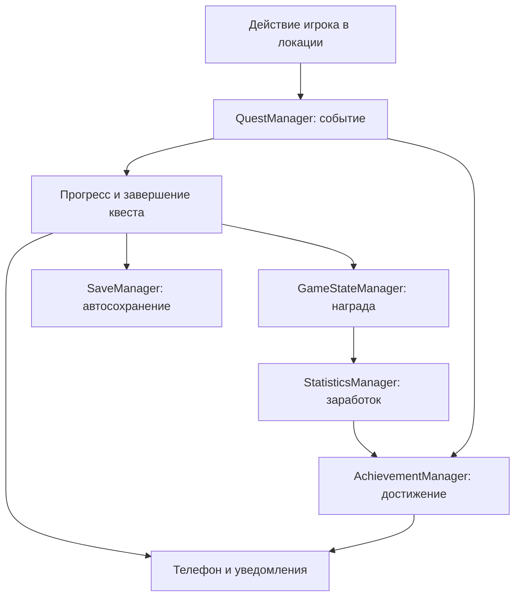

# StudentDay — инструкция по архитектуре и подключению модулей

Эта инструкция предназначена для участников проекта «Один день из жизни студента», в том числе для тех, кто недавно начал работать с Godot. Здесь объясняется, как открыть проект, проверить управление, создать свою локацию и подключить её к общим системам.

Описано состояние архитектуры модуля 7 на 27 октября 2026 года, после коммита `c7aa02d`. Примеры с библиотекой показывают порядок подключения будущей локации. Сцены библиотеки, автобуса и остальных участников в этой версии ещё не добавлены.

## Содержание

1. [Что уже готово и какую версию открыть](#status)
2. [Первый запуск: пошагово](#start)
3. [Управление на компьютере и в VR](#controls)
4. [Небольшой словарь Godot](#words)
5. [Как устроен проект](#structure)
6. [Менеджеры и порядок их работы](#managers)
7. [Создание и регистрация своей локации](#location)
8. [Настройка переходов](#transitions)
9. [Показатели студента и деньги](#stats)
10. [Кнопки, предметы и взаимодействие руками](#interaction)
11. [Квесты: выдача, события, награды](#quests)
12. [Достижения](#achievements)
13. [События дня](#events)
14. [Игровое время](#time)
15. [Общий игрок](#player)
16. [Часы, телефон, меню и уведомления](#ui)
17. [Сохранение и загрузка](#save)
18. [Справочник сигналов](#signals)
19. [Проверка своей локации](#check)
20. [Разбор частых проблем](#problems)
21. [Передача работы через Git](#git)
22. [Что нужно согласовать при объединении модулей](#integration)
23. [Официальная документация](#sources)

<a id="status"></a>
## 1. Что уже готово и какую версию открыть

Проект проверялся в **Godot 4.7.2 stable Steam**, сборка `ed1daf0bf`. Используется GDScript, рендерер **GL Compatibility**, физика **Jolt Physics**, частота физики 90 Гц.

В проект включены:

- **Godot XR Tools**: версия `4.5.1` указана в `addons/godot-xr-tools/plugin.cfg`;
- **Godot OpenXR Vendors**: в истории установленной зависимости указана версия `5.1.0`, минимальная версия Godot в её GDExtension — `4.6`;
- собственный домашний симулятор рук и головы на клавиатуре и мыши.

OpenXR Vendors загружается как GDExtension. Отсутствие его названия в списке обычных Editor Plugins само по себе не означает, что зависимости нет. Основные файлы находятся в `addons/godotopenxrvendors/`.

Рабочая архитектура сейчас находится в ветке:

```text
Modul_7(DimaKorniloov+AlisaMeshkova)
```

В `main` и `dev` могут находиться более ранние версии. До согласованного слияния модуля 7 для ознакомления используйте именно указанную ветку.

**Уже работает:** общий игрок, перемещение и взаимодействие, домашнее управление, показатели, часы, загрузка локаций с затемнением, квесты и награды, достижения, статистика, состояние событий дня, телефон, меню паузы, уведомления со звуком, сохранение и загрузка.

**Сейчас в Main подключена только TestRoom.** Это общая тестовая комната с кубиком, ориентирами, точками A/B и выходом. Полноценные игровые локации делают их участники.

Общая цепочка проверена на компьютере. Для Android подготовлен профиль **PICO 4** в `export_presets.cfg` и собран тестовый APK. Запуск, управление и удобство интерфейса на настоящем PICO 4 ещё необходимо проверить отдельно: при подготовке сборки шлем не был доступен. Порядок сборки и установки описан в разделе 22.3.

<a id="start"></a>
## 2. Первый запуск: пошагово

### 2.1. Открыть проект

1. Получите папку проекта целиком из нужной ветки репозитория.
2. Найдите в ней `project.godot`. Это файл проекта, его не нужно прикреплять как скрипт.
3. В **Godot Project Manager** выберите **Import**, укажите `project.godot` и откройте проект.
4. Дождитесь импорта моделей, звука и регистрации классов. При первом открытии это занимает больше времени.
5. В левом нижнем углу находится **FileSystem** — список файлов проекта. Откройте `scenes/main.tscn` двойным щелчком.
6. Нажмите **F5 — Run Project**.

**F5 запускает общий Main. F6 запускает только открытую сцену.** Отдельная локация без Main не получает игрока и полный контекст переходов. Для проверки архитектуры используйте F5.

Если Godot предлагает выбрать главную сцену, выберите `res://scenes/main.tscn`.

### 2.2. Что должно появиться

Вы увидите TestRoom: пол, красный и синий ориентиры, жёлтый кубик на подставке, рамку «Переход», руки игрока и часы слева. Телефон изначально спрятан. Меню при запуске не открывается. Сверху на четыре секунды появляется уведомление о главном квесте.

Игра начинается в **08:00**. При обычном F5 запускается новое состояние текущего процесса. Сохранение с диска автоматически не подгружается: откройте меню клавишей **M** и выберите **«Загрузить сохранение»**.

### 2.3. Если дома нет шлема

Может появиться сообщение:

```text
OpenXR was requested but failed to start.
HMD was not detected...
Godot will start in normal mode.
```

Без подключённого шлема можно нажать **OK** и продолжить домашнюю проверку. Симулятор включится автоматически. Это сообщение не подтверждает работоспособность VR на устройстве; на самом PICO запуск OpenXR должен быть успешным.

### 2.4. Проверить настройки один раз

В **Project → Project Settings → Globals → Autoload** должны присутствовать менеджеры из раздела 6. Повторно добавлять их не нужно. Порядок важен: Godot создаёт Autoload сверху вниз. [Объяснение Autoload в Godot](https://docs.godotengine.org/en/4.7/tutorials/scripting/singletons_autoload.html)

В **Project → Project Settings → Plugins** проверьте, что Godot XR Tools включён. Строка Autoload `XrSimulator` также уже настроена.

<a id="controls"></a>
## 3. Управление на компьютере и в VR

### 3.1. Клавиатура и мышь

| Действие | Управление |
|---|---|
| Ходьба | W, A, S, D |
| Поворот головы | Движение мыши, когда Q и E отпущены |
| Поворот тела шагом | Стрелки влево/вправо |
| Перемещение левой руки | Удерживать Q и двигать мышь |
| Перемещение правой руки | Удерживать E и двигать мышь |
| Поворот выбранной руки | Удерживать Q или E, добавить Shift и двигать мышь |
| Приблизить выбранную руку | Удерживать Q или E, крутить колесо вниз |
| Отдалить выбранную руку | Удерживать Q или E, крутить колесо вверх |
| Нажать курок выбранной руки | Удерживать Q или E и нажать ЛКМ |
| Взять/отпустить предмет выбранной рукой | Удерживать Q или E и нажать ПКМ |
| Достать/спрятать телефон | Tab |
| Открыть/закрыть меню | M |
| Освободить курсор | Esc |
| Вернуть захват мыши игрой | Щёлкнуть в окне игры; затем повторить нужное действие |
| Сбросить домашнее направление взгляда | R |
| Остановить запуск из редактора | F8 |

Q/E нужно **удерживать**, это выбор руки на время нажатия. При ПКМ захват предмета фиксируется и остаётся после отпускания Q/E. Следующее нажатие ПКМ той же выбранной рукой отпускает предмет.

Если перейти в другое окно, симулятор сбрасывает нажатия и освобождает курсор. После возвращения сначала щёлкните по игре, затем заново удерживайте Q/E.

### 3.2. Как нажать кнопку телефона

1. Нажмите Tab. Телефон находится в правой руке.
2. Удерживая E, расположите телефон удобно для чтения. Колесо вниз подносит руку ближе.
3. Отпустите E. Удерживайте Q и направьте луч левой руки на кнопку.
4. При необходимости приблизьте левую руку колесом вниз: начало луча должно находиться перед экраном телефона.
5. Продолжая удерживать Q, нажмите и отпустите ЛКМ.

Кнопки 3D-интерфейса выбираются лучом руки. Обычный курсор компьютера не является указателем VR-контроллера.

### 3.3. Управление контроллерами VR

| Действие | Настройка текущего игрока |
|---|---|
| Ходьба | Левый стик, действие `primary` |
| Поворот тела | Правый стик, шаг 30° |
| Близкое взаимодействие / выбор UI | Курок, `trigger` / `trigger_click` |
| Захват предмета | Боковой захват, `grip` |
| Телефон | Правая A, `ax_button` |
| Меню | Левый `menu_button` |
| Повторная калибровка | Правая B, `by_button` |

Профиль `/interaction_profiles/bytedance/pico4_controller` настроен в `openxr_action_map.tres`. Доступность кнопок и удобство положения интерфейсов нужно подтвердить на PICO 4.

<a id="words"></a>
## 4. Небольшой словарь Godot

| Термин | Что это значит в нашем проекте |
|---|---|
| Node — узел | Один объект дерева: свет, модель, игрок, точка появления |
| Scene — сцена | Сохранённое дерево узлов, файл `.tscn` |
| Instance — экземпляр | Копия готовой сцены внутри другой; оригинал остаётся отдельным файлом |
| Prefab — префаб | В этой инструкции так называем готовую сцену для повторного использования |
| Script | Файл `.gd` с поведением узла |
| Resource — ресурс | Данные/настройки: материал, форма коллизии, описание квеста; часто `.tres` |
| Inspector | Правая панель настроек выбранного узла или ресурса |
| Signal — сигнал | Сообщение о событии: например, «квест выполнен» |
| Method — метод | Действие, которое можно вызвать из кода, например `change_stat()` |
| API | Согласованные методы и сигналы для связи модулей |
| Autoload | Постоянный узел, который Godot создаёт до Main |
| ID — идентификатор | Короткий постоянный ключ: `library`, `breakfast`, `energy` |
| Marker3D | Точка с положением и направлением, используемая для появления игрока |
| Collision | Физическая форма: не даёт пройти через пол или обнаруживает руку |
| Group — группа | Метка узла; нужный скрипт может искать объекты по этой метке |
| Local / Remote | Local — сохранённая сцена; Remote — экземпляры работающей игры |
| `res://` | Корневая папка проекта, где лежит `project.godot` |
| `user://` | Отдельная папка данных пользователя, где хранится сохранение |

**Название для игрока и ID — разные вещи.** Игрок читает «Библиотека», а менеджеры используют `library`. Пробелы, регистр и написание ID важны. Имена существующих квестов и событий после выпуска сохранений меняют только согласованно.

В Inspector поля обычно показываются по-английски: например, переменная `target_location` отображается как **Target Location**.

<a id="structure"></a>
## 5. Как устроен проект

```text
student-day/
├── project.godot                 Настройки, главная сцена, Autoload
├── openxr_action_map.tres        Действия XR-контроллеров
├── addons/                      XR Tools и OpenXR Vendors
├── assets/                      Модели, текстуры, материалы и звук
├── resources/
│   ├── quests/                  Описания квестов
│   ├── achievements/            Описания достижений
│   └── events/                  Описания событий дня
├── scenes/
│   ├── main.tscn                Постоянная общая сцена
│   ├── locations/               Локации участников
│   ├── player/                  Игрок и модели рук
│   ├── objects/                 Готовые предметы и выход
│   ├── systems/                 Сцены менеджеров
│   ├── ui/                      Часы, телефон, меню, уведомления
│   └── debug/                   Домашний симулятор
└── scripts/                     Поведение сцен и описания ресурсов
```

Дерево [Main](scenes/main.tscn):

```text
Main
├── Locations
│   └── TestRoom                 Заменяется при переходе
├── VRPlayer                     Остаётся тем же объектом
│   ├── CollisionShape3D
│   └── XROrigin3D
│       ├── XRCamera3D
│       ├── RightHand
│       │   ├── HandVisual
│       │   ├── Phone
│       │   ├── VRGrab
│       │   └── FunctionPointer
│       └── LeftHand
│           ├── HandVisual
│           ├── WristWatch
│           ├── VRGrab
│           └── FunctionPointer
├── MainMenuPanel
└── Notifications
```

При переходе SceneManager заменяет дочернюю сцену внутри `Locations`. Сам Main, игрок, часы, телефон и общие менеджеры продолжают существовать.

### Какие файлы сохранять в Git

Сохраняйте `.tscn`, `.gd`, `.tres`, модели, текстуры, звук, файлы `.import` рядом с исходными ресурсами и `.uid` рядом со скриптами. `.import` хранит параметры импорта; `.uid` — постоянный идентификатор. Это обычные файлы Godot.

Папка `.godot/` — локальный кэш редактора, в Git она исключена. Временные копии DLL, экспортированные APK/AAB и папка `exports/` также исключены. Текущая `.gitattributes` уже задаёт окончания строк для текстовых файлов. [Правила Godot для Git](https://docs.godotengine.org/en/4.7/tutorials/best_practices/version_control_systems.html)

Зависимости внутри `addons` сохраняйте целиком вместе с их лицензиями. Скрипты глобальных классов и внутренние ресурсы плагина могут использоваться косвенно, даже если их путь не встречается в нашей сцене.

<a id="managers"></a>
## 6. Менеджеры и порядок их работы

| Менеджер | Ответственность | Что делает локация |
|---|---|---|
| GameStateManager | Шесть показателей студента | Читает или изменяет показатель через метод |
| TimeManager | Игровые часы, пауза, перемотка, события времени | Читает время, согласованно перематывает или подписывается на событие |
| QuestManager | Выданные/выполненные квесты, прогресс и награды | Сообщает, что игрок совершил действие |
| SceneManager | Реестр локаций, загрузка, затемнение и размещение игрока | Запрашивает переход или использует готовый выход |
| StatisticsManager | Заработок, посещения, игровое время в локациях | Читает результаты; обычно ничего вручную не прибавляет |
| AchievementManager | Условия и открытые достижения | Обычно отправляет событие через QuestManager |
| RandomEventManager | Начатые и завершённые события дня | Запускает/завершает подходящее событие, реализует его поведение |
| SaveManager | Файл сохранения, восстановление, новая игра | При необходимости запрашивает сохранение |

Autoload в `project.godot` расположены так:

```text
XRToolsUserSettings
XRToolsRumbleManager
GameStateManager
TimeManager
QuestManager
SceneManager
StatisticsManager
AchievementManager
RandomEventManager
SaveManager
XrSimulator
```

Сцены менеджеров уже подключены. Не создавайте их дополнительные экземпляры в локациях и не меняйте порядок при переносе проекта.

Пример общей связи:



В GDScript общий менеджер доступен по настроенному имени:

```gdscript
var energy: int = GameStateManager.get_stat("energy")
GameStateManager.change_stat("energy", -5)
```

**Как вставлять примеры.** Блок, который начинается с `extends`, показан как целый скрипт для указанного узла. Короткий блок без `extends` — фрагмент для существующего метода, например `interact()` или `_ready()`. Вставляйте его внутрь метода с таким же отступом, как у соседних строк. Не добавляйте второй `extends` в уже готовый файл. Комментарий после `#` объясняет строку и не является отдельной командой. Имена локаций из примеров заменяйте на свои только после их регистрации.

Скрипт с `_` в начале имени метода или переменной обозначает внутреннюю реализацию. Для подключения локаций используйте описанные публичные методы. `get_save_data()` и `restore_save_data()` нужны прежде всего SaveManager; восстановление одного менеджера вручную может рассогласовать остальные.

<a id="location"></a>
## 7. Создание и регистрация своей локации

### 7.1. Создать сцену с полом и точкой появления

Пример: подключаем будущую библиотеку.

1. Выберите **Scene → New Scene** и корень **3D Scene**. Тип корня — `Node3D`.
2. Назовите корень `Library` и сохраните сцену как `res://scenes/locations/library.tscn`.
3. Добавьте к корню `StaticBody3D` с именем `Floor`.
4. Внутрь Floor добавьте `MeshInstance3D`. В Inspector у **Mesh** создайте **BoxMesh**. Размер, например, `(10, 0.2, 10)` метров.
5. Внутрь того же Floor добавьте `CollisionShape3D`. В его **Shape** создайте **BoxShape3D** с таким же размером `(10, 0.2, 10)`.
6. У Floor задайте **Transform → Position → Y = -0.1**. Верх пола окажется на Y = 0.
7. У Floor оставьте физический **Collision Layer 1**.
8. Добавьте к корню `DirectionalLight3D`, направьте его вниз. Освещение можно взять за образец из TestRoom.
9. Добавьте к корню `Marker3D`, назовите **Spawn_Default**. Для примера поставьте его в `(0, 0, 2)`.
10. Сохраните сцену через **Ctrl+S**.

```text
Library (Node3D)
├── Floor (StaticBody3D)
│   ├── MeshInstance3D
│   └── CollisionShape3D
├── DirectionalLight3D
├── Spawn_Default (Marker3D)
└── ...мебель и интерактивные объекты
```

Модель пола сама по себе не удерживает игрока: нужна коллизия. CollisionShape3D должна быть прямым ребёнком физического тела. Для двигающихся предметов используйте простые/выпуклые формы. [Коллизии в Godot](https://docs.godotengine.org/en/4.7/tutorials/physics/collision_shapes_3d.html)

### 7.2. Правила для всех локаций

- Сохраняйте сцену в `res://scenes/locations/`; подпапки допустимы.
- Масштаб мира: **1 юнит = 1 метр**.
- Корень — Node3D или его подходящий наследник, с обычным масштабом `(1, 1, 1)`.
- Player, XROrigin3D и общие менеджеры остаются в общей архитектуре. Не добавляйте их копии в локацию.
- Текущая проверка SceneManager запрещает активную Camera3D внутри локации. Камеры для специальных механик, включая отдельные SubViewport, заранее согласуйте с интегратором.
- Для обычного входа используйте Marker3D с точным именем `Spawn_Default`.
- Все точки, на которые ссылается SceneManager, должны быть **непосредственными детьми корня локации**.
- Marker3D стоит на уровне поверхности для ног. Высоту головы учитывает игрок.
- Взгляд после появления направлен по локальной оси **-Z** маркера. Поворачивайте маркер по Y, чтобы направить игрока внутрь помещения.
- Оставляйте свободное место для капсулы игрока и рук. Точка появления должна находиться за пределами зоны выхода.

### 7.3. Зарегистрировать сцену

Без регистрации SceneManager не разрешит переход по новому ID.

1. Откройте `scenes/systems/scene_manager.tscn`.
2. Выберите корень **SceneManager**.
3. В Inspector раскройте **Initial Locations**.
4. Сохраните существующий ключ `test_room`.
5. Добавьте запись: ключ **library**, значение **res://scenes/locations/library.tscn**.
6. Сохраните сцену.

Ключ вводится без кавычек. Путь должен указывать на уже сохранённую сцену. Для другого модуля выберите свой согласованный ID и путь.

Программная регистрация также существует:

```gdscript
var registered: bool = SceneManager.register_location(
    "library", "res://scenes/locations/library.tscn"
)
```

Её выполняет общий инициализатор один раз. Повторная регистрация того же ID возвращает `false`. Для обычного подключения участнику проще редактировать Initial Locations.

**Добавьте локацию в Android-сборку.** Откройте **Project → Export… → PICO 4 → Resources**. В режиме экспорта выбранных сцен отметьте новую сцену локации вместе с уже выбранными Main и TestRoom. Сохраните настройки. SceneManager хранит пути строками, поэтому экспортёр не всегда может определить такую зависимость автоматически. Без этого шага локация может работать в редакторе, но отсутствовать в APK. Модели, материалы, звуки и остальные прямые зависимости выбранных сцен экспортёр добавляет сам. Фильтр `openxr_action_map.tres` оставьте: он включает общую карту действий контроллеров.

### 7.4. Название локации в телефоне

1. Откройте `scenes/ui/phone_statistics.tscn`.
2. Выберите корень **PhoneStatistics**.
3. В Inspector раскройте **Location Names** и добавьте `library` → `Библиотека`.
4. Сохраните сцену.

В реестре используется ID, в телефоне — это понятное название. Если название не задано, интерфейс покажет «Локация 1», «Локация 2» и т. п.

### 7.5. Если локация должна стать начальной

Это изменение общей сборки, согласуйте его с интегратором. В текущем `scripts/main.gd` есть прямое обращение `$Locations/TestRoom`. Одного изменения поля Initial Location Id недостаточно.

Нужно заменить начальный экземпляр внутри Main/Locations, обновить ссылку на его узел в `SceneManager.setup(...)` и задать соответствующий Initial Location Id. Сохраните вызовы setup меню, телефона и уведомлений. После этого и новая игра будет начинаться в этой локации.

Для обычной разработки оставьте TestRoom начальной и подключайтесь через переход.

<a id="transitions"></a>
## 8. Настройка переходов

### 8.1. Использовать готовый выход

Готовая сцена: [location_exit.tscn](scenes/objects/location_exit.tscn).

1. Откройте свою локацию.
2. Перетащите `scenes/objects/location_exit.tscn` из FileSystem на корень сцены.
3. Назовите экземпляр, например, **TransitionTo_TestRoom**.
4. Поставьте его на пол перед дверью. Учитывайте объём зоны, а не только видимую рамку.
5. В Inspector задайте **Target Location = test_room**, **Target Spawn = Spawn_Default**.
6. Сохраните локацию.

Готовый выход уже содержит Area3D, CollisionShape3D, рамку, подпись, группу `exit_point` и подключённый `body_entered`. Повторно подключать сигнал не нужно.

Переход запускается, когда тело игрока входит в зону. Нажатие рукой не требуется. Зона выхода имеет Collision Mask 1 и обнаруживает тело игрока на физическом слое 1.

Для пробного пути **TestRoom → Library → TestRoom** в своей согласованной интеграционной ветке:

- у выхода TestRoom задайте `Target Location = library`, `Target Spawn = Spawn_Default`;
- в Library добавьте выход обратно с `Target Location = test_room`, `Target Spawn = Spawn_Default`;
- убедитесь, что оба ID зарегистрированы, и запускайте F5.

Изменение общего TestRoom и реестра покажите в своём запросе на объединение, чтобы остальные участники понимали, какие связи добавлены.

### 8.2. Что делает SceneManager

Запрос перехода блокирует повторный запрос, временно отключает движение, затемняет изображение, загружает сцену, проверяет её корень и точку появления, отпускает удерживаемые предметы и заменяет комнату. Затем размещает прежнего игрока, убирает затемнение и восстанавливает прежний режим движения.

При регистрации ресурса есть синхронная проверка файла. Во время самого перехода используются `load_threaded_request`, `load_threaded_get_status` и `load_threaded_get` после готовности ресурса. Именно эта часть является фоновой загрузкой. [Фоновая загрузка в Godot](https://docs.godotengine.org/en/4.7/tutorials/io/background_loading.html)

### 8.3. Запрос из скрипта

```gdscript
var accepted: bool = SceneManager.change_location("library", "Spawn_Default")
```

`true` означает **«запрос принят»**, а не «игрок уже появился». Окончание приходит сигналом `location_changed(location_id, spawn_name)`. При отказе после начала перехода приходит `transition_failed(location_id, reason)`.

Обычный запрос через готовую рамку не требует собственного кода. Для дополнительных реакций используйте сигналы; не добавляйте ожидание в удаляемый узел старой комнаты в расчёте, что он обязательно продолжит работу.

| Метод | Результат |
|---|---|
| `register_location(id, scene_path)` | bool: добавлена ли запись |
| `has_location(id)` | bool: существует ли ID |
| `get_location_path(id)` | Путь зарегистрированной сцены |
| `get_current_location_id()` | ID текущей локации |
| `get_current_location()` | Корень текущей локации Node3D; до подключения Main может быть null. Используется общей системой сохранения |
| `get_initial_location_id()` | ID начальной локации текущего Main |
| `is_transitioning()` | Выполняется ли переход |
| `change_location(id, spawn_name)` | bool: принят ли запрос |
| `setup(location_root, player, current_location, id)` | Вызывается общей сценой Main один раз |

Для штатных переходов используйте SceneManager. Прямой `get_tree().change_scene_to_file()` заменяет общую сцену целиком и нарушает предусмотренный жизненный цикл игрока и контекста переходов.

Удерживаемые предметы остаются частью своей локации. При переходе они отпускаются и удаляются со старой комнатой. Переносимый между локациями инвентарь отдельно не реализован.

<a id="stats"></a>
## 9. Показатели студента и деньги

Начальные значения заданы в скрипте GameStateManager; сцена менеджера их сейчас не переопределяет.

| Ключ | Показатель | Начало | Пределы |
|---|---|---:|---|
| `energy` | Энергия | 80 | 0…100 |
| `satiety` | Сытость | 50 | 0…100 |
| `knowledge` | Знания | 0 | 0…100 |
| `money` | Деньги | 200 | Не меньше 0 |
| `mood` | Настроение | 70 | 0…100 |
| `health` | Здоровье | 100 | 0…100 |

Это текущие настройки проекта, а не всеобщая формула баланса из задания. Для изменения старта откройте `scenes/systems/game_state_manager.tscn`, выберите корень и измените поля **Initial Stats**. Общий баланс согласуется командой.

### 9.1. Прочитать, установить и изменить

```gdscript
var current_energy: int = GameStateManager.get_stat("energy")
var all_stats: Dictionary = GameStateManager.get_stats()

GameStateManager.set_stat("energy", 40)     # Сделать энергию равной 40.
GameStateManager.change_stat("energy", -5)  # Уменьшить текущее значение на 5.
```

Положительная величина прибавляет, отрицательная вычитает. Например, изменение сытости с 90 на +30 даст 100, а не 120. `get_stats()` возвращает копию: изменение полученного словаря не меняет состояние игры.

При изменении менеджер отправляет `player_stat_changed(stat_name, value)`. **value — новое итоговое значение**, не величина прибавки. Телефон подписан на этот сигнал и обновляется сам.

Показатели не убывают автоматически только от течения времени: расход и восстановление вызывают механики локаций и награды квестов.

### 9.2. Текущий баланс и заработок

```gdscript
GameStateManager.change_stat("money", 100)  # Выплата: увеличит баланс и заработок.
GameStateManager.change_stat("money", -20)  # Покупка: уменьшит баланс.
```

Положительное `change_stat("money", amount)` отправляет `money_earned(amount)`. StatisticsManager накапливает такие поступления. Покупки заработок не уменьшают. Начальные 200 и восстановление сохранения заработком не считаются.

`set_stat("money", value)` устанавливает баланс без регистрации заработка. Поэтому за обычную выполненную работу используйте `change_stat`, а не `set_stat`.

Перед оплатой проверьте достаточность денег через `get_stat`: простое уменьшение на слишком большую сумму обрежет баланс до нуля, но само по себе не отклонит покупку.

### 9.3. Статистика

| Метод StatisticsManager | Что возвращает |
|---|---|
| `get_money_earned()` | Сколько всего заработано за день |
| `get_visited_location_ids()` | Список посещённых ID |
| `get_location_visit_count(id)` | Число посещений локации |
| `get_location_time_seconds(id)` | Суммарные игровые секунды в локации, включая текущий визит |

Переход из A в B и обратно в A увеличивает счётчик A. Перезагрузка той же локации, включая тестовый переход внутри TestRoom, новым посещением не считается. Перемотка игрового времени прибавляется к времени в текущей локации.

<a id="interaction"></a>
## 10. Кнопки, предметы и взаимодействие руками

Есть два способа взаимодействия: близкое действие курком возле предмета и выбор 3D-интерфейса лучом. Это разные пути в текущем игроке.

### 10.1. Близкое взаимодействие: метод interact()

Пример книги, которая засчитывает библиотечный квест:

```text
InformationBook (StaticBody3D)   ← скрипт и группа interactable
├── MeshInstance3D
└── CollisionShape3D
```

1. Создайте StaticBody3D внутри своей локации.
2. Добавьте видимую модель и подходящую CollisionShape3D.
3. У тела оставьте Collision Layer 1.
4. Выберите тело и откройте **Node → Groups** в правой панели. Добавьте его в **interactable**.
5. К этому телу прикрепите скрипт, например `res://scripts/objects/information_book.gd`.
6. В скрипт вставьте целиком:

```gdscript
extends StaticBody3D

func interact() -> void:
    if QuestManager.is_quest_active("library_research"):
        QuestManager.notify_event("exam_material_found")
```

Это пример для создания участником; такого файла пока нет в базовой сборке. Сначала получите квест через телефон, затем поднесите руку к книге и нажмите курок. В домашнем режиме это Q/E + движение руки, затем ЛКМ выбранной рукой.

Скрипт захвата ищет тела `interactable` внутри GrabArea возле контроллера. Радиус области в префабе игрока — 0.16 м. Видимого пересечения пальца с картинкой недостаточно: важны физическая форма и расстояние до контроллера.

Название `interact` и отсутствие параметров важны. Если на физическом теле метода нет, поиск поднимается по его родителям. Проще начать с размещения скрипта и группы на одном StaticBody3D.

### 10.2. Предмет, который можно взять

Начните с [test_cube.tscn](scenes/objects/test_cube.tscn): перетащите его в свою локацию, разместите на поверхности и проверьте захват. Для отдельного вида предмета сохраните собственную сцену/унаследованную сцену и замените модель и форму коллизии.

Требования текущего захвата:

- физическое тело — `RigidBody3D`;
- группа **grabbable**;
- доступная CollisionShape3D и физический слой 1;
- методы `begin_hold(target)` и `end_hold()`;
- базовый скрипт `scripts/objects/grabbable.gd` уже реализует физическое следование руке.

Чтобы взять предмет, приблизьте выбранную руку и нажмите ПКМ в домашнем режиме или grip в VR. Для отпускания повторите действие. Один предмет одновременно держит одна рука.

При изменении общего материала/меша помните, что ресурс может использоваться несколькими экземплярами. Для самостоятельного варианта создайте отдельный ресурс или выберите **Make Unique** у ресурса в Inspector.

Дополнительные необязательные методы предмета, которые распознаёт захват:

| Метод | Когда вызывается |
|---|---|
| `update_hold(camera, trigger_pressed, delta)` | Каждый физический кадр удержания; bool сообщает об использовании для короткой вибрации |
| `try_use(camera)` | При новом нажатии курка у удерживаемого предмета; bool сообщает об успешном использовании |

Они нужны для специальных механик; обычному кубику достаточно базового grabbable.gd.

### 10.3. Группы: как обстоят дела в коде

| Группа | Реальное назначение |
|---|---|
| `interactable` | Тела для близкого вызова `interact()` курком |
| `grabbable` | Обязательная группа для текущего физического захвата |
| `exit_point` | Метка готового выхода; сам переход выполняет скрипт Area3D |
| `pickup` | Соглашение задания; сама по себе захват не включает |
| `quest_target` | Соглашение задания; сама по себе событие квеста не отправляет |

Если участник использует `pickup`, добавьте также фактически используемую группу `grabbable`, когда предмет должен браться текущими руками. Присвоение группы не заменяет код механики.

### 10.4. Выбор интерфейса лучом

FunctionPointer на каждой руке настроен на физический **слой 23 — VR UI** и расстояние 4 м. Телефон и меню уже имеют подходящий 3D-экран. Для своего диэгетического UI используйте существующую сцену XR Tools `objects/viewport_2d_in_3d.tscn` как образец и её 2D-сцену содержимого.

Обычный предмет с группой interactable текущим UI-лучом не активируется. Близкое действие описано выше. Если нужен новый дальний способ взаимодействия, согласуйте общий контракт, чтобы не ломать действующее управление.

Layer/Mask — физические слои. Они не равны VisualInstance3D/Visibility Layers, которые относятся к отрисовке.

<a id="quests"></a>
## 11. Квесты: выдача, события, награды

### 11.1. Как проходит квест

1. Описание квеста заранее хранится в `.tres` и подключено к QuestManager.
2. Игрок получает квест через телефон. Главный `main_exam` выдаётся автоматически.
3. Механика локации после успешного действия вызывает `QuestManager.notify_event(...)`.
4. Менеджер увеличивает счётчик соответствующего условия активных квестов.
5. Когда все условия выполнены, квест становится завершённым и менеджер один раз применяет его Stat Rewards.
6. Телефон, уведомления и автосохранение реагируют на сигналы.

Квестовый прогресс засчитывается только после выдачи квеста. Событие, отправленное до этого, не хранится «на будущее» для поздней выдачи. При этом AchievementManager слушает события отдельно и может открыть своё событийное достижение.

Один вызов `notify_event` добавляет **одну единицу** каждому подходящему условию. Не вызывайте его каждый кадр: сообщайте о завершённом действии, например о вручённой посылке.

### 11.2. Точные ID готовых квестов

| ID квеста | Название | Событие и количество | Награда |
|---|---|---|---|
| `main_exam` | Сдать экзамен на отлично в 16:00 | `exam_excellent` × 1 | Настроение +10 |
| `breakfast` | Позавтракать в общежитии | `breakfast_eaten` × 1 | Сытость +30 |
| `library_research` | Посети библиотеку и найди информацию по теме экзамена | `exam_material_found` × 1 | Знания +15 |
| `cafeteria_meal` | Поешь в столовой | `cafeteria_meal_eaten` × 1 | Сытость +25 |
| `workout` | Потренируйся в спортзале | `workout_completed` × 1 | Энергия +20, Сытость -10 |
| `party` | Сходи на вечеринку | `party_attended` × 1 | Настроение +30, Энергия -25 |
| `courier_job` | Подработай курьером | `delivery_completed` × 1 | Деньги +100, Энергия -20 |
| `robot_assembly` | Собери робота в мастерской | `robot_assembled` × 1 | Знания +20 |
| `medical_check` | Пройди профосмотр | `medical_check_completed` × 1 | Здоровье до 100 |
| `dean_certificate` | Забери грамоту в деканате | `certificate_collected` × 1 | Не задана |
| `feed_ducks` | Покорми уток в парке | `ducks_fed` × 1 | Настроение +15 |

Главный квест связан с событием `exam_excellent`. Порогов Знания ≥ 70, Энергия ≥ 40 и Сытость ≥ 30 недостаточно для автоматического выставления «5»: оценку определяет экзаменационный модуль по согласованным правилам. После фактической отличной оценки он отправляет это событие. Автоматический переход на экзамен в 16:00 в текущем Main не настроен.

Медосмотр восстанавливает здоровье до 100: в ресурсе награда `health +100`, а GameStateManager ограничивает итог верхним пределом 100. У грамоты отдельная денежная награда сейчас не задана; наличие грамоты можно проверять по завершению `dean_certificate`. Правила стипендии определяет соответствующая механика.

### 11.3. Правильный вызов из локации

```gdscript
QuestManager.notify_event("delivery_completed")
```

Если квест курьера активен, он сам начислит +100 денег и -20 энергии. **Не прибавляйте эти же 100 и не вычитайте эти же 20 ещё раз в локации.** Отдельные покупки, расходы и действия, которые не являются той же наградой, используют GameStateManager отдельно.

Повторное событие для завершённого квеста его награду снова не выдаёт. Проверка активного квеста в примере книги также защищает действие после повторного входа в локацию.

### 11.4. Как добавить своё согласованное задание

1. В FileSystem откройте `resources/quests/`.
2. Через **Create New → Resource…** создайте `QuestDefinition`.
3. Сохраните ресурс с понятным именем, например `find_two_items.tres`.
4. В Inspector задайте уникальный **Quest Id**, **Title**, **Description**.
5. В **Required Events** добавьте нужные ключи и целые положительные количества. Например: `book_found` → 1, `note_found` → 1.
6. В **Stat Rewards** добавьте награды с ключами из таблицы показателей, например `knowledge` → 10. Это пример настройки, баланс требует согласования.
7. Откройте `scenes/systems/quest_manager.tscn`, выберите корень.
8. Увеличьте список **Quest Definitions** на один элемент и перетащите в него новый ресурс.
9. Сохраните ресурс и сцену. После нового запуска квест появится в доступных заданиях телефона.

Если событие требуется трижды, задайте количество 3 и отправляйте его по одному разу за каждое самостоятельное действие. Несколько разных Required Events означают, что должны выполниться **все** условия.

**Initial Quests** — список автоматически выдаваемых ID. Сейчас там только `main_exam`; побочные задания не нужно массово добавлять в этот список.

### 11.5. Методы QuestManager

| Метод | Что делает / возвращает |
|---|---|
| `give_quest(id)` | bool: выдан ли квест; повторная выдача активного/готового возвращает false |
| `notify_event(event_id)` | Сообщает об одном фактическом действии |
| `is_quest_active(id)` | Активен ли квест |
| `is_quest_completed(id)` | Выполнен ли квест |
| `get_active_quest_ids()` | Копия списка активных ID |
| `get_available_quest_ids()` | Описанные квесты, которые ещё не активны и не завершены |
| `get_completed_quest_ids()` | Копия списка завершённых ID |
| `get_quest_definition(id)` | Ресурс описания; null для неизвестного ID |
| `get_quest_progress(id)` | Копия словаря счётчиков условий |

`reset_quests`, `restore_save_data` и `set_events_enabled` используются общей системой новой игры/загрузки. Локации не должны сбрасывать все задания при своём открытии.

<a id="achievements"></a>
## 12. Достижения

Достижения открывает AchievementManager. Описания находятся в `resources/achievements/`, список подключён в `scenes/systems/achievement_manager.tscn`.

| ID достижения | Название | Условие из ресурса |
|---|---|---|
| `hard_worker` | Трудяга | Заработай не менее 500 за один игровой день. |
| `athlete` | Спортсмен | Посети спортзал три раза. |
| `bookworm` | Зубрила | Проведи в библиотеке суммарно более двух игровых часов за день. |
| `partygoer` | Тусовщик | Проведи в клубе суммарно более одного игрового часа за день. |
| `excellent_student` | Отличник | Сдай экзамен на оценку «5». |
| `early_bird` | Ранняя пташка | Выключи будильник в течение пяти реальных минут после его запуска. |
| `explorer` | Исследователь | Посети все игровые локации. |

Важные детали текущих условий:

- **Трудяга**: суммарные положительные выплаты через `change_stat("money", amount)` достигают 500. Текущий остаток денег может быть меньше 500 после покупок.
- **Спортсмен**: используется точный ID локации **gym**; нужно три посещения с выходами в другие локации между ними.
- **Зубрила**: ID **library**, суммарно **строго больше 7200 игровых секунд**.
- **Тусовщик**: ID **club**, суммарно **строго больше 3600 игровых секунд**.
- **Отличник**: событие **exam_excellent** после оценки «5».
- **Ранняя пташка**: сначала событие **alarm_started**, затем **alarm_disabled** в течение **300 реальных секунд**. Это согласованная замена исходного условия «до 07:00», поскольку день начинается в 08:00.
- **Исследователь** пока является заглушкой с ручным условием. Автоматического обхода 14 локаций нет; окончательный список посещаемых локаций ещё предстоит согласовать.

### 12.1. Будильник

Локация общежития сообщает о действительном запуске будильника:

```gdscript
QuestManager.notify_event("alarm_started")
```

При выключении игроком:

```gdscript
QuestManager.notify_event("alarm_disabled")
```

Не отправляйте alarm_started каждый кадр: повторный запуск этого события сбрасывает начало отсчёта. Реальный таймер этого достижения не зависит от скорости игровых часов; время открытого меню также проходит. В сохранение записывается уже прошедшая длительность, время вне запущенной игры после сохранения к ней не добавляется.

### 12.2. Методы и настройка

| Метод AchievementManager | Что делает |
|---|---|
| `is_achievement_unlocked(id)` | Проверяет, открыто ли достижение |
| `get_unlocked_achievement_ids()` | Возвращает копию списка открытых ID |
| `get_achievement_definition(id)` | Возвращает описание |
| `unlock_achievement(id)` | Ручное открытие известного достижения; bool: открыто ли сейчас впервые |

Для обычных семи достижений используйте их существующие условия. Прямое открытие из локации нужно только для согласованного ручного условия. Повторное открытие не отправляет сигнал ещё раз.

При добавлении нового AchievementDefinition задайте условие **Condition**: Manual, Money Earned, Location Visits, Location Time, Event или Timed Event. Для времени Location Time порог задаётся в игровых секундах; Timed Event — в реальных секундах. Подключите ресурс к массиву **Achievement Definitions** в сцене менеджера. Такой новый ресурс и его правила согласуются с командой.

<a id="events"></a>
## 13. События дня

RandomEventManager хранит, какие события начались и какие завершены. Он не реализует поведение столовой, турнира или фотокамеры и не запускает случайные события по таймеру самостоятельно.

| ID | Событие |
|---|---|
| `lecture_cancelled` | Лекция отменена |
| `free_lunch` | Бесплатный обед |
| `sports_tournament` | Турнир в спортзале |
| `photo_contest` | Фотоконкурс в парке |

### 13.1. Начало, действие и завершение

```gdscript
var started: bool = RandomEventManager.start_event("free_lunch")
```

При первом успешном запуске возвращается true, состояние становится активным, приходит `event_started(event_id)`. Общие уведомления автоматически покажут описание события с заголовком «Событие дня» и звуком.

Повторный запуск активного или уже завершённого события в тот же день вернёт false. Он не создаст повторное уведомление.

Пример чтения состояния в механике столовой:

```gdscript
var lunch_is_free: bool = RandomEventManager.is_event_active("free_lunch")
```

На основании этого флага локация определяет цену своей покупки. Сам start_event не выдаёт еду, не меняет сытость и не начисляет приз турнира.

Когда акция должна закончиться:

```gdscript
var finished: bool = RandomEventManager.finish_event("free_lunch")
```

Возвращается true, только если событие было активным. Текущее уведомление о начале не является таймером длительности акции: исчезновение сообщения через четыре секунды **не завершает** событие. Уведомления о завершении сейчас не подключены.

### 13.2. Случайный выбор

`start_random_event()` равновероятно выбирает одно событие из ещё не начатых и не законченных, запускает его и возвращает ID. Если подходящих нет, возвращает пустой StringName.

В этом методе нет фильтра по локации и расписанию. Для конкретной столовой или спортзала используйте start_event с нужным ID. Момент запуска и условия доступности определяет соответствующий модуль по общим договорённостям.

### 13.3. Дополнительные методы

| Метод | Результат |
|---|---|
| `is_event_active(id)` | bool: активно ли событие |
| `is_event_finished(id)` | bool: завершено ли событие |
| `get_active_event_ids()` | Копия списка активных ID |
| `get_finished_event_ids()` | Копия списка завершённых ID |
| `get_event_definition(id)` | Описание или null |

Для нового события создайте Resource типа **RandomEventDefinition**, задайте Event Id, Title, Description, сохраните в `resources/events/` и добавьте в **Event Definitions** сцены `scenes/systems/random_event_manager.tscn`. Текст Description должен быть коротким: уведомление рассчитано примерно на две строки.

<a id="time"></a>
## 14. Игровое время

### 14.1. Фактические настройки

В текущем коде старт — **08:00**, скорость — **20 игровых секунд за одну реальную**. Сцена `time_manager.tscn` скорость не переопределяет.

Это означает:

- 1 игровая минута проходит за 3 реальные секунды;
- 5 игровых минут — за 15 реальных секунд;
- от 08:00 до 16:00 проходит 24 реальные минуты без пауз и перемоток.

Ранее обсуждавшаяся скорость 30 дала бы 16 реальных минут до 16:00, но фактическое текущее значение — 20. При изменении скорости пересчитывайте сроки домашней проверки. Настройка находится в `scenes/systems/time_manager.tscn`: корень → **Clock Settings → Game Seconds Per Real Second**.

В 24:00 часы останавливаются. Автоматического начала следующего дня нет; новую игру запускает SaveManager.

### 14.2. Чтение, пауза и перемотка

```gdscript
var text: String = TimeManager.get_time_text()          # Например, "08:15".
var minutes: int = TimeManager.get_total_minutes()      # Минуты с начала суток.
var seconds: float = TimeManager.get_total_seconds()   # Игровые секунды с начала суток.

TimeManager.advance_minutes(15)                       # Поездка/сон: +15 игровых минут.
```

`get_total_minutes()` в 08:00 возвращает **480**, а не 0. `get_total_seconds()` возвращает **28800**. Для длительности действия сохраняйте время его начала и вычитайте его из текущего времени.

Пауза игровых часов:

```gdscript
TimeManager.set_time_paused(true)
# ...механика, требующая остановки времени...
TimeManager.set_time_paused(false)
```

Когда нужно восстановить предыдущую паузу, предварительно сохраните исходное состояние. Общая временная пауза меню хранится отдельно; закрытие меню не должно отменять явную паузу механики.

`advance_minutes()` доступен даже на паузе: это явная перемотка. Отрицательная перемотка не поддерживается. Перемотка также проверяет достигнутые события времени.

### 14.3. Событие в определённое время

Пример регистрации согласованного события на 16:00:

```gdscript
var registered: bool = TimeManager.register_time_event("exam_start", 16 * 60)
```

Имя должно быть уникальным, момент — будущим и в пределах суток. Регистрация прошедшего времени или повторного ID вернёт false.

Пример подписки в скрипте компонента, который должен получить сигнал:

```gdscript
extends Node

func _ready() -> void:
    TimeManager.time_event_reached.connect(_on_time_event_reached)

func _on_time_event_reached(event_id: StringName, scheduled_minutes: int) -> void:
    if event_id == "exam_start":
        print("Наступило время экзамена: ", scheduled_minutes)
```

Это пример обработчика, а не уже установленный в Main контроллер экзамена. Если реакция нужна независимо от текущей комнаты, обработчик должен жить в постоянной части игры. Скрипт выгруженной локации сигнал не получит.

Регистрации и список уже сработавших событий сохраняются. При загрузке достигнутое событие не повторяется. При новой игре список очищается: общий организатор расписания должен выполнить нужные регистрации для нового дня. Сейчас такого автоматического экзаменационного организатора нет.

Публичные методы: `get_time_text`, `get_total_minutes`, `get_total_seconds`, `advance_minutes`, `register_time_event`, `set_time_paused`, `is_time_paused`. `set_time_suspended` применяется общим меню для временной паузы; прямой сброс всех часов через reset_time оставьте общей новой игре.

<a id="player"></a>
## 15. Общий игрок

Готовая сцена: [player.tscn](scenes/player/player.tscn). В Main находится один её экземпляр — VRPlayer.

| Метод игрока | Назначение |
|---|---|
| `set_movement_enabled(enabled)` | Разрешить или запретить ходьбу и поворот стиком |
| `is_movement_enabled()` | Получить текущее разрешение движения |
| `place_at_spawn(marker)` | Разместить у действительного Marker3D; bool: удалось ли размещение |
| `release_held_objects()` | Отпустить предметы обеих рук |
| `request_calibration()` | Запросить XR-калибровку при наличии активного VR |
| `set_pointers_enabled(active)` | Включить/выключить оба UI-луча |

Переменные `camera`, `left_hand`, `right_hand`, `xr_origin` доступны после готовности игрока. Локации не должны обходить эти методы и править внутренние поля состояния движения.

Запрет движения не отключает отслеживание головы и рук. Игрок продолжает осматриваться и взаимодействовать. place_at_spawn учитывает горизонтальное смещение головы внутри XROrigin3D и направление точки. Поэтому при переходах не заменяйте его простым присваиванием global_position.

Игрок выполняет стартовую XR-калибровку после нескольких кадров валидного трекинга. place_at_spawn вернёт false, если калибровка ещё выполняется или точка уже удалена. SceneManager обрабатывает такой отказ как неуспешный переход.

### Для автора автобуса

В этом Player нет методов `sit_at` или `leave_seat`. Конкретная посадка, положение сиденья, следование движущемуся транспорту и момент высадки проектируются с автором автобусного модуля. Для согласованной реализации доступны запрет движения и размещение у точки выхода. Отслеживание головы ради фиксации камеры отключать не следует.

Если локация обнаруживает игрока через Area3D/body_entered, она может получить ссылку из параметра body и проверить его тип:

```gdscript
extends Area3D

const Player = preload("res://scripts/player/player.gd")

func _on_body_entered(body: Node3D) -> void:
    if body is Player:
        print("В область вошёл общий игрок")
```

Сигнал body_entered этого примера нужно подключить к методу через панель Node → Signals. Для готового location_exit.tscn это уже выполнено.

<a id="ui"></a>
## 16. Часы, телефон, меню и уведомления

### 16.1. Откуда интерфейс получает данные

- Часы слева читают TimeManager.
- «Состояние» телефона читает GameStateManager.
- «Квесты» читают QuestManager; кнопка получения вызывает give_quest.
- «Достижения» читают AchievementManager.
- «Статистика» читает StatisticsManager.
- Меню вызывает SaveManager и временно приостанавливает часы/движение.
- Уведомления слушают получение/выполнение квестов, открытие достижений и начало событий дня.

От локации не требуется искать Label на телефоне и вручную менять его текст. Меняйте данные через API, интерфейс обновится по сигналам.

Сцены интерфейса заранее собраны в `scenes/ui/`. Их можно открыть и редактировать в Inspector и дереве Scene до запуска.

### 16.2. Сцены и настройки

| Что изменить | Где это находится |
|---|---|
| Экран состояния | `scenes/ui/phone_status.tscn` |
| Квестовые карточки | `scenes/ui/phone_quests.tscn` |
| Достижения | `scenes/ui/phone_achievements.tscn` |
| Статистика и понятные названия локаций | `scenes/ui/phone_statistics.tscn` |
| Расположение вкладок | `scenes/ui/phone_screen.tscn` |
| Модель и экран телефона | `scenes/ui/phone.tscn` |
| Размер/положение телефона на правой руке | экземпляр Phone в `scenes/player/player.tscn` |
| Содержимое меню | `scenes/ui/main_menu.tscn` |
| Расстояние меню до головы | корень `scenes/ui/main_menu_panel.tscn`, Menu Distance |
| Вид и положение уведомления | `scenes/ui/notifications.tscn`, корень и дочерние элементы |
| Время уведомления | корень Notifications, Display Seconds; сейчас 4 реальные секунды |
| Смещение уведомления от головы | корень Notifications, View Offset |
| Громкость уведомления | дочерний NotificationSound, Volume dB; сейчас -14 dB |
| Звук | `assets/audio/ui/notification.wav` |

Положительный View Offset Y поднимает уведомление. Отрицательный Z размещает его впереди головы. Уведомление следует за камерой, сообщения показываются по очереди. Во время меню панель и звук приостанавливаются; после закрытия показ продолжается. Загрузка очищает старую очередь. Полученные ранее достижения при загрузке заново не объявляются.

Телефон не ставит часы на паузу. Открытие меню скрывает телефон. Пункт «Вернуться в игру» закрывает меню, а «Загрузить сохранение» восстанавливает файл с диска — это разные действия.

Меню приостанавливает общие игровые часы и перемещение игрока, но не переводит всё дерево SceneTree на паузу. Физические объекты и самостоятельные таймеры локаций могут продолжать работу. Если мини-игре нужна остановка вместе с меню, этот режим следует согласовать при подключении её механики; не рассчитывайте на автоматическую остановку всех узлов.

На реальном PICO отдельно оцените читаемость, размер телефона, положение часов, уведомлений и громкость. Текущие размеры подбирались в домашней проверке.

<a id="save"></a>
## 17. Сохранение и загрузка

### 17.1. Где находится файл

SaveManager использует ConfigFile и один слот:

```text
user://save.cfg
```

На Windows при стандартных настройках это обычно:

```text
%APPDATA%/Godot/app_userdata/StudentDay/save.cfg
```

Точный каталог можно открыть через **Project → Open User Data Folder** или узнать вызовом `OS.get_user_data_dir()`. Папка user:// находится отдельно от исходников и предназначена для записи на устройстве пользователя. [Пути данных Godot](https://docs.godotengine.org/en/4.7/tutorials/io/data_paths.html)

Сохранение локальное. Оно не передаётся другим участникам через Git и не синхронизируется между компьютером и шлемом.

### 17.2. Что сохраняется

Формат имеет версию **1**. Разделы файла:

| Раздел | Данные |
|---|---|
| `stats` | Шесть показателей |
| `time` | Игровые секунды суток, явная пауза, расписание и сработавшие события |
| `quests` | Активные/завершённые ID и счётчики условий |
| `achievements` | Открытые ID и длительности начатых реальных таймеров |
| `statistics` | Заработок, посещения, время в локациях и текущая локация |
| `events` | Активные и завершённые события дня |
| `location` | ID текущей локации и состояния подключённых локаций по их ID |

### 17.3. Когда выполняется запись

Автосохранение запрашивается **после успешного перехода** и **после завершения квеста**. После квеста запись отложена до окончания обработки события, чтобы награды уже попали в файл.

Получение задания, простое открытие достижения, начало события, покупка и закрытие меню сами по себе не являются отдельными точками автосохранения. Кнопка «Выход» также не вызывает save_game.

Если после важного действия локации нужна запись сразу, явно вызовите SaveManager после того, как действие и связанные изменения закончены:

```gdscript
var saves: Node = get_node("/root/SaveManager")
var saved: bool = saves.save_game()
```

Проверяйте saved при показе собственного сообщения об успехе. Во время перехода или загрузки запись может быть отклонена. Не делайте копию сохранения в собственном скрипте поверх общего файла.

### 17.4. Загрузка и новая игра

```gdscript
var saves: Node = get_node("/root/SaveManager")
var accepted: bool = saves.load_game()
```

Или:

```gdscript
var saves: Node = get_node("/root/SaveManager")
var accepted: bool = saves.start_new_game()
```

Эти методы возвращают bool принятия запроса. О завершении сообщают сигналы:

- `game_loaded()` — загрузка закончена;
- `new_game_started()` — новая игра подготовлена;
- `game_load_failed(reason)` — начатый запрос не удалось завершить.

Пока `is_loading()` возвращает true, повторные запросы не принимаются. Общая загрузка временно приостанавливает SceneTree и запрещает квестовые события во время инициализации загружаемой сцены. Затем согласованно обновляет интерфейс.

Новая игра сбрасывает менеджеры, очищает сохранённые в памяти состояния локаций и выдаёт главный квест. **Она не удаляет старый файл save.cfg немедленно.** До следующего автосохранения или явного save_game загрузка может вернуть предыдущее сохранение. Учитывайте это при проверке «Новая игра → Загрузить».

Если файла нет, он повреждён, версия неизвестна или структура несовместима, load_game вернёт false до начала восстановления либо сообщит об ошибке. Существующий файл автоматически не удаляется. Причину смотрите в Output/Debugger. При ошибке начатого перехода менеджер пытается восстановить состояние до запроса.

### 17.5. Как подключить собственные данные локации

Общий механизм уже есть в SaveManager. Подключение необязательное: локация без методов сохранения продолжает работать как раньше. Отдельный менеджер и собственный файл сохранения участнику не нужны.

Сначала согласуйте список данных. Например: сохраняем открытие двери, получение ключа и факт завершения мини-игры; обычные стаканы и стулья возвращаем на исходные места. Отдельно решите, нужно ли продолжать незавершённую мини-игру с середины или достаточно её итогового результата. Общие деньги, награды и прогресс квестов повторно хранить в локации не нужно: за них отвечают соответствующие менеджеры.

В скрипте **корня локации** добавьте два метода:

| Метод | Назначение |
|---|---|
| `get_save_data() -> Dictionary` | Вернуть текущее состояние своей локации |
| `restore_save_data(data: Dictionary) -> void` | Применить ранее сохранённое состояние к готовым узлам |

Пример для локации, в которой есть дочерние узлы **DoorPivot** (ось поворота двери) и **Key** (видимый ключ):

```gdscript
extends Node3D

var door_open: bool = false
var key_collected: bool = false
var minigame_completed: bool = false

@onready var _door: Node3D = $DoorPivot
@onready var _key: Node3D = $Key


func get_save_data() -> Dictionary:
	return {
		"door_open": door_open,
		"key_collected": key_collected,
		"minigame_completed": minigame_completed,
	}


func restore_save_data(data: Dictionary) -> void:
	door_open = data.get("door_open", false)
	key_collected = data.get("key_collected", false)
	minigame_completed = data.get("minigame_completed", false)
	_door.rotation.y = deg_to_rad(90.0) if door_open else 0.0
	_key.visible = not key_collected
```

Это пример сохранения, а не готовая механика двери и мини-игры. Ваши обработчики взаимодействия должны менять соответствующие переменные. Если у ключа есть коллизия и возможность захвата, при восстановлении отключите их вместе с видимостью или удалите уже забранный ключ. Угол открытия и имена узлов замените на свои. Результат мини-игры нужно отобразить в её собственном интерфейсе.

**Когда вызываются методы:**

1. При обычном переходе SceneManager отпускает удерживаемые предметы. Пока старая локация ещё находится в дереве, SaveManager запрашивает её состояние.
2. Данные остаются в памяти по ID комнаты, даже когда её узлы удалены. При успешном переходе обычное автосохранение записывает их в общий `user://save.cfg` вместе с остальными данными игры.
3. При возвращении комната создаётся заново. После её `_ready()` и размещения игрока SaveManager вызывает `restore_save_data`, если для этого ID есть данные. В этот момент экран ещё затемнён. Восстановление должно выполняться сразу, без `await` и длительных анимаций.
4. При явном `save_game()` состояние текущей комнаты также запрашивается, поэтому для сохранения не обязательно выходить из неё.
5. При загрузке из файла используются данные именно из файла; текущая комната их не перезаписывает. При новой игре накопленные состояния очищаются, а новая сцена остаётся в начальном состоянии.

`get_save_data` должен только читать данные. `restore_save_data` должен только восстанавливать состояние: не вызывайте из него `notify_event`, начисление денег, завершение квестов, переход или новое сохранение. Не используйте для восстановления обработчик «игрок прошёл мини-игру»: он может повторно выдать награду. Подключённые к изменениям интерфейса сигналы тоже не должны повторно запускать игровые действия.

В словаре используйте строки с постоянными именами полей, числа, bool, массивы, вложенные словари и значения вроде Vector3. Для нескольких однотипных объектов задайте собственные постоянные ID, например `entrance_door` и `desk_key`; не используйте `get_instance_id()`, поскольку он меняется при пересоздании сцены. Не сохраняйте ссылки на Node, Resource, Callable и другие объекты. SaveManager делает отдельные копии словарей, но смысл данных и их применение остаются ответственностью автора локации.

Если добавляете новое поле, задавайте начальное значение через `data.get("поле", значение)`, как в примере. Тогда сохранение, сделанное до появления этого поля, продолжит работать. Старые сохранения версии 1, в которых ещё нет раздела состояний локаций, также читаются: комнаты в них начнутся со своих исходных состояний. Переименование ID комнаты или полей нужно согласовать отдельно, чтобы старые данные не потеряли соответствие.

Для проверки: измените состояние → выйдите и вернитесь → убедитесь, что оно восстановилось. Затем сохраните игру, измените состояние ещё раз и загрузите файл: должны вернуться данные из файла. Проверьте новую игру и отсутствие повторной награды. Запись на диск происходит в точках из раздела 17.3, а не после каждого открытия двери.

### 17.6. Что не сохраняется автоматически

Без дополнительной логики локации общий SaveManager **не хранит**:

- точную позицию и направление игрока внутри комнаты;
- конкретную точку Spawn_Second;
- положение каждого физического предмета;
- открытые шкафы, введённые ответы, состояние NPC, отдельных мини-игр;
- содержимое отдельного инвентаря;
- временную очередь уведомлений и открытое меню.

После загрузки выбранной локации игрок появляется в её **Spawn_Default**. Сама локация создаётся заново. Локальная переменная `_used = true` у предмета без отдельной интеграции сохранения пропадёт при пересоздании комнаты.

Для уже завершённого квеста используйте его состояние из QuestManager, чтобы повторный вход не позволял повторно получать ту же награду. Собственные поля локации подключаются через методы из раздела 17.5; сами по себе узлы и их переменные в сохранение не попадают.

При добавлении/переименовании ID квестов и ресурсов учитывайте старые сохранения. Простая смена FORMAT_VERSION без обработки совместимости не переносит данные старого формата.

<a id="signals"></a>
## 18. Справочник сигналов

Сигналы сообщают о событиях и этапах работы менеджеров. Для запросов вызывайте метод менеджера; не имитируйте событие, вручную отправляя его сигнал из локации.

| Источник | Сигнал | Значение параметров |
|---|---|---|
| GameStateManager | `player_stat_changed(stat_name, value)` | Ключ показателя и новое итоговое значение |
| GameStateManager | `money_earned(amount)` | Величина одного положительного поступления |
| TimeManager | `time_changed(total_minutes)` | Игровые минуты с начала суток |
| TimeManager | `time_event_reached(event_id, scheduled_minutes)` | ID и назначенное время события, даже если перемотка ушла дальше |
| QuestManager | `quest_started(quest_id)` | Квест выдан |
| QuestManager | `quest_progress_changed(quest_id)` | Обновлён счётчик подходящего события; квест мог уже завершиться |
| QuestManager | `quest_completed(quest_id)` | Квест завершён и награды применены |
| QuestManager | `event_received(event_id)` | Принято действие локации; приходит до обработки квестовых наград |
| SceneManager | `transition_started(location_id)` | Принят запрос перехода |
| SceneManager | `location_unloading(location_id)` | Старая комната ещё в дереве; общий SaveManager собирает её данные перед заменой |
| SceneManager | `location_loaded(location_id)` | Новая комната готова, игрок размещён; общий SaveManager восстанавливает данные до снятия затемнения |
| SceneManager | `location_entered(location_id)` | Игрок размещён в локации; также при подключении Main |
| SceneManager | `location_changed(location_id, spawn_name)` | Переход завершён успешно |
| SceneManager | `transition_failed(location_id, reason)` | Начатый переход завершился ошибкой |
| StatisticsManager | `money_earned_changed(total)` | Общий накопленный заработок за день |
| StatisticsManager | `location_visited(location_id, visits)` | Новый визит и итоговое число визитов |
| AchievementManager | `achievement_unlocked(achievement_id)` | Достижение открыто впервые |
| RandomEventManager | `event_started(event_id)` | Событие стало активным |
| RandomEventManager | `event_finished(event_id)` | Активное событие завершено |
| SaveManager | `game_loaded()` | Восстановление закончено |
| SaveManager | `new_game_started()` | Новая игра готова |
| SaveManager | `game_load_failed(reason)` | Начатый запрос не завершился |
| Player | `calibrated(eye_height)` | XR-калибровка закончена; высота в метрах |

Пример подписки из собственного компонента:

```gdscript
extends Node

func _ready() -> void:
    GameStateManager.player_stat_changed.connect(_on_player_stat_changed)
    print("Текущая энергия: ", GameStateManager.get_stat("energy"))

func _on_player_stat_changed(stat_name: StringName, value: int) -> void:
    if stat_name == "energy":
        print("Новая энергия: ", value)
```

Узел подписывается в _ready. Обработчик получит последующие изменения; исходное значение при необходимости прочитайте отдельно. Когда узел локации удаляется, его обработчик также перестаёт работать. Поэтому общие сообщения и сохранение находятся в постоянных компонентах.

<a id="check"></a>
## 19. Проверка своей локации

### 19.1. Короткий рабочий проход

Перед передачей участнику достаточно одного понятного прохода, а не множества временных тестовых объектов:

1. Зарегистрируйте свою сцену и настройте путь из TestRoom и обратно.
2. Запустите **Main через F5**.
3. Перейдите в локацию. Убедитесь, что ноги на полу, направление входа правильное, игрок и камера одни.
4. Через телефон получите нужное задание.
5. Выполните действие обычным управлением: рукой, курком, зоной или механикой своей локации.
6. Проверьте результат в телефоне и уведомление. Награда должна примениться один раз.
7. Выполните переход или явное сохранение, затем загрузите файл через меню.
8. Убедитесь, что квест и показатели восстановились; повторное действие не даёт ту же квестовую награду.

Для наглядного подтверждения можно сохранить короткое видео: вход → действие → результат в телефоне. Для PICO нужен отдельный запуск на устройстве.

### 19.2. Как посмотреть данные в Remote

1. Во время F5 вернитесь в редактор.
2. В верхней части панели Scene переключите **Local → Remote**.
3. Раскройте дерево root. Там находятся Autoload и Main.
4. Выберите нужный узел. Inspector показывает его состояние в текущем запуске.

Remote-настройки относятся к работающему экземпляру. Сохраняемые правки выполняйте в Local или в исходной сцене. Не путайте временно изменённый показатель с настройкой Initial Stats.

### 19.3. Как использовать Evaluator

Evaluator нужен для проверки вызова API, когда физическая механика ещё не готова. Он не заменяет проверку фактического взаимодействия руками.

1. Остановите предыдущий запуск через F8.
2. Откройте `scripts/ui/notifications.gd`.
3. Найдите функцию `_process` и внутри неё строку `_update_panel()`.
4. Щёлкните в поле слева от номера этой строки: появится красная точка остановки.
5. Нажмите F5. Если появилось сообщение OpenXR без шлема, закройте его кнопкой OK.
6. Вернитесь в основное окно Godot. Выполнение должно стоять на отмеченной строке.
7. Внизу откройте **Debugger → Stack Trace**, выберите кадр notifications.gd/_process в Stack Frames.
8. Откройте **Evaluator**, щёлкните в **Expression to evaluate**, введите одно выражение и нажмите **Evaluate**.
9. После проверки уберите красную точку и нажмите **Continue** в Debugger.

Сначала попробуйте чтение:

```gdscript
get_node("/root/GameStateManager").get_stats()
```

Проверка события дня в свежем запуске:

```gdscript
get_node("/root/RandomEventManager").start_event("free_lunch")
```

Используйте в этих примерах обычные кавычки, без префикса `&`. true означает, что запуск принят. false для повторного запуска в этот день — ожидаемый результат. После Continue сообщение появится в общей очереди; перед ним может закончиться стартовое уведомление.

Выражения с изменением состояния не стоит оставлять как постоянные наблюдения или многократно запускать. В обычной работе просматривайте данные, а игровые действия вызывайте из механик локации.

### 19.4. Оранжевая рамка поверх игры

Это выделение объекта инструментами редактора. В окне `StudentDay (DEBUG)`:

1. Нажмите **3D** рядом с Input/2D.
2. Найдите значок **глаза** после значка списка и нажмите его, чтобы скрыть подсветку.
3. Вернитесь в **Input** для обычного управления.

Это отладочное отображение окна Game; в экспортированной игре оно не используется. [Панель Game и выделение объектов](https://docs.godotengine.org/en/4.7/tutorials/editor/game_embedding.html#toggle-selection-visibility)

<a id="problems"></a>
## 20. Разбор частых проблем

| Симптом | Что проверить в первую очередь |
|---|---|
| В локации нет игрока | Запускался F5/Main или только F6 открытой комнаты? |
| Игрок проваливается | Есть ли коллизия пола и слой 1; расположен ли Spawn на поверхности? |
| Два игрока / чужой вид камеры | Не добавлен ли Player или активная Camera3D внутрь локации? |
| Выход не срабатывает | Входит ли тело в Area3D; верны ли Mask 1, Target Location и Target Spawn? |
| «Неизвестная локация» | Добавлен ли ID в Initial Locations сцены SceneManager до запуска? |
| «Нет точки Marker3D» | Совпадают ли имя и регистр; точка — прямой ребёнок корня? |
| После перехода сразу выкидывает обратно | Spawn стоит внутри зоны обратного выхода; разнесите их |
| Кнопка телефона не нажимается | Выбран ли контроллер Q/E; луч начинается перед экраном; включён Input? |
| Предмет не берётся | RigidBody3D, группа grabbable, begin_hold/end_hold, слой 1, расстояние до руки |
| interact() не вызывается | Группа interactable на физическом теле, правильный метод, близость руки, курок |
| Квест не засчитан | Квест получен? Точно ли совпадает event_id с Required Events? |
| Награда удвоилась | Не изменяет ли локация те же показатели дополнительно к Stat Rewards? |
| Заработок в телефоне больше баланса | Это нормально после покупок: статистика считает положительные поступления |
| Уведомление исчезло, но акция активна | Длительность сообщения не равна длительности события; нужен finish_event |
| Сохранение не найдено | Было ли завершение квеста, переход или явное save_game? |
| После загрузки предмет снова на месте | Положение отдельных объектов сейчас не входит в общий файл |
| «Identifier not found» у Autoload | Совпадает ли имя в Globals/Autoload; завершён ли импорт; попробуйте заново открыть проект |
| «Compilation failed» | Найдите первую Parse Error/Compile Error выше этой итоговой строки в Output |
| Evaluator серый | Есть ли действительная остановка скрипта и выбранный кадр Stack Trace? |
| В Evaluator null и ошибка Expected expression | Проверьте само выражение; используйте показанный вариант с обычной строкой; обновите остановку/запуск после ошибки |
| После возврата из редактора мышь не управляет | Щёлкните по игре для захвата курсора, заново удерживайте Q/E |
| Сообщение Jolt про Custom solver bias | Это ограничение параметра формы в Jolt; посмотрите источник, не меняйте общую физику наугад |
| Не удаётся удалить временную ~DLL | Завершите игру и закройте Godot; основные библиотеки плагина удалять не нужно |

При Compile Error нужна первая строка с причиной и номером строки, а не только «Failed to load script». Наличие старых записей в Debugger само по себе не говорит, что они появились в новом запуске: смотрите время и воспроизведение.

<a id="git"></a>
## 21. Передача работы через Git

### 21.1. Получить правильную основу

Репозиторий: [Dimasyaaa/UniversityLifeVR](https://github.com/Dimasyaaa/UniversityLifeVR).

Для ознакомления можно выбрать рабочую ветку на GitHub и **Code → Download ZIP**, затем открыть project.godot. Для отправки своих изменений нужен Git-клон.

Пример первоначального клонирования в выбранную папку:

```powershell
git clone --branch 'Modul_7(DimaKorniloov+AlisaMeshkova)' https://github.com/Dimasyaaa/UniversityLifeVR.git
```

Ветка содержит скобки, поэтому в командной строке она взята в кавычки. Сначала убедитесь, что ещё не работаете в существующем клоне; вложенный второй репозиторий не нужен.

### 21.2. Ветки команды

- **main** — основной проект;
- **dev** — объединение модулей и рабочие сборки;
- **Modul_7(DimaKorniloov+AlisaMeshkova)** — текущая реализация общей архитектуры;
- отдельные рабочие ветки участников — их локации и механики.

До слияния модуля 7 проверьте, что выбранная основа действительно содержит менеджеры, телефон и эту инструкцию. Текущее наличие старой dev ещё не означает наличия в ней последней архитектуры.

Согласуйте основу своей ветки с интегратором. Если работа начинается из текущей архитектуры до её слияния, создайте свою ветку от неё. После переноса общей основы в dev новые ветки обычно создаются от актуальной dev.

Пример создания собственной ветки из уже выбранной правильной основы:

```powershell
git status
git switch -c module_5_library
```

Имя module_5_library — пример. Для обновления уже опубликованной основы сначала сохраните свои изменения и используйте обычное получение изменений команды. Не применяйте reset --hard или принудительную отправку для решения непонятной ситуации.

### 21.3. Что отправить

Перед коммитом:

1. Остановите запуск и сохраните сцены/скрипты в Godot.
2. Посмотрите `git status` и `git diff`.
3. Добавьте свою локацию, её код, модели, материалы, `.uid` и `.import`.
4. Покажите изменения общих файлов отдельно: реестр сцен, описания квестов, названия локаций телефона, тестовые связи.
5. Уберите из состава отправки временные логи, генераторы, тестовые сохранения и экспортированный APK.
6. После проверки сделайте понятный коммит и отправьте **свою** ветку.

Пример для созданных в этой инструкции файлов; выполняйте строки только для действительно существующих файлов:

```powershell
git add scenes/locations/library.tscn
git add scripts/objects/information_book.gd scripts/objects/information_book.gd.uid
git add scenes/systems/scene_manager.tscn scenes/ui/phone_statistics.tscn
git diff --cached
git commit -m "Добавлена библиотека и взаимодействие с книгой"
git push -u origin module_5_library
```

Добавьте также собственные ресурсы/модели, если они появились. Совместные изменения TestRoom включайте только при их согласованной передаче.

Создайте Pull Request в согласованную интеграционную ветку, обычно dev. В описании укажите ID локации, файл сцены, точки появления, события, проверенные действия и оставшиеся ограничения. Слияние общей dev/main согласуется командой.

Настройте собственные имя и email автора локально в своём клоне. Автор коммита и GitHub-аккаунт, выполнивший push, — разные настройки. Не используйте чужие данные автора и не меняйте глобальную конфигурацию коллег.

<a id="integration"></a>
## 22. Что нужно согласовать при объединении модулей

### 22.1. Минимальная информация от каждого участника

Перед передачей укажите:

- путь сцены в scenes/locations;
- уникальный ID локации и её название для телефона;
- Spawn_Default и дополнительные точки появления;
- куда ведут выходы и на какие точки;
- точные ID квестовых событий и момент их отправки;
- изменения статов: что является наградой QuestManager, а что отдельным расходом/действием;
- новые ресурсы квестов, достижений или событий дня, если они согласованы;
- собственные данные мини-игры/локации, которые требуется сохранять;
- специальные требования к камере, транспорту, предметам или контроллерам;
- результат проверки на компьютере и, отдельно, на PICO.

Общие настройки проекта, базовые скрипты игрока, действия контроллеров и менеджеры меняются согласованно. Свою игровую логику размещайте в собственных сценах и скриптах, обращаясь к общему API.

### 22.2. Честные границы готовой основы

- Подключена TestRoom; остальные локации ещё предстоит собрать и зарегистрировать.
- Нет общей формулы оценки экзамена и автоматического переноса игрока на экзамен в 16:00. Экзаменационный модуль должен выдать фактический результат и событие exam_excellent только для «5».
- Нет реализованной автобусной посадки и следования сиденью. Это проектируется совместно с автором транспорта.
- Нет карты курьерской доставки и системы фотографирования. Они требуют данных и механик соответствующих локаций.
- Исследователь остаётся заглушкой до утверждения списка реальных игровых локаций.
- События дня имеют общий жизненный цикл и уведомления; длительность, выбор подходящего момента, призы и физическое поведение относятся к локациям.
- Есть общий механизм сохранения состояний локаций; конкретные двери, предметы и мини-игры подключаются их авторами по разделу 17.5. TestRoom собственных данных пока не отдаёт.
- Android-профиль подготовлен, тестовый APK собран; запуск и удобство интерфейса на настоящем PICO требуют отдельной проверки.

### 22.3. Android-сборка для PICO 4

В `export_presets.cfg` есть профиль **PICO 4**. Он использует Gradle, OpenXR и библиотеку PICO из установленного OpenXR Vendors. Другие платформенные XR-библиотеки отключены. Архитектура — только **ARM64**, минимальный Android API — **29**, целевой — **36**. Имя приложения — **StudentDay**, идентификатор пакета — `org.universitylifevr.studentday`, версия — `0.1` (код 1). Отслеживание отдельных пальцев и лица не включено: проект использует контроллеры и существующие модели рук.

Результат отладочного экспорта: `exports/StudentDay-PICO4-debug.apk`. Это файл для установки и проверки, а не подтверждение работы в шлеме. APK подписывается стандартным отладочным ключом Godot; для публикации потребуется отдельная релизная подпись.

**Первоначальная подготовка на компьютере участника:**

1. Откройте проект в **Godot 4.7.2**. Через **Editor → Manage Export Templates** установите шаблоны экспорта той же версии. Шаблоны другой версии не подходят.
2. Установите **JDK 17** и Android SDK. В **Editor Settings → Export → Android** укажите **Java SDK Path** (корень JDK, не папку bin) и **Android SDK Path** (корень SDK). Эти пути относятся к вашему компьютеру и не хранятся в Git. Не требуется менять общесистемную версию Java.
3. Для использованного шаблона 4.7.2 нужны **Android SDK Platform 36**, **Build-Tools 36.1.0** и **Platform-Tools** (содержат adb для установки на шлем). Установите их через SDK Manager в Android Studio и примите лицензии. Первой Gradle-сборке нужен доступ к интернету для зависимостей; последующие используют локальный кэш.
4. Если в проекте ещё нет `android/build`, выберите **Project → Install Android Build Template…**. Godot создаст локальный Android-проект. Эта папка генерируется из шаблонов и исключена из Git.
5. Откройте **Project → Export…** и выберите уже существующий профиль **PICO 4**. В Options проверьте **Use Gradle Build**, **XR Mode = OpenXR**, **Enable Pico Plugin** и архитектуру **arm64-v8a**. Для текущей сборки не нужно задавать собственные ключи подписи.
6. Во вкладке **Resources** оставьте экспорт выбранных сцен. Сейчас выбраны `scenes/main.tscn` и `scenes/locations/test_room.tscn`; их зависимости включаются автоматически. При подключении каждой новой локации добавляйте её сюда, как описано в разделе 7.3. Фильтр `openxr_action_map.tres` включает общую карту действий.

**Повторная сборка:**

1. Сохраните изменённые сцены и скрипты.
2. Откройте **Project → Export… → PICO 4**.
3. Нажмите **Export Project…**, оставьте **Export With Debug** включённым и сохраните APK в `exports/StudentDay-PICO4-debug.apk`. При необходимости создайте папку exports.
4. Дождитесь завершения экспорта. Если он завершился ошибкой, не устанавливайте старый APK под тем же именем: проверьте сообщение и время изменения файла.

В Git передаются `export_presets.cfg`, значок приложения, общие настройки проекта и инструкция. Папки `.godot`, `android`, `exports`, APK/AAB и файлы ключей `.keystore`/`.jks` исключены через `.gitignore`. Android SDK, JDK, локальные пути и кэш Gradle остаются на компьютере каждого участника. Не добавляйте пароли и закрытые ключи в настройки, публикуемые в репозитории.

**Установка, когда появится PICO 4:**

1. Включите режим разработчика и отладку по USB на шлеме. Подключите его кабелем, который передаёт данные, и подтвердите разрешение отладки внутри шлема.
2. Откройте PowerShell в папке проекта. Если SDK установлен стандартным способом Android Studio, выполните:

```powershell
& "$env:LOCALAPPDATA\Android\Sdk\platform-tools\adb.exe" devices
```

3. Устройство должно появиться со статусом `device`. При `unauthorized` подтвердите запрос в шлеме; при пустом списке проверьте подключение. Если SDK установлен в другом месте, замените путь к adb на свой. При нескольких подключённых Android-устройствах выбирайте нужное через параметр adb `-s СЕРИЙНЫЙ_НОМЕР`.
4. Установите APK:

```powershell
& "$env:LOCALAPPDATA\Android\Sdk\platform-tools\adb.exe" install -r .\exports\StudentDay-PICO4-debug.apk
```

5. После сообщения `Success` откройте **StudentDay** в библиотеке приложений шлема. Расположение установленных вручную приложений зависит от версии PICO OS. Обновление через `-r` обычно сохраняет данные приложения. Если Android сообщает о несовпадающей подписи, не удаляйте старую версию без необходимости: удаление приложения также удалит его локальное сохранение. Для обновления используйте тот же ключ подписи.

**Что проверить именно в шлеме:** успешный запуск OpenXR; повороты и наклоны головы; положение рук; ходьбу левым стиком и повороты правым; захват и отпускание предметов; выбор кнопок UI-лучами; часы; открытие телефона кнопкой A правого контроллера; паузу кнопкой меню левого контроллера; переход через TestRoom; сохранение и загрузку. Оцените размер и читаемость текста, положение интерфейсов и громкость уведомлений. При обнаружении ошибки запишите действие, результат и сообщение Godot/adb, затем передайте интегратору.

Домашний симулятор отключается на Android и при успешном запуске настоящего OpenXR. Успешная сборка и проверка подписи APK не заменяют этот запуск на устройстве. Дополнительные сведения: [официальное руководство Godot 4.7 по Android XR](https://docs.godotengine.org/en/4.7/tutorials/xr/deploying_to_android.html).

<a id="sources"></a>
## 23. Официальная документация

Эта инструкция описывает API, который реально находится в scripts/systems и scripts/player этого проекта. Для возможностей самого движка и зависимостей используйте:

- [Godot 4.7: Autoload](https://docs.godotengine.org/en/4.7/tutorials/scripting/singletons_autoload.html) — подключение и порядок общих узлов.
- [Godot 4.7: пути res:// и user://](https://docs.godotengine.org/en/4.7/tutorials/io/data_paths.html) — расположение исходников и сохранений.
- [Godot 4.7: фоновая загрузка](https://docs.godotengine.org/en/4.7/tutorials/io/background_loading.html) — threaded loading.
- [Godot 4.7: коллизии 3D](https://docs.godotengine.org/en/4.7/tutorials/physics/collision_shapes_3d.html) — физические тела и формы.
- [Godot 4.7: окно Game](https://docs.godotengine.org/en/4.7/tutorials/editor/game_embedding.html) — Input, выделение и отладочная камера.
- [Godot 4.7: работа с Git](https://docs.godotengine.org/en/4.7/tutorials/best_practices/version_control_systems.html) — генерируемые данные и окончания строк.
- [Godot 4.7: Android XR](https://docs.godotengine.org/en/4.7/tutorials/xr/deploying_to_android.html) — подготовка сборки для шлема.
- [Godot XR Tools](https://godotvr.github.io/godot-xr-tools/) — документация используемой библиотеки.
- [Godot OpenXR Vendors](https://github.com/GodotVR/godot_openxr_vendors) — официальная зависимость для платформенных XR-возможностей.

Если пример из внешнего урока использует другой Player, другие имена действий или свои копии менеджеров, сначала сопоставьте его с этой архитектурой. При передаче своих изменений обновляйте относящиеся к ним разделы инструкции после согласования API.
